# Strategy development

Context for work under `utama_core/engine/`, `utama_core/tactics/`, `utama_core/skills/`,
`utama_core/strategy/`, or `tools/evaluation/`/`docs/strategies.md`. Assumes you've read the
root `AGENTS.md`. Design rationale and rejected alternatives: `docs/tactic_model_design_decisions.md`
— read it before proposing a change to the kernel's shape.

`engine/` is the scheduler/protocol infra; `strategy/` holds the `build_*_kernel_strategy`
factories (one module per strategy, `kernel_strategy.py` re-exporting them), where day-to-day
strategy edits land. (`engine/` was
renamed from `kernel/` so it can't be confused with "kernel strategy", the model's own term.)

## The tactic-kernel model

A team's play is a `Strategy` (`engine/strategy.py`): a scheduler that re-partitions the
outfield robots across concurrently-running `Tactic`s every tick. The goalkeeper (robot 0 by
default, `Strategy.set_goalkeeper()`) is pinned outside the scheduler.

- **`Tactic`** (`engine/tactic.py`) — a plain object: `tick(game, ctx, robot_ids, mem) ->
  (commands, mem)`, a required `tag` (ATTACK/DEFENSE/MIXED — used only for dashboard
  colouring), and optional `applicable()`/`is_committed()`/`suggest_next()`. `mem` is a plain
  dataclass; no blackboard, no state-machine base class.
- **`Partitioner`** — a plain function that splits the *free* robots (those no committed slot
  holds) across tactic slots. It receives `available_tactic_ids` (applicable and not pinned by
  a commitment) and may only assign robots to those. No bid/fitness scoring.
- **`AbstractStrategy`** (`engine/abstract_strategy.py`) — what `StrategyRunner` drives; wraps
  a `Strategy` built by a factory.

The main classes and who holds or calls whom:

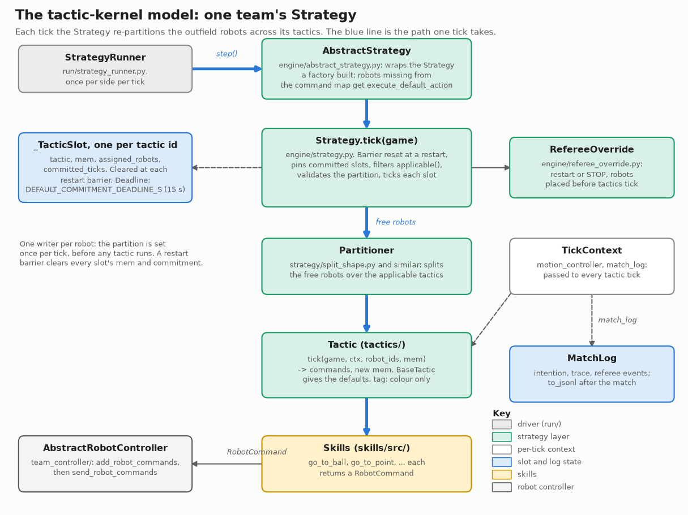

Drawn by `docs/img/strategy/make_tactic_kernel.py`; rerun it when a name in it changes.

**Invariants:**
- *Single writer:* the partition is decided once per tick, before any `Tactic` runs, so two
  tactics can never contend for a robot. Don't add a path that lets a `Tactic` claim or release
  robots outside the `Partitioner`.
- *Commitment:* while `is_committed()` is True the slot's robots can't be reassigned. Backstop:
  `commitment_deadline_s` (default 15s) releases a slot committed that long with the ball moved
  <5cm, and logs it. A deadline release means your tactic lacks a release path — fix the
  tactic, don't raise the deadline.
- *Resets* (`engine/referee_reset.py`): entering a restart (kickoff, penalty, free kick, ball
  placement, goal), resuming from one, or `FORCE_START` straight out of `STOP`/`HALT` is a
  barrier — every slot's `mem` and commitment clears. `STOP`/`HALT` alone only pause; a pause
  resumed by `NORMAL_START` keeps state.

One tick, from the runner to the robot commands (the branches are the referee cases handled
in `Strategy.tick`):

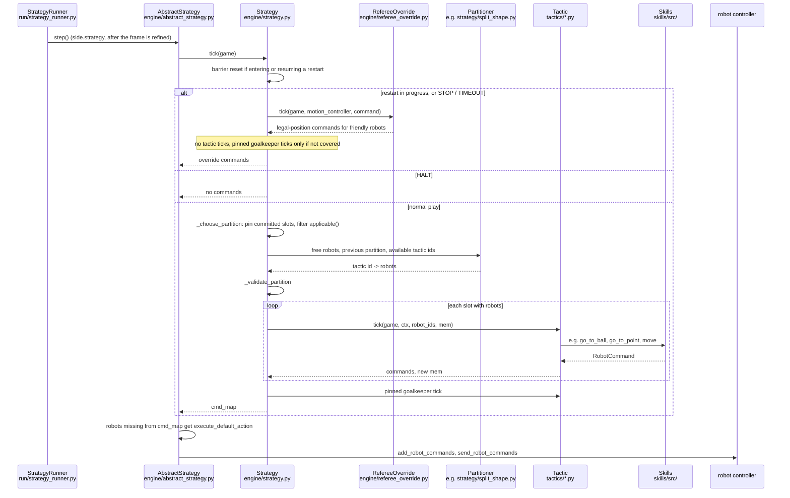

## Referee handling

`CustomReferee` (`utama_core/custom_referee/`) runs in-process and identically across
rsim/grsim/real. During a restart, `RefereeOverride` (`engine/referee_override.py`) takes over
every outfield robot *before* any `Tactic` ticks, reusing the `*Step` classes in
`custom_referee/actions.py`. Strategies can override a restart formation via
`Strategy(referee_overrides=...)`. See `docs/custom_referee.md`.

To see where the override sends every robot for a restart, run `tools/restart_picture.py`
(`REPLAY.npz --t S`, or `--all-restarts` for one small panel per restart command in the replay). It
records each commanded target without changing the engine, and flags a target inside the 0.8 m keep-out
or a defence area it must avoid. Shown below: one match's restarts from our side (top) and from the other
team's side (bottom), and a free kick against us where the robot inside the keep-out is moved to its edge.

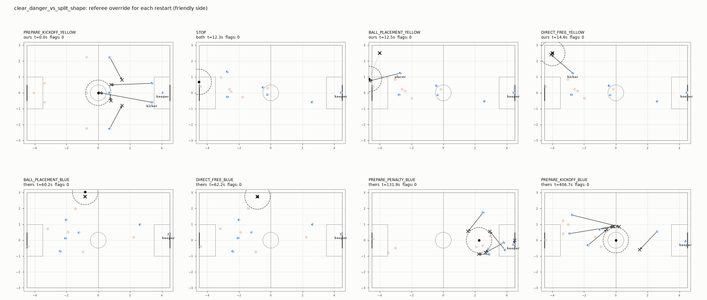
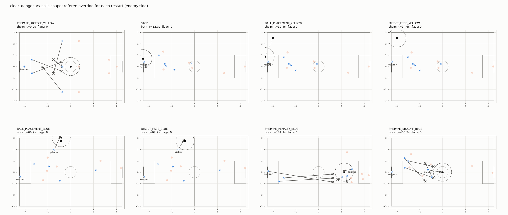
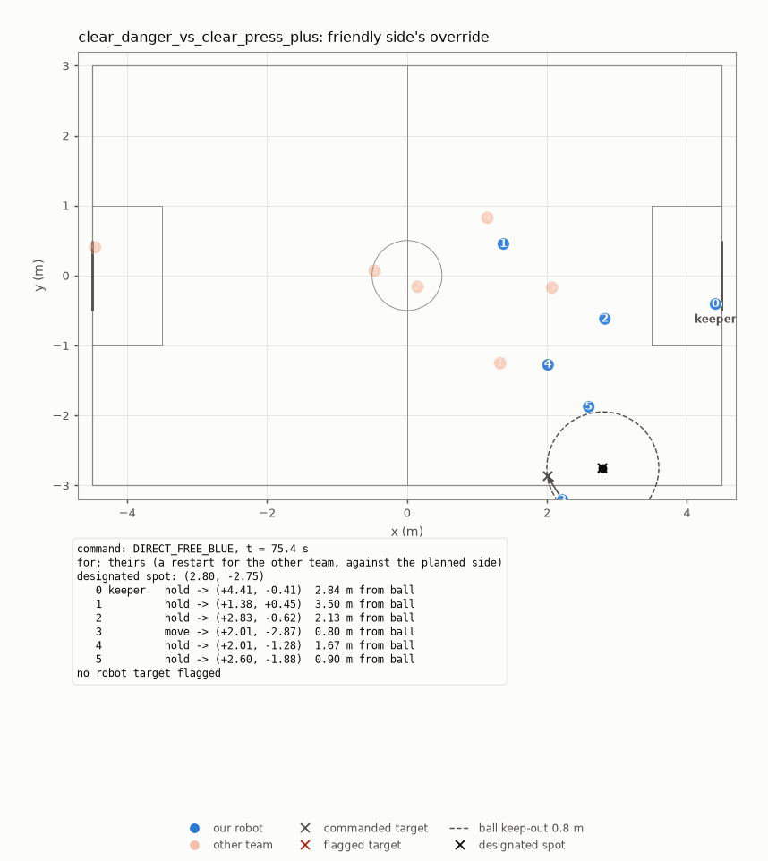

What each referee command makes our robots do, and when tactics take control again. "Ours" and
"theirs" are resolved against our team colour in `RefereeOverride._step_for`.

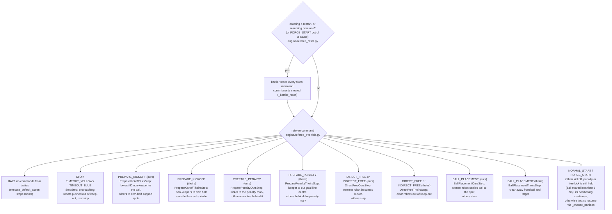

## Writing a Tactic

Lessons from bugs that recurred (mostly `SwitchOfPlayTactic`, `tactics/switch_of_play.py`):

- **`go_to_point()` always faces the ball.** If orientation matters while stationary (facing a
  pass target), use `move()` with `target_oren`. Check every `go_to_point(` call site — fixing
  one doesn't fix the pattern.
- **`intercept_point()` (`shared/pass_and_score_geometry.py`) projects along the passer's
  current orientation,** not toward the receiver. A mis-facing passer sends the receiver to a
  nonsense point; it fails quietly and looks like a vague stall.
- **Every path that sets `is_committed()` True needs a path back to False** — success, failure
  and timeout. Check a timeout reset actually sticks for a full tick rather than being
  re-advanced past in the same tick.
- **Verify by tracing a real match** (`ctx.match_log.trace`, below), not by reading the phase
  logic.
- **A tactic can trip referee rules unrelated to its logic** (e.g. a relay walking an attacker
  into its own defense area). On a foul stall, check which robot and which rule first.

## Writing and evaluating a strategy

A strategy is a combination of existing tactics plus a partitioner that decides how many robots
each gets. Most new strategies need no new tactic. When one does, add it as a new module in
`tactics/` (on a strategy branch, never by changing an existing tactic: see below).

How a strategy composes tactics, using `build_split_shape_kernel_strategy`: two tactic slots and
one hand-written partitioner that switches on which side has the ball.

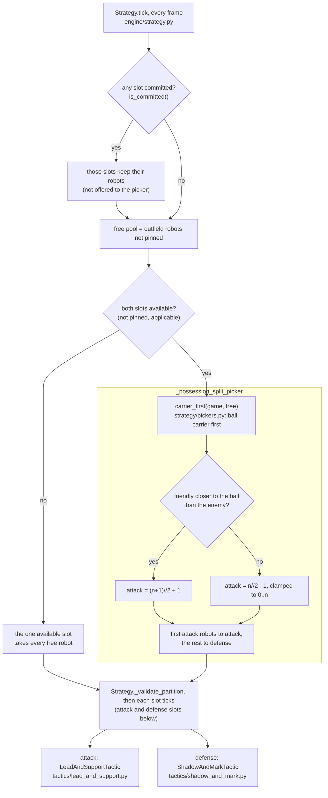

**Writing one.** Add `strategy/<name>.py` with `build_<name>_kernel_strategy(outfield_robot_ids)`,
returning a `Strategy(tactics={...}, partitioner=...)`, and the pickers only it uses; then import
the factory in `strategy/kernel_strategy.py`. Every `build_*_kernel_strategy` that module
re-exports is discovered by name (`match`), so it joins round-robins and `evaluate.py` as
`<name>` (a test fails if a factory is defined but not re-exported). Reuse the shared partitioner
pieces in `strategy/pickers.py` rather than re-deriving them:
- `friendly_closer_to_ball(game)` — the possession edge. True/False is a clear edge; None is a
  near-tie or unreadable state, where a sticky picker keeps its previous split.
- `carrier_first(game, free)` / `clearer_first(game, ordered)` — robot order for a slot that
  must take the ball: the carrier (or the kicker at a still ball) first, else the nearest.
- `fixed_ratio_picker` (in `pickers.py`), `_possession_split_picker` (in `split_shape.py`) — the
  two common split shapes.

`tests/engine/test_all_strategy_configs.py` picks it up the same way and runs it through the
kernel invariants. Give its partitioner pure-function tests in `tests/strategy/test_<name>.py` (a
`Game` built by hand, no rsim), and add a row to `docs/strategies.md`'s round-robin table.

**Evaluating one,** cheapest first; stop as soon as a step fails:
1. **Tests:** its own, `test_all_strategy_configs.py`, then the full suite `--headless`.
2. **One saved match** against a few opponents: `round_robin.py --pair <name> <opp>`.
   Saved, so stalls are recorded (`--no-save` cannot see them). A stall is a bug to fix
   before anything else.
3. **Matches:** `tools/evaluation/evaluate.py <name>` (see [Evaluating a strategy](#evaluating-a-strategy)):
   is it better than the pool's champion, worse, or not clearly either? Several candidates go in
   one call. A strict round-robin (`round_robin.py --strict --reuse`) is the check for stalls
   and the occasional health check of the whole catalog, no longer the way to judge one change.

A change to `tactics/`, `skills/` or `pickers.py` is the other way round: reuse saves little,
because most strategies import the changed code and their matches all rerun. Batch such
changes and run one round-robin over the batch.

**`--reuse`** takes a match's result from
`replays/match_cache/` when nothing it runs has changed since it was stored, so after a change
to one strategy only its matches play, one per other config (21 of 231 with 22 configs). What counts as
"runs" is `utama_core/replay/fingerprint.py`'s: the factory's own module, every module that
imports (`strategy/pickers.py` and the tactics among them, whole files), and the shared code and
environment (planner, referee, runner, simulator build, packages, CPU). Editing `pickers.py`
reruns every config that imports it, which is most of them; changing shared code reruns
everything, correctly. Each run replays 5% of what it would reuse (`--spot-check`) and compares; a
difference evicts the records, says the fingerprint missed a dependency, and fails the run.
Use `--reuse` on every run.

**What counts as better.** The verdict is `evaluate.py`'s: goal difference per match, paired against the champion of the reference pool. A round-robin's W-D-L is a diagnostic.
Everything in [Reading a tournament run](#reading-a-tournament-run) explains a result; none of
it is a target. Don't tune a threshold until results move: a change needs a reason in game
terms. Two round-robins of near-identical code agree
at Spearman +0.97, but that is not a ceiling: rsim is deterministic, so they agree largely
because the code is near-identical.

### Evaluating a strategy

`tools/evaluation/evaluate.py CANDIDATE [CANDIDATE ...]` answers one question per candidate: is
it stronger than the champion of a fixed reference pool, in goals, under the realistic sim noise?

The flowchart contrasts it with the round-robin, which answers a different question.

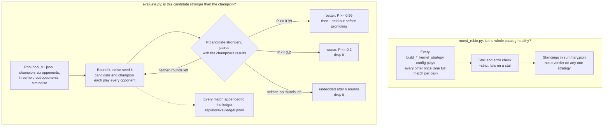

- **The pool** (`tools/evaluation/pools/pool_v1.json`): a champion, six opponents chosen for
  spread of styles, three held-out opponents and the sim noise. It changes only on purpose, as
  a new version, so a result means the same thing next month; it does not follow the latest
  standings.
- **Rounds.** In round k every candidate plays each opponent and the champion once, and the
  champion plays each opponent, all with noise seed k and the side under test in the same colour
  (the noise is drawn per colour and robot, so one seed can favour a colour by half a goal). A
  candidate and the champion are compared on the same opponents under the same noise.
- **The decision** (`ratings.paired_difference`): the candidate's goal difference against each
  opponent minus the champion's, same opponent, seed and colour, from rounds 1..k, plus their
  head-to-head matches. Paired results face the same noise, so much of it cancels: all of it
  for identical code (a byte copy of the champion gets 24 diffs of exactly 0 and stays
  undecided), little for unrelated strategies. P(candidate stronger) >= 0.99 is **better**,
  <= 0.2 **worse**, and after 6 rounds it is **undecided**: not clearly better, so drop it.
  Simulated (match noise SD 1.9 goals): two equal strategies are called better at most 3% of the
  time. An unrelated strategy one goal per match worse is dropped after ~2 rounds (~14
  matches), one goal better found 61% of the time, half a goal 20%. A small edit of the champion
  (paired results correlated ~0.9): one goal better found every time in ~3 rounds, half a goal
  55%. Small gains of unrelated strategies are below what matches resolve at this cost.
- **Ratings** (`analysis/ratings.py`): a strength per strategy in goals per match with its SD,
  fitted on every match in the ledger; printed at the end, and the match noise for the decision.
- **The ledger** (`replays/eval/ledger.jsonl`, `replay/eval_ledger.py`): one line per match from
  evaluate.py and round-robins, keyed by the code that played it. A match is never played twice;
  the champion's matches are played once per seed and reused by every candidate, and editing a
  strategy starts its record afresh. Replays are not kept, except during a `--explain` run (rerun one with `round_robin.py --pair
  A B --sim-noise` and the pool's noise with that seed).
- **Before promoting** a candidate called better, run `evaluate.py <name> --held-out`: it must not
  be clearly worse against opponents never used for selection. Then edit the pool's champion by
  hand. Check its per-opponent table: a candidate far better against one opponent and worse
  against the rest is a matchup, not a better strategy.
- **Pictures** (`evaluate.py <name> --explain`, `tools/evaluation/explain.py`): for each candidate,
  where both strategies' robots stand with and without the ball, their shots for and against,
  their fouls by rule, and a `summary.json` of the numbers behind them, written to
  `replays/eval/explain/<name>_<run id>/`. The run's matches are kept until they are written. They
  explain a verdict and never make one: the verdict is still goals, and a picture is not a ranking.
  Matches reused from the ledger have no replay in the run, so the pictures cover only what was
  played; the paired goal difference in `summary.json` is only as complete as that. Example, from a
  round-robin (`explain.py replays/tournament_<id> split_shape clear_press_plus --out ...`):
  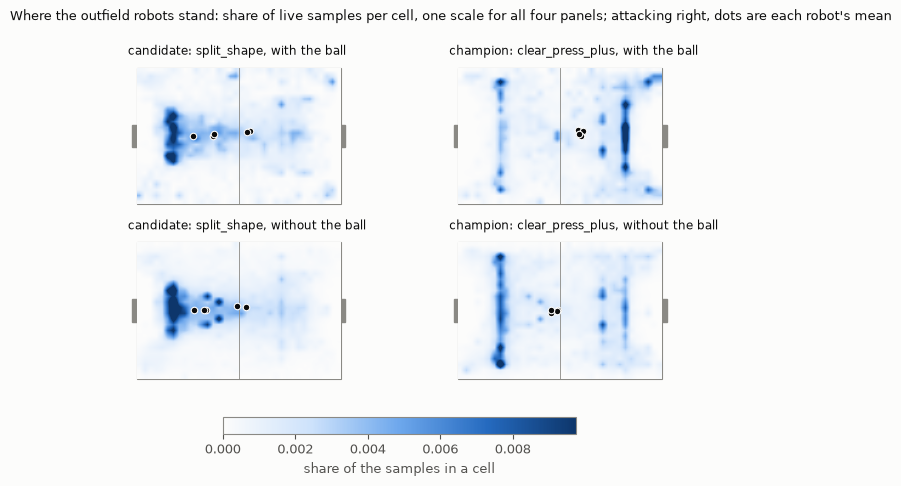
- **Cost.** ~45 min of laptop per 66 matches on 8 workers. A clearly worse candidate costs ~14
  matches (~10 min), a close one up to 42.

### Strategy branches

A new or changed strategy, whether a person or an agent writes it, goes on its own branch and
reaches `main` by pull request:

1. Branch from `main` as `strategy/<idea>`. In a git worktree, symlink `.pixi` and `replays`
   from the main checkout first: pixi needs the environment, and `--reuse` needs
   `replays/match_cache/`, or every match plays again.
2. Change only `utama_core/strategy/`, `utama_core/tactics/` (new modules only),
   `utama_core/tests/strategy/` (tests for your strategy and any tactic you add) and
   `docs/strategies.md`. CI fails a `strategy/*` pull request that changes anything else
   (`tools/check_strategy_branch.py`, run from `main`'s copy). Anything else it needs, such as a
   skill or an engine primitive, is a separate change on an ordinary branch.
3. Leave the opponents as they are on `main`: either add new strategy modules (plus their import
   lines in `kernel_strategy.py`) or change exactly one existing strategy, never both, and never
   `pickers.py` or an existing tactic: the opponents run those. To improve a tactic, copy it into
   a new module and change the copy; making the improvement everyone's is a human change. Your
   strategy's and tactics' code may not reach outside its module: no import-time effects,
   no module-level state (keep state in the factory's closure), no imports of another strategy,
   no changing attributes of what it imports. CI checks all of this statically, from `main`'s
   copy of the checker; the reviewer still reads the diff. Tests import pickers from your module
   directly, not through `kernel_strategy.py`.
4. Write, test and evaluate it as above, and record the round-robin in `docs/strategies.md`.
   `git add` new files before `pixi run lint`: it checks tracked files only. Before waiting on
   a `--reuse` round-robin, read the "N reused ... M to play" line it prints: M much larger
   than your own matches means the cache is stale (shared code changed since it was filled).
   Let it run anyway (a full round-robin of 600 s matches has taken from about 1 h 50 min, on 15 workers plugged in, to 4.7 h for `tournament_20261005_170958`; matches are now two halves of 300 s of playing time: about 710 s of sim time on average by the final run's stoppages, 785 s in two measured matches, so expect roughly 20-30% longer): the other
   strategies' matches run `main`'s code, so they refill the cache for everyone.
4. Open a draft pull request into `main` with the round-robin result. An agent never merges: a person reviews and merges.

Several branches can be worked on at once, each in its own worktree; they share
`replays/match_cache/`. A round-robin uses one worker per core (`--max-workers N` to cap it), so
concurrent runs split the machine's cores and each takes longer; a machine with more cores runs
more of them at once. How to organise a search (how many in parallel, which ideas) is up to
whoever runs it.

## Observability — use these before adding a debug print

- **`MatchLog`** (`engine/match_log.py`) — one JSONL per match. `Strategy` records an
  intention row per slot-assignment *change*; call `ctx.match_log.trace(tick, sim_time, key,
  value)` yourself from a `Tactic` or skill (guard with `if ctx.match_log is not None:`; it's
  `None` on tournament/CI runs, so traces can stay in). Examples: `skills/src/go_to_ball.py`,
  `tactics/give_and_go.py`. Enable with `match_log_path=` or `match.run_match(...,
  run_dir=...)`; read back with `load_jsonl(path)`.
- **`render_window()` / `render_around_event()`** (`analysis/render_window.py`) — PNG of
  robot/ball trails over a window, optionally anchored on a `MatchLog` event. **Default to this
  over `load_frames_in_range()`**: a coordinate dump is expensive in context and easy to misread
  spatially. Use raw frames only for an exact number once the picture has localized the issue.
- **`tools/match_timeline.py`** — one match window as swimlanes on a shared time axis: the referee
  command band, one lane per robot coloured by the tactic it was in (a thin tick at each switch, a
  dark strip where it had the ball), each robot's distance to the ball, and goals, fouls and shots on
  top. Use it for thrashing (a robot switching tactics every few ticks), a tactic stuck committed, or
  everyone chasing the ball. Friendly side only has tactic lanes (the intentions log is config_a's).
  Thrashing in `split_shape` against `tiki_taka_plus`: robots 2-4 flip between the attack and defence
  slots about every 1.5 s, in pairs of rows at the same tick. It is not split_shape's alone: most
  strategies that split attack and defence on possession take a tactic for under 1 s and revert about
  5 times a minute (the `tactic_thrash` finding, with the numbers per strategy in `match_timeline.py`):
  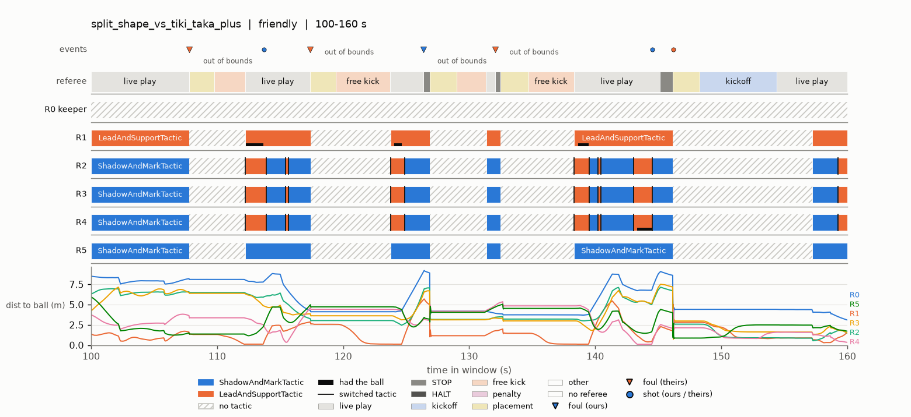
- **`render_clip()`** (`analysis/render_clip.py`) — MP4 of a window for humans, ball-following
  or full-pitch camera; sim ball teleports are never shown. Needs `ffmpeg`. Commands behind
  committed clips: `assets/clips/README.md`.
- **`docs/strategies.md`** — every factory, whether a round-robin plays it or it is retired,
  and the latest results.
- **`tools/evaluation/round_robin.py`** — round-robin runner (`--max-workers N`, `--both-sides`,
  `--strict`, `--stop-at-first-stall`, `--fuzz-restarts SEED`, `--fuzz-interval LO HI`,
  `--sim-noise JSON`, `--no-save`, `--pair A B` for one fixture with A as config_a — reruns a stalled match from a
  round-robin; see the determinism caveat below).
- **Ball losses** (`analysis/turnover_breakdown.py`) — runs after every saved tournament and
  writes `ball_losses.md`; see [Reading a tournament run](#reading-a-tournament-run).
  `python -m utama_core.analysis.turnover_breakdown <run_dir>` re-runs it on an older run.
- **Stall watchdog** (`engine/match_stats.py`) — records `StallEvent`s, never affects play:
  `RESTART_STALL` (a restart/stoppage command held >15s) and `COMMITTED_FROZEN` (ball moved
  <5cm for >10s in live play while a slot is committed). Each `RESTART_STALL` carries a one-line
  `diagnosis` (ball in goal / past a line, taker not closing on the ball, taker at the ball but
  not kicking). The tournament prints a STALLS section, writes it to `summary.json`, and `--strict` exits non-zero on any stall; a
  possession-pinned backstop flags what the watchdog misses.
- **Restart fuzzing** (`custom_referee/restart_fuzzer.py`) — injects legal restarts at
  seeded-random times to exercise auto-advance paths; same seed and interval reproduce the
  schedule. Details: `docs/custom_referee.md`.
- **Sim noise** (`rsoccer_simulator/src/Utils/sim_noise.py`, `--sim-noise JSON`) — seeded
  command latency per robot, kick speed and direction noise (a per-robot offset plus
  kick-to-kick spread), two-phase ball friction (slide after a kick, then roll), per-robot
  speed, acceleration and braking limits applied to the commands the sim acts on (hardware caps,
  below any planner), the physics substep count, and vision noise and dropped detections, all
  off by default. Ball friction, kick direction and substeps need a robosim binary built from
  `vendor/rSim` (`vendor/rSim/FORK_NOTES.md`); with the stock binary they raise. Draws depend on the seed, team
  colour and robot id only, so every pairing in a run gets the same physics and A/B comparisons
  stay paired; the same seed replays a match exactly. Settings and draws go into each replay
  (`columnar_reader.load_sim_noise`) and `summary.json`, and into the match key only when set.
  Ranges come from `docs/sim_realism.md` Phase 1; until then the knobs have no calibrated values.
- **`tools/replay_trace.py REPLAY.npz T0 T1`** — text trace of a window: referee command and
  why it changed, ball, nearest robot per side. The first look at a stall or a voided restart.
- **`tools/repro_from_replay.py`** — reload a replay's field state at time *t* into a fresh headless
  match with tracing on, instead of re-running the whole match (`--help` for flags).

### Debugging a foul or failure

A foul or failure seen in a match is a symptom: the cause may be the robot, the shared referee
override, the planner, the referee itself, or the check that flagged it. Of the first six found
this way (table below), two were the referee or the check, not the robot.

Start with `tools/triage.py RUN_DIR --strategy NAME`: open its `index.md` for the worst matches, the finding counts by kind
and the pictured findings. Filter `findings.jsonl` on the kind you care about, open that finding's picture to see what it
means, and confirm with the numbers in its message (or `replay_trace.py --events`) before concluding anything. Triage reads only the friendly side of
each match (the intentions log is written for it): a strategy's matches where it is config_a. In a round-robin each pair plays once,
so a strategy gets only the pairs where it comes first in the config order.

The same steps as a flowchart; the moment branch is the optional step 5.

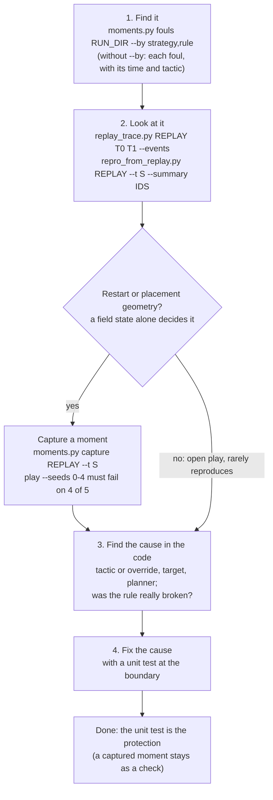

The picture tools (`match_timeline.py`, `restart_picture.py`, `plan_trace.py`, `pitch_maps.py`) write their flags as JSON with `--findings`: filter on that, open the picture to understand a flag, and never conclude from a picture alone.

1. **Find it.** `pixi run python tools/moments.py fouls replays/tournament_<id> --by strategy,rule`
   counts our side's fouls (any of strategy, rule, tactic, restart; `out_of_bounds`, the ball
   leaving the field, is a stoppage and left out unless `--include-stoppages`); without `--by` it
   lists each with its time, robot, tactic and the referee command then active
   (`--skip-own-restart` drops fouls during our own restarts; `--json` writes either form as JSON).
2. **Look at it.** `tools/replay_trace.py REPLAY T0 T1` is the text timeline of the window:
   referee command, ball, nearest robot per side; `--events` lists the kicks, possession,
   referee changes and fouls instead; `--json` gives either as JSON.
   `tools/repro_from_replay.py REPLAY --t S --summary 3` replays that state with the tactics'
   `match_log` tracing on and prints each listed robot's tactic, position and target every
   0.25 s (trace keys name tactics, not strategies). In a parallel worktree, run
   `tools/setup_worktree.sh` first.
   When a robot does something odd near an obstacle or a keep-out zone (a carrot that swings round a robot,
   a robot parked just inside a circle), `tools/plan_snapshot.py REPLAY --t S --robot ID --target X Y`
   draws what the planner decided on that tick: the obstacles and clearance rings, the keep-out circle,
   the target and the carrot it returned (`--side enemy` for the other strategy's robot; example:
   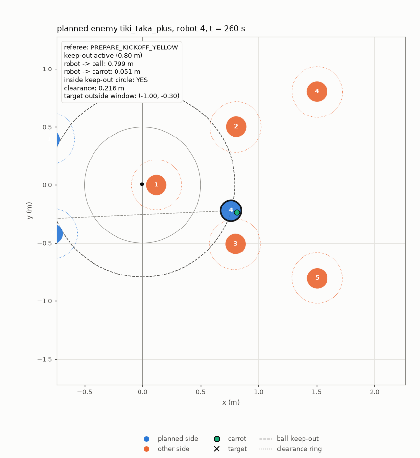).
   `tools/plan_trace.py REPLAY --t0 S --t1 S --robot ID [--target X Y]` runs the same planner on every
   tick of a window and draws the robot's path, each tick's carrot and the distances over time, so a
   defect that unfolds over seconds shows as a trace (example: the kick-off robot of
   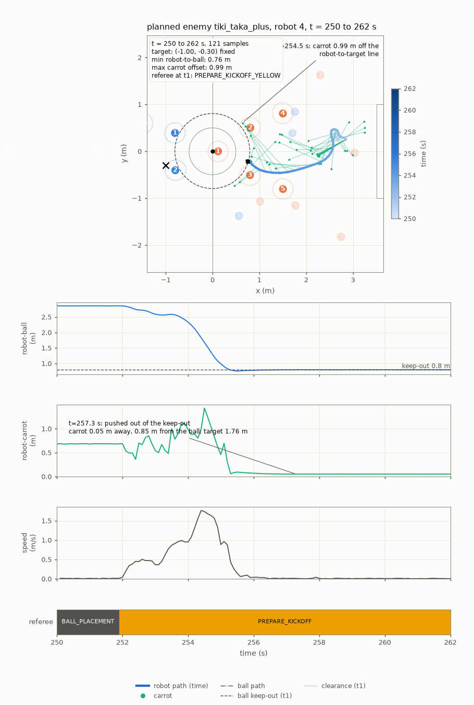). The robot's positions are the replay's,
   not re-simulated: this window was recorded before the push-out fix, so the robot stays 0.80 m from the
   ball, while the current planner's carrot from those states is the push-out point 0.85 m from the ball.
3. **Find the cause in the code**, from what the trace shows: which tactic or override sent the
   robot there, and the target, waypoint and obstacles it used. Ask whether the rule was really
   broken (real rules, `docs/custom_referee_design_decisions.md`) and whether the check reads it
   right.
4. **Fix the cause, with a unit test at the boundary** (CLAUDE.md, Testing), e.g. "a computed
   target is off the field". That test is the protection, and it does not need the foul to
   reproduce.
5. **Optionally keep a moment**, where a field state alone decides the behaviour (restart and
   placement geometry under the referee override). `tools/moments.py capture REPLAY --t S --name
   ... --check ... --note "..." [--out PATH]` saves the state; `play JSON --seeds 0-4` must fail on
   at least 4 of 5 before the fix (`--against REF` plays the code at REF beside it; `--events`
   lists referee changes, fouls, keep-out entries and kicks; `--strategy scratch.py:factory`
   tries a strategy from a scratch file). Its note names the fix; if the fix is not in the same
   change, set `"known_failure": "<cause>"` (a strict xfail).

Open-play fouls rarely reproduce from a captured state: robots start from rest, tactics from
fresh memory, and the play diverges within a second. Of 21 fouls captured from
tournament_20261017_002337, none reproduced on 4 of 5 seeds, and one did with the opponents
steered along their recorded paths for 1-2 s (tried 2026-10-17, reverted in `9c224880`). Robot
velocities cannot be set either: every rsim teleport resets all robots (`SSLWorld::replace`). So
for open play, go from the trace to the code and a unit test.

A moment's `checks` are `tools/moments.py`'s `CHECKS` (`keeps_clear`, `stop_speed`) or referee rule names; its `requires` (`restart_lasts`,
`robot_near_ball`) fail it with `did not arise` when the situation it tests never happened. A
restart moment plays one strategy, since the referee override moves every outfield robot the same
way whatever the strategy. `tools/moments.py new NAME --command CMD ...` writes a hand-made field
state to edit. Moments are not a gate on strategies: they pin shared-code bugs.

| Symptom | Looked like | Cause | Fix | Test |
|---|---|---|---|---|
| Defender pushed off the pitch during their corner placement | robot leaving the field | override push-out target off the pitch in a corner | `14038121` | `tests/referee/test_referee_unit.py` |
| Defender stuck against their placer | robot ignoring the restart | planner found no path out for a robot inside another's clearance | `c64fc6f9` | `test_fpp_pressed_against_robot.py` |
| Defender boxed in a corner closes on the ball | robot driving in | planner detour led back toward the ball; the keep-out guard skipped robots already inside | `935da778` | `test_fpp_inside_ball_keep_out.py` |
| Same moment still failing after the fix | robot driving in | `keeps_clear` counted the ball placed onto a robot standing still | `20ca1974` | `test_moments.py` |
| keep_out foul on their free kick | robot driving in | referee: the kicker moved the ball 0.75 m in the preparation stage; it was in play | `12b46412` | `test_free_kick_taken.py` |
| Our placement times out (hand-made moment) | slow placer | placer drove through the ball toward a point behind it (planner ignores the ball in our placement) | `78685f79` (goes round it) | `test_referee_unit.py` (TestBallPlacementOursApproachAroundBall) |

The last row matters on real robots only: in sim matches `StrategyRunner` teleports a placed ball
to its target (`docs/custom_referee_design_decisions.md`, Ball placement), so our placer never
runs in a round-robin. Its moment was dropped for that reason: check that a moment's behaviour
happens in sim matches at all before keeping it. The placer is still slow (about 5 s round the
ball, and the carry curves off line), a real-robot item.

**Frame convention trap:** rsim's own frame stores y negated relative to ours. Anything that
writes into the sim (e.g. `teleport_robot`) must negate y *and* heading — `543741e` fixed a
teleported robot facing the mirrored heading, which had silently corrupted teleported scenarios.

**Determinism:** an rsim match is reproducible: `--pair A B` replays a round-robin match exactly (13 of
13 sampled from `tournament_20260928_221404` at `1de1e18d`, every replay array and sidecar).
One cause of "differs run to run" was state that outlived a match: `has_ball`'s and shielding's
hysteresis were module dicts keyed by robot id, shared by both teams and carried from match to
match in a round-robin worker process (`c27bfad7`). Module-level state in a tactic or
skill must be keyed by team and cleared at match start (`StrategyRunner.__init__`). If a
round-robin match and its `--pair` rerun still differ, suspect more of the same; compare the two
replays' `ball_p` to find the first differing tick.

**Fast and exact numerics:** the motion planner, refiners and Kalman filter use faster float code
by default (about 19% less wall time per match under full load). `UTAMA_EXACT_MATH=1` restores the
original numpy paths, byte-identical to before (`8c191eea`); the round-robin pools and rsim
all inherit it. The two modes agree to 1e-9 per call but matches diverge after the first differing
tick, so a baseline recorded in one mode is only comparable with a candidate run in the same mode.

## Reading a tournament run

Every saved `round_robin.py` run prints its sections and writes the same data to
`replays/<run>/summary.json`. [`docs/signals.md`](signals.md) lists every signal it records
(and the offline ones), grouped by the question each answers: is something broken, does it
create chances, keep and move the ball, defend, take restarts. Each comes with where to find
it, a reference range from the latest round-robin and what an off value usually means. Look
there before adding a metric: it probably exists.

These are diagnostics, not objectives. Fewer losses is not better on its own: a strategy that
never passes or shoots loses the ball least. Rank strategies by results (goals, through
the ratings: `docs/signals.md`, "Ranking"), and use the rest to explain why one wins or loses, and which shared primitive (reception, carrying, the
planner, the referee) is failing every strategy at once.

## Real matches

`tools/convert_ssl_log.py` turns the league's official game logs
(https://ssl.robocup.org/game-logs/) into replays in our format, so `load_columnar_replay`,
`render_window`, `scenario_from_replay` and the analyses read a real match like one of ours:

    pixi run python -I tools/convert_ssl_log.py --corpus 2022-2026 --jobs 2 --out <dir outside replays/>

Only the converted files are kept: each raw log (up to 370 MB) is deleted once converted, and a
converted match takes about 35 MB. The published Division B logs for 2022-2026 are 118
matches.

What a converted match holds, and where it differs from a sim replay (the details are in
`utama_core/replay/ssl_log.py`'s docstring):

- Yellow is the friendly team: the team that wore yellow at kick-off. `side_is_right` follows
  the referee, so it flips at half time. Two things the converter corrects, both flagged in
  `source.json`: teams that swap colours at half time instead of sides (`colours_swapped`),
  and referee sides set the wrong way round (`sides_inverted_share`: where yellow's goalkeeper
  and yellow's robots both played on the other half).
- The score is the game controller's, so a revoked goal makes it fall. A penalty shoot-out is
  dropped with the post-game stage: a match decided on penalties ends level here.
- 60 Hz ticks from the first referee message to the end of play, with halts, timeouts and half
  time left in. Real play is mostly stopped (live 9-24% of a 2022 match, median 14%), so count
  per minute of `NORMAL_START`/`FORCE_START`, not per match.
- Robots and ball are the autoref tracker's filtered world, in metres. Each robot id a team
  used has its own column, NaN while that robot is off, so a substitution loses no robot; more
  than 6 columns is normal, and teams often field fewer than 6 robots (one 2022 match was 1
  against 2). Rebuilding a sim
  start from a real moment needs those ids mapped onto the sim's 0-5: not done yet. A ball
  seen beyond the walls (a spare ball, or a tracker's chip estimate gone wild) counts as
  unseen and holds its last position.
- `has_ball` is the vision-proximity rule (robot centre within 0.13 m of the ball): real logs
  have no dribbler sensor. It is looser than rsim's contact flag, so compare possession signals
  among real matches, not one to one with ours.
- A real free kick goes live as soon as the ball moves: the game controller sends no
  `NORMAL_START` and keeps `DIRECT_FREE_*` until the next stoppage. The converter switches it
  to `NORMAL_START` once the ball has moved 0.05 m, as our referee does.
- `<stem>.source.json` holds the teams, the final score, the tracker used and the field size.
- Sidecars for measuring physics and vision (sim realism, [sim_realism.md](sim_realism.md)),
  not read by any replay tool: `<stem>.kicks.json`, every kick the tracker reported (start,
  kicker, start position, velocity estimates, stop); `<stem>.tracker.zip`, per-tick ball and
  robot visibility and robot angular velocity; with `--raw-vision`, `<stem>.vision.zip`, every
  raw camera detection (about another 35 MB a match). Kicks and visibility come from whichever
  autoref's tracker sends them (in 2026 TIGERs did, ER-Force not). For a match converted
  before these existed, `--backfill-extras` downloads the log again and adds them without
  rewriting the replay.
- Logs before 2020 have no tracker: the converter merges raw camera detections without
  filtering (ghost robots, ball jumps), and their referee also sends `GOAL_*` and
  `INDIRECT_FREE_*`. The corpus above starts in 2022.

The scenario bench (retired 2026-10-17) replayed 10 s starts harvested from replays; to look at one point in a replay use `tools/repro_from_replay.py <replay> --t <s>`, and to pin a failure there add a regression moment ("Debugging a foul or failure", above), and `analysis/goal_ledger.py` lists a replay's situations and goals.
