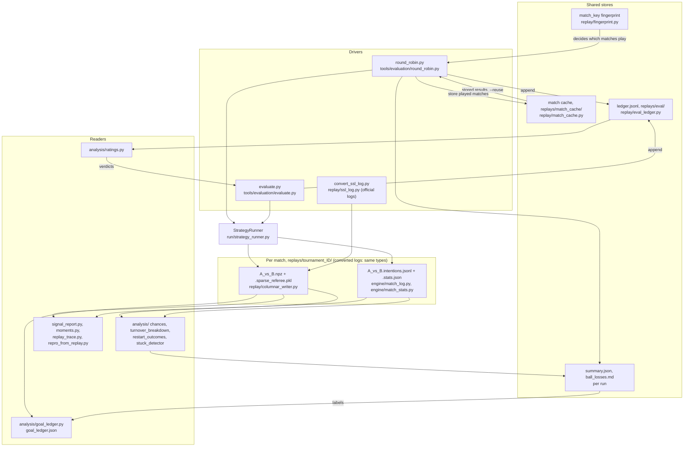
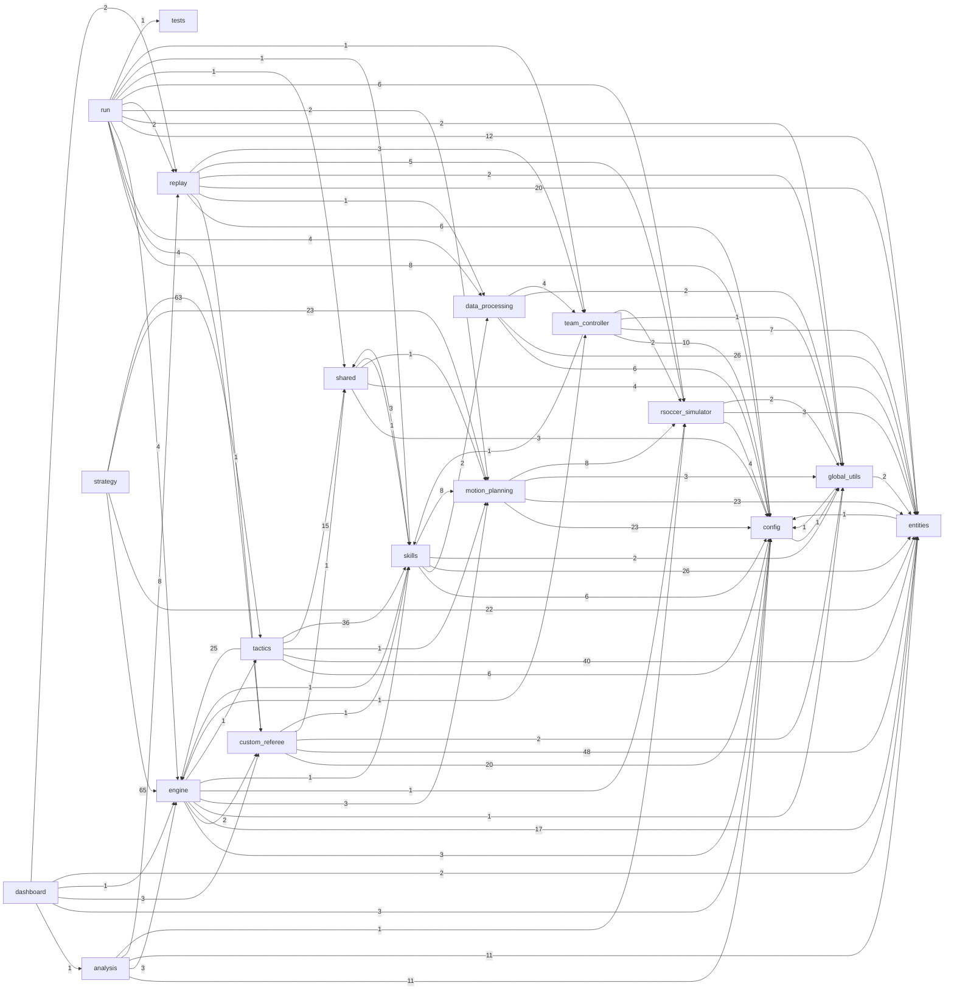

# Architecture

How the packages under `utama_core/` depend on each other, and how one tick flows through them.

## One tick

The flow of one tick, from vision to robot, is the Mermaid diagram in the
[README](../README.md#system-design). [pipeline_method.md](pipeline_method.md) describes the same
path in more detail.

## Match data flow

Every rsim match writes files under `replays/` (`REPLAY_BASE_PATH`), and the analyses, tools and
evaluation read them back. A match's file stem is `A_vs_B` (`round_robin.py`'s `_tag`); the names
below are from a real run directory. `--reuse` reads the match cache, and only matches whose
fingerprint changed are played again.

`evaluate.py` removes its own scratch run directory when it finishes, so its matches survive only
in the ledger.

## Package dependencies

Generated by `tools/package_graph.py` from the imports of every `.py` under `utama_core/` (tests
excluded as sources). Each edge is one first-level package importing another, labelled with its
number of imports; packages with no edges are left out. Regenerate and paste the output below:

    pixi run python tools/package_graph.py

The only edge into `tests` is `run` (the runner imports `utama_core/tests/common`'s test manager).
The rule the script checks: `replay/` never imports `analysis/` (see [AGENTS.md](../AGENTS.md)).

Violations of the import rules (`replay/` never imports `analysis/`):
none
