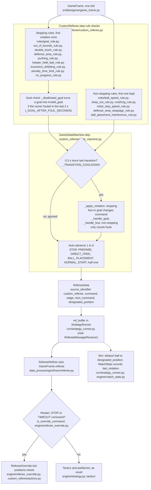
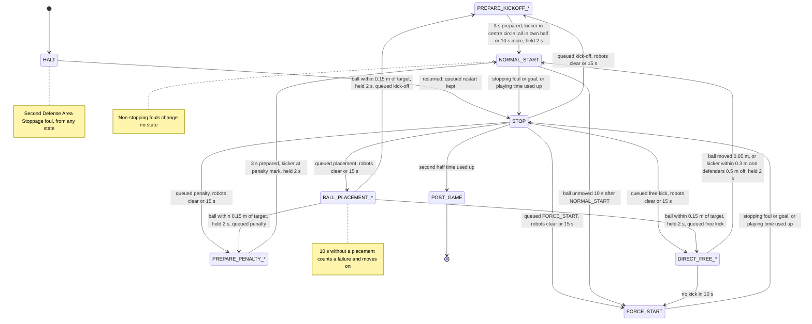

# Custom Referee

`CustomReferee` (`utama_core/custom_referee/`) is an in-process referee: it steps
synchronously on `GameFrame`s and produces `RefereeData`, which `RefereeOverride`
(`engine/referee_override.py`) reads each tick via `game.referee`. No network, no AutoReferee
process, no simulator-specific code — identical in RSim, grSim and Real.

**Why not the TIGERs AutoReferee?** It is an asynchronous real-time Java/UDP process: unusable
in RSim and for faster-than-real-time RL, its thresholds are hardcoded (break on small test
fields), and strict rules ruin human-vs-robot exhibition play. Profiles solve the last two.

## Architecture

```
CustomReferee.step(game_frame, t)
  ├─ for rule in rules (priority order): rule.check(frame, geometry, command, placement_target)
  │     first *stopping* violation wins; a non-stopping foul (SSL §8.4.2) only feeds the
  │     foul counter and never suppresses a later stopping rule
  └─ GameStateMachine.step(t, violation)   # command, score, stage, next_command,
        → RefereeData(source_identifier="custom_referee")   designated_position
```

- 0.3s transition cooldown (`_TRANSITION_COOLDOWN`) stops one violation applying repeatedly.
- One-frame lag (the frame is from the previous step) — acceptable in every mode.
- `RefereeGeometry` is a frozen dataclass decoupled from `Field`; `StrategyRunner` overrides it
  from `full_field_dims` at startup (default `STANDARD_FIELD_DIMS`). YAML never sets geometry.
  In grSim/Real, `StrategyRunner` raises if the first vision geometry packet disagrees with
  `full_field_dims`.

Each tick, the rule checks decide which violation (if any) reaches the state machine, and the
state machine's output reaches the strategy through `RefereeRefiner` and `RefereeOverride`:



## Rules

Built in `_build_active_rules` (`custom_referee.py`), in this priority order; defaults live in
`profiles/profile_loader.py`'s config dataclasses.

| Rule | Active during | Notes |
|---|---|---|
| `GoalRule` | live play | Scoring team from `my_team_is_right`/`my_team_is_yellow`; 1s cooldown; `designated_position=(0,0)`. `CustomReferee.step` turns it into a goal kick (`invalid_goal`) when the scorer committed a non-stopping foul in the previous 2 s (§7). |
| `OutOfBoundsRule` | live play | Free kick to the team that didn't touch last, placed 0.25m infield; over a goal line, a corner or goal kick in the corner, or, for a ball last touched in the kicker's own half that crossed the opponent's goal line untouched, a free kick from where it was touched (aimless kick, §6.2.3, Division B; `out_of_bounds.aimless_kick`, on in both profiles). Last touch: `rules/last_touch.py`'s colour-blind `infer_last_touch_team` (both teams' contact data; closest robot only when there is no prior attribution; unresolved rather than a default colour). |
| `BallSpeedRule` | live play | Ground speed > 6.5 m/s, edge-detected; same last-touch attribution. Non-stopping (§8.4.2). |
| `DoubleTouchRule` | `NORMAL_START` after a restart | Only the restart kicker (first toucher after arming) is barred; disarms when any other robot touches. Open-play release-and-reacquire dribbling is legal. Keeps `_prev_command` across `reset()` because `reset()` runs on the very transition it must observe. |
| `DefenseAreaRule` | live play | An extra defender (> `max_defenders`) touching the ball in its own area: penalty. An attacker touching the ball while at least partly in ours: non-stopping, 2 s re-raise (§8.4.2). |
| `KeepOutRule` | `DIRECT_FREE_*`, `PREPARE_KICKOFF_*` | Defending team within 0.5m for 30 consecutive frames: non-stopping, 2 s re-raise, restarts the free kick's 10 s clock (§8.4.3). Not during bare `STOP` or penalties, nor once a free kick is taken (stage 3 of the state machine: the ball moved 0.05m, so it is live). |
| `PenaltyTimeLimitRule` | `NORMAL_START`/`FORCE_START` after `PREPARE_PENALTY_*` | Penalty still in play 10 s after its normal start: goal kick for the defenders (§5.3.5). |
| `NoProgressRule` | live play | Ball hasn't moved 0.05 m in 10 s: `STOP` then `FORCE_START` where it lies, moved out of the opponent's defense area if it is inside it (`legal_restart_position`, §8.1). The clock waits for the ball to be in play (a `NORMAL_START` restart: 0.05 m of movement or the 10 s auto-in-play) and is held while the ball is inside either defense area. Last in the list, so a real foul on the same tick wins. |
| `PushingRule`, `KeeperHeldBallRule`, `ExcessiveDribblingRule`, `RobotStopSpeedRule`, `CrashingRule`, `DefenseAreaStoppageRule`, `BallPlacementInterferenceRule` | see each rule file | SSL §8.3/8.4 audit (`434ab29`). Rationale per rule: `custom_referee_design_decisions.md`. |

## State machine and auto-advance

`GameStateMachine` starts in `HALT`. Violations move live play to `STOP` with a queued
`next_command`; then, when the profile's `auto_advance` flags allow (constants at the top of
`state_machine.py`):

| # | Transition | Trigger |
|---|---|---|
| 1 | `STOP` → queued restart | all robots ≥0.5m from ball (15s clear timeout) |
| 2 | `PREPARE_KICKOFF_*`/`PREPARE_PENALTY_*` → `NORMAL_START` | prepare timer + kicker in position (kick-off: and every robot in its own half, waited for at most 10 s past the prepare timer, `_KICKOFF_POSITIONING_CAP_S`), held 2s |
| 3 | `DIRECT_FREE_*` → `NORMAL_START` | the free kick is taken: the ball has moved ≥0.05m from where it was when the command began (at once, from any kick during the preparation); or kicker ≤0.3m from ball, defenders ≥0.5m, held 2s |
| 4 | `BALL_PLACEMENT_*` → next command | ball ≤0.15m from target, held 2s (10s placement timeout) |
| 5 | `NORMAL_START` → `FORCE_START` | `kickoff_timeout_seconds` elapsed and ball unmoved |
| 6 | end of a half → second half, then `POST_GAME` | the half's playing time (`half_duration_seconds`) used up |

The same transitions as a state diagram, with the command each one leaves and enters (team-specific
commands are shown as `*`; the restart team is the one named in the command):



Nothing leaves `HALT` on its own: a person or the game controller resumes it. In the sim,
`StrategyRunner` resumes after 5 s with `resume_from_halt`, which goes to `STOP` and keeps the
queued restart, so play continues into it (transition 1). A `HALT` that interrupts a restart in
progress (a kick-off being prepared, a ball being placed, a free kick) queues that restart again.
With nothing queued, the runner holds `STOP` for 4 s to clear robots, then `NORMAL_START`.

The match clock (`stage_time_left`) counts playing time only: it runs under `NORMAL_START`,
`FORCE_START` and free kicks and is paused in `STOP`, `HALT`, kick-off and penalty preparation and
ball placement, as the rulebook's Game Stages section says. When the first half's time is up
(transition 6), play stops, the stage becomes `NORMAL_SECOND_HALF_PRE` (half-time takes 0 s), the
ball goes to the centre and the team that didn't kick off the first half (`kickoff_team`) kicks
off the second, and the teams change ends.

**Ends.** The referee says which team defends the +x goal in `blue_team_on_positive_half`, the
game controller's field: taken from the side the teams start on, swapped at half-time.
`StrategyRunner` follows it every tick, from `CustomReferee` or the real game controller: when it
disagrees with the side a team plays on, both teams' frames, `Field`s and game history start
again on the other side (tactic memory is already cleared by the stoppage it happens in). In the
sim, every robot is also carried to the other end, turned half a turn about the centre spot, as
people do in the break: driving there crosses both defense areas. The
columnar replay stores the side on every tick (`side_is_right`; `ColumnarReplay.is_right_at`),
and replay analyses read it per frame (`frame.my_team_is_right`), never once per file.
`scenario_from_replay` turns a second-half frame half a turn, so a scenario is still played with
config_a defending the right goal. Replays written before this have one side throughout.

When the second half's time is up, the stage becomes `POST_GAME` with a plain
`STOP` (no `designated_position`, so the sim runner doesn't restart play), and violations are
ignored from then on. `round_robin.py` ends a match there.

`force_start_after_goal` is a legacy path (STOP → FORCE_START after `stop_duration_seconds`).
Scripts resume play with `referee.set_command(RefereeCommand.NORMAL_START, timestamp=...)`.

## Profiles

`CustomReferee.from_profile_name("simulation" | "human" | "/path/to.yaml", n_robots_yellow=,
n_robots_blue=)`.

- **`simulation`** — every rule on, all auto-advances on. Simulator, AI-vs-AI, RL.
- **`human`** — every rule off, auto-advances off; an operator issues every command. Real-field
  testing and human-vs-robot exhibition play.

Give every rule an explicit `enabled:` — an omitted rule block silently falls back to enabled
with sim defaults (`load_profile()` warns listing them; this once ran 9 strict rules in a
relaxed profile). Copy `simulation.yaml`/`human.yaml` to start a new profile.

## StrategyRunner integration

Pass `StrategyRunner(..., referee=CustomReferee(...))`. Then the UDP `RefereeMessageReceiver` is
not started; `referee.step()` runs each tick and feeds `ref_buffer`
(→ `RefereeRefiner` → `game.referee` → `RefereeOverride`); and when a `sim_controller` exists (skipped in
Real) the ball is teleported to the restart's `designated_position`: on entry to `BALL_PLACEMENT_*`
for a restart with a spot (fouls, goals, half time; the restart itself follows), or on the edge into
a `STOP` whose next command is `FORCE_START` (no progress), which then force-starts. `StrategyRunner` only checks `isinstance(referee, CustomReferee)`, so subclasses work
unchanged. `CustomReferee.reset()` restores score/stage/command/timers for a new RL episode
(`BaseRule.reset_for_new_episode()` also clears `GoalRule`'s cooldown); call `seed_clock()`
again afterwards.

## Restart fuzzing (`RestartFuzzingReferee`)

`custom_referee/restart_fuzzer.py`: an opt-in subclass that injects legal restarts at
seeded-random sim times during live play (never on top of a queued restart), via the same
public `set_command` path an operator uses, so a stall it exposes is a real one. rsim is
deterministic, so this is how a round-robin explores new restart geometries. Kinds: ball
placement → `DIRECT_FREE_*` (position ≥0.25m infield, ≥0.2m from both defense areas),
`PREPARE_KICKOFF_*`, and `STOP` → `FORCE_START`. `referee.injections` records each one; with a
`MatchLog` attached, they are traced as `restart_fuzzer_injection`. Used by
`round_robin.py --fuzz-restarts SEED`.

```python
referee = RestartFuzzingReferee.from_profile_name("simulation", seed=1, interval_s=(8.0, 20.0),
                                                  n_robots_yellow=6, n_robots_blue=6)
```

## Known gaps

- **Last-touch attribution needs contact data for both teams.** Enemy `has_ball` is filled
  by `RobotInfoRefiner` from sim contact physics (`data_processing/refiners/robot_info.py`).

Resolved (kept here so nobody re-reports them): the old friendly-first, ≤0.15m proximity
last-touch heuristic and its yellow default (replaced by `infer_last_touch_team`), double touch,
ball speed, full-episode reset, teams changing ends at half-time,
`bt_nodes` → `debug_status` rename, auto-advance after goals/timeouts, keep-out during bare
`STOP`, blue-perspective goal tests, `StrategyRunner` integration tests
(`tests/strategy_runner/test_referee_rsim.py`, `test_ball_placement_rsim.py`),
`force_start_after_goal`.

## Running

```bash
pixi run pytest utama_core/tests/custom_referee/ --headless
pixi run python examples/demo_custom_referee.py     # pygame, 6 scripted rule scenes; SPACE pause, R restart, ←/→ skip
pixi run python examples/demo_referee_gui_rsim.py   # RSim + dashboard referee tab, see custom_referee_gui.md
```
