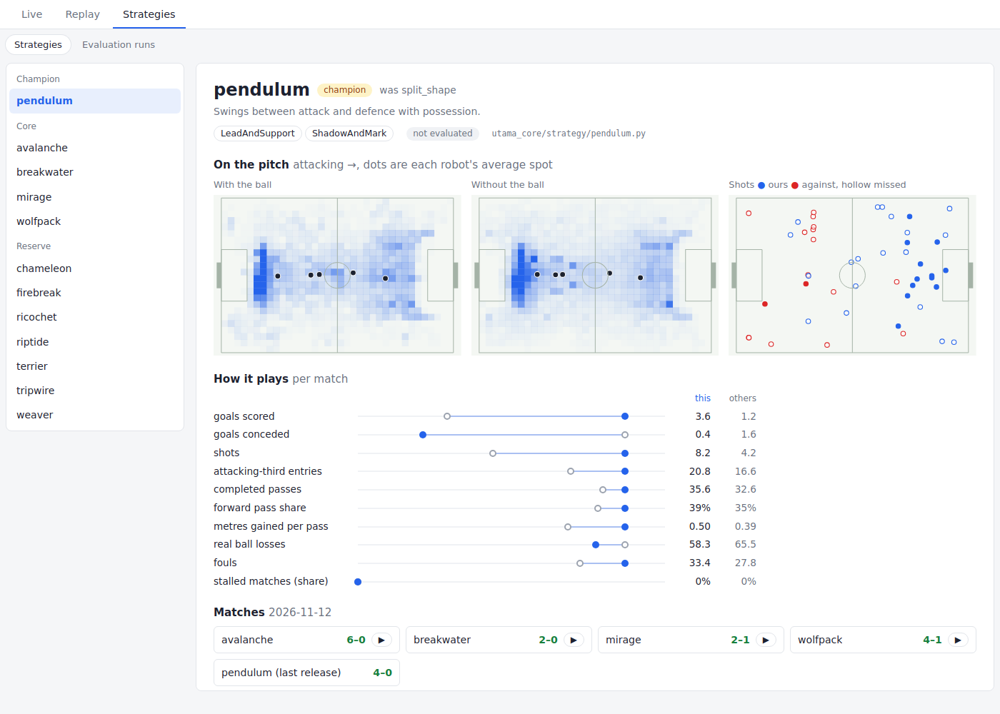
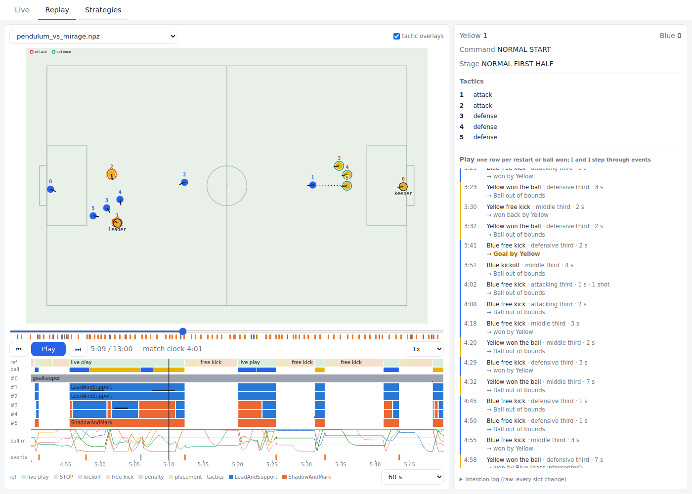

# Your first strategy

This page takes you from zero to a strategy of your own, playing in the simulator.
You need no knowledge of the codebase. Allow about an hour and a half.

First, install everything: follow steps 1 to 3 of the [README](../README.md#quick-start).

## 1. Watch a match

```
pixi run main
```

A window opens and two strategies play football. Yellow plays `pendulum`. Blue plays `wolfpack`.
Press Ctrl+C to stop.

You can pick any two strategies:

```
pixi run main riptide terrier
```

Step 2 shows every strategy on the dashboard.

## 2. Look around our strategies

The dashboard shows every strategy, how it plays and replays of its matches. To fill it, download
[`replays-v2.6.0.zip`](https://github.com/First-Order-RoboCup-SSL/Utama-Core/releases/download/v2.6.0/replays-v2.6.0.zip)
(160 MB: the core strategies playing each other once) and unpack it:

```
pixi run python -m zipfile -e replays-v2.6.0.zip replays/
pixi run dashboard
```

Open http://localhost:8080 and click **Strategies**.



- **On the pitch**: where its robots stand with the ball and without it (darker is more time), and
  where its shots came from. Every picture attacks to the right.
- **How it plays**: each number beside the other strategies' average. These explain a style; more is
  not always better.
- **Matches**: click ▶ to watch one.



The replay shows the robots, the referee's decisions and which tactic each robot ran, on a timeline
under the pitch. The list on the right has one row per restart or ball won; click a row to jump to it.

Pick two strategies with different maps and watch a match of each. What do they do differently?

## 3. Three words you need

- **Strategy**: decides what the whole team does. One file in `utama_core/strategy/`.
  The file's name is the strategy's name.
- **Tactic**: tells a group of robots what to do, every tick (60 times a second).
  A strategy is made of one or more tactics.
- **Skill**: one robot action, like "go to the ball" or "go to this point".
  Tactics use skills.

The goalkeeper is handled for you. Your strategy controls the other five robots.
Restarts (kickoffs, free kicks, stops) are also handled for you.

## 4. Make a branch

```
git switch main
git pull
git switch -c strategy/rookie
```

## 5. Write the strategy

Create the file `utama_core/strategy/rookie.py` and paste this in:

```python
# utama_core/strategy/rookie.py
"""`rookie`: the robot nearest the ball chases it and kicks it forward. The others follow the play."""

from utama_core.engine.context import TickContext
from utama_core.engine.strategy import Strategy
from utama_core.engine.tactic import BaseTactic, TacticTag
from utama_core.entities.data.vector import Vector2D
from utama_core.skills.go_to_ball import go_to_ball
from utama_core.skills.go_to_point import go_to_point
from utama_core.skills.kick_upfield import kick_upfield

LANES = [-2.0, -0.7, 0.7, 2.0]  # where the helpers stand across the pitch (y, metres)


class ChaseAndKick(BaseTactic[None]):
    tag = TacticTag.ATTACK

    def initial_mem(self):
        return None  # this tactic remembers nothing between ticks

    def tick(self, game, ctx, robot_ids, mem):
        if not robot_ids or game.ball is None:
            return {}, mem
        ball = game.ball.p
        robots = game.friendly_robots

        # The robot nearest the ball is the chaser.
        chaser = min(robot_ids, key=lambda i: robots[i].p.distance_to(ball))
        # +1 if our goal is on the right, -1 if it is on the left.
        back = 1 if game.field.my_goal_line[0][0] > 0 else -1

        commands = {}
        if robots[chaser].has_ball:
            commands[chaser] = kick_upfield(game, ctx.motion_controller, chaser)
        else:
            commands[chaser] = go_to_ball(game, ctx.motion_controller, chaser)

        # The helpers stand 1 m behind the ball, spread across the pitch.
        helpers = [i for i in robot_ids if i != chaser]
        x = ball.x + back * 1.0
        x = max(-3.3, min(3.3, x))  # stay out of the goal areas
        for i, y in zip(helpers, LANES):
            commands[i] = go_to_point(game, ctx.motion_controller, i, Vector2D(x, y))
        return commands, mem


def build(outfield_robot_ids, motion_controller):
    return Strategy(
        tactics={"chase": ChaseAndKick()},
        partitioner=Strategy.single_tactic_picker(lambda game, active: "chase"),
        outfield_robot_ids=outfield_robot_ids,
        ctx=TickContext(motion_controller=motion_controller),
    )
```

What it does:

- `tick` runs 60 times a second. It gets the game (`game`) and the robots it controls (`robot_ids`).
- It returns one command per robot.
- `build` puts the tactic into a strategy. Every strategy file needs a `build` function.

## 6. Watch it play

```
pixi run main rookie wolfpack
```

Your team is yellow. Does the chaser reach the ball? Do the helpers follow the play?

## 7. Change something

Try one small change, then watch again:

- Move the helpers closer to the ball: change `1.0` to `0.5`.
- Put the helpers in front of the ball instead: change `back * 1.0` to `-back * 1.0`.
- Use fewer lanes, so one robot stays near your goal.

Change one thing at a time, so you know what made the difference.

## 8. Test it

```
pixi run pytest utama_core/tests/engine/test_all_strategy_configs.py --headless
pixi run test
pixi run lint
```

All three must pass before you open a pull request.

## 9. Is it better? Run an evaluation

Watching one match is not enough. Football is full of luck.
The evaluation plays many matches and tells you if your strategy beats the champion (our best strategy).

```
pixi run evaluate rookie
```

This takes a while: matches play in the background, several at a time.
Matches that were already played are reused, so a second run is faster.

At the end, look at the **verdict** line:

```
rookie   DROPPED   in the screen after 2 round(s): mean diff -1.20 ± 0.40 goals/match ...
```

Read two things:

1. **The verdict.**
   - `BETTER`: it beats the champion. Well done.
   - `DROPPED`: it is not better. Most new strategies end here. That is normal.
   - `UNDECIDED`: maybe a little better, but not clearly. Treat it as not better.
2. **The mean diff.** How many more goals per match your strategy scores than the champion,
   against the same opponents. +0.5 means half a goal per match better. Negative means worse.

Ignore everything else in the output for now.

Then open the dashboard again: `rookie` is on the **Strategies** tab with its verdict, its maps
and its matches, beside the strategies you looked at in step 2.

## 10. Now let an agent write one

You know how a strategy works now. A coding agent (like Claude Code) can write and test new ones
much faster. This repo has a step-by-step guide for agents: the `change-strategy` skill.

Open Claude Code in the repo and ask, for example:

> Use the change-strategy skill. Make a new strategy where two robots always defend near our goal
> and three attack.

The agent makes the branch, writes the strategy, runs the tests and asks you before it runs
an evaluation. Read what it wrote. Watch the strategy with `pixi run main <name> wolfpack`.
You decide what to keep.

## Where to go next

- [STRATEGY_DEVELOPMENT.md](STRATEGY_DEVELOPMENT.md): how strategies and tactics really work.
  Read it when you want to write a proper tactic.
- `utama_core/tactics/`: real tactics to copy from.
- `utama_core/skills/`: every skill a robot can use.
