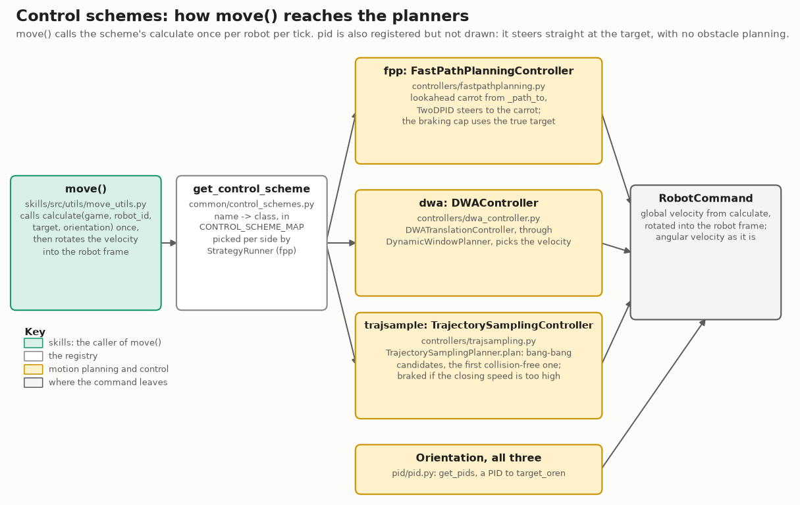
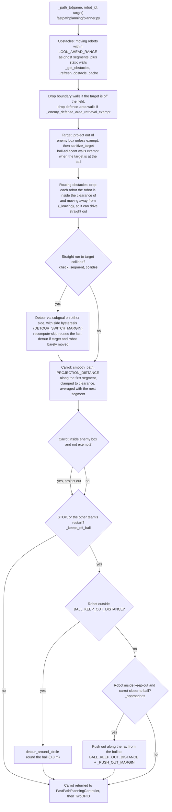
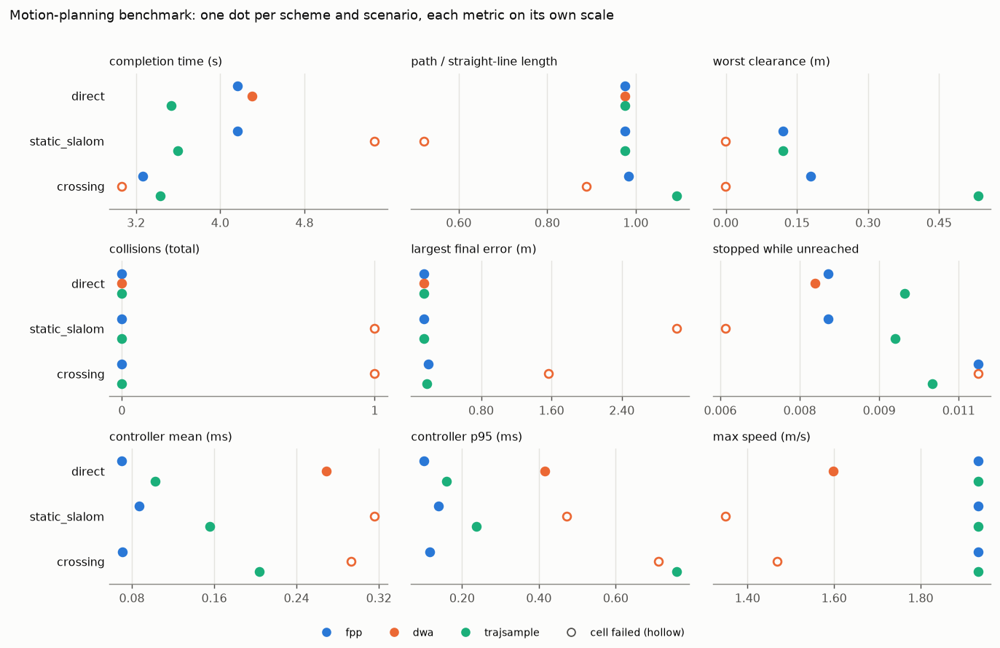
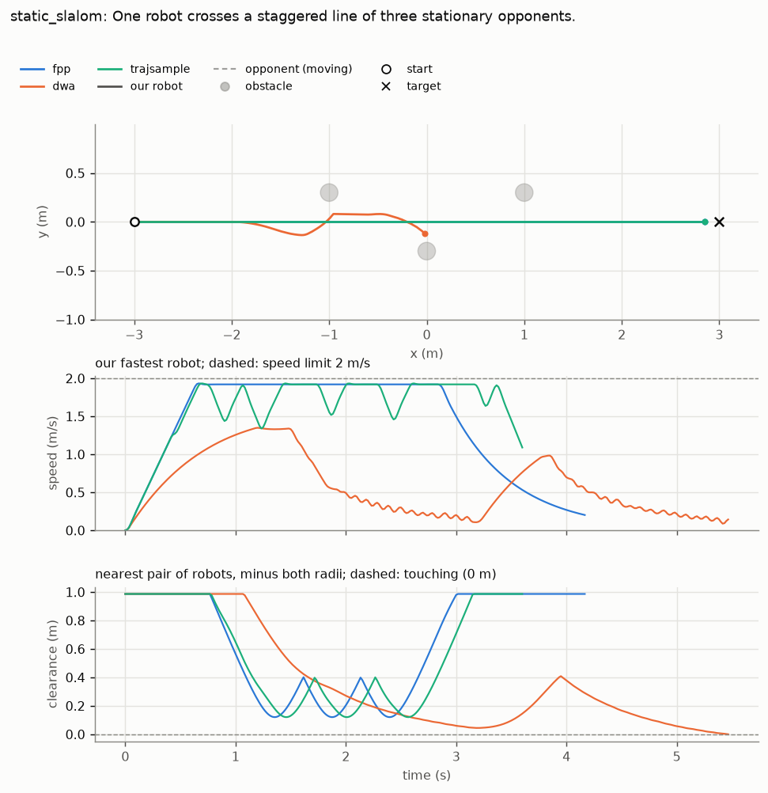
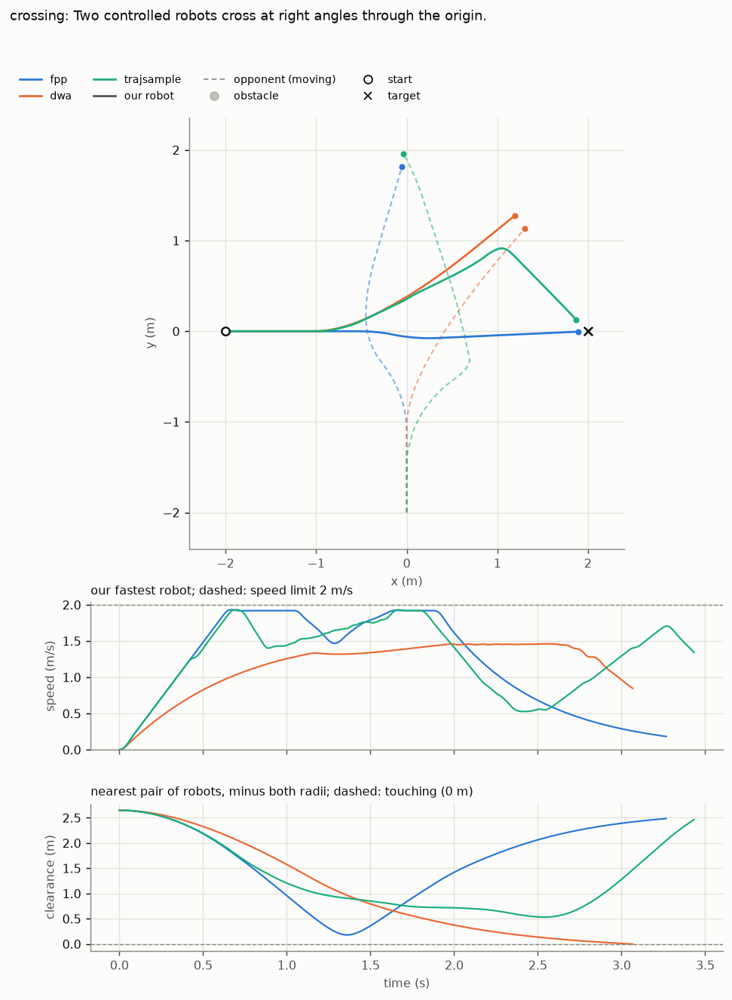

# Comparing motion-planning algorithms

`tools/motion_planning_benchmark.py` runs `fpp`, `dwa` and `trajsample` through the same
`StrategyRunner` + headless rsim path and writes raw JSON plus a Markdown table to
`benchmark_results/` (gitignored). It is a benchmark/regression report, not a replacement for unit tests of
algorithm internals (bang-bang endpoint invariants, FPP collision-kernel equivalence, ...).

```bash
pixi run python tools/motion_planning_benchmark.py                      # full matrix, once
pixi run python tools/motion_planning_benchmark.py --scenarios direct static_slalom --allow-failures
pixi run python tools/motion_planning_benchmark.py --repeats 5          # expose instability
pixi run python tools/motion_planning_benchmark.py --schemes fpp trajsample --scenarios mirror_swap --repeats 3
pixi run python tools/motion_planning_benchmark.py --list-scenarios
pixi run python tools/motion_planning_benchmark.py --scenarios direct --figures docs/img/motion_planning  # PNG figures too
```

Runs are sequential (concurrent cells would contend for CPU and corrupt latency numbers).
Geometry, colours/sides, rsim noise and the sampler seed are fixed; `--repeats` checks that the
deterministic setup stays repeatable. Exits non-zero if any cell fails (after writing reports)
unless `--allow-failures`; `--output-dir PATH` redirects output.

## Control schemes

Every scheme is a `MotionController`, and `move()` calls its `calculate` once per robot per tick. The
scheme name picks the class through `CONTROL_SCHEME_MAP`; `StrategyRunner` resolves it per side from
`strategy.control_scheme` (default `fpp`, and `pid` is also registered). Each `calculate` returns a
global velocity and an angular velocity, which `move()` rotates into the robot frame.



Drawn by `docs/img/motion_planning/make_control_schemes.py`; rerun it when a name in it changes.

## Scenarios

| Name | Exercises | Timeout | Tolerance |
|---|---|---:|---:|
| `direct` | Unobstructed 6m traversal and braking | 12s | 0.15m |
| `static_slalom` | Three staggered stationary robots | 20s | 0.15m |
| `crossing` | One perpendicular crossing robot | 20s | 0.20m |
| `crossing_oblique_45` | Crossing at 45°, both heading the same general way | 20s | 0.20m |
| `crossing_oblique_135` | Crossing at 135°, heading broadly towards each other | 20s | 0.20m |
| `crossing_offset` | Perpendicular crossing off-centre, reaching it at different times | 20s | 0.20m |
| `crossing_steady_runner` | Opponent follows a point crossing our path at 1 m/s | 20s | 0.20m |
| `overtaking` | Passing an opponent that follows a point ahead on the same line at 0.5 m/s | 20s | 0.20m |
| `grid_intersection` | Four moving robots, four crossing points | 30s | 0.25m |
| `mirror_swap` | Dense 6v6 yielding and convergence (2cm symmetry-breaking offset) | 45s | 0.30m |
| `ball_scrum` | A run to a support spot just past three robots circling the ball at 0.5 m/s, a marker crossing the lane | 15s | 0.20m |
| `recovery_run` | A run back past a 2v2 pack circling the ball, an opponent runner crossing in front | 15s | 0.20m |
| `wing_switch` | Two teammates cross just ahead of a teammate on the ball, an opponent shuttling across | 15s | 0.20m |
| `kickoff_reset` | Ten robots from a corner scramble to the kick-off formation (real positions from a replay) | 20s | 0.20m |
| `narrow_passage` | Threading a 0.24m gap between two stationary robots | 10s | 0.15m |
| `head_on_swap` | Two robots swap positions driving straight at each other | 10s | 0.20m |
| `field_boundary_corner` | Target just inside a field corner | 10s | 0.15m |
| `defense_area_boundary` | Target just outside the defense-area keep-distance (fpp's clamp settles ~0.2m short) | 10s | 0.25m |
| `interception` | Meeting an opponent that follows a point at constant velocity | 8s | 0.20m |
| `sudden_obstacle` | Clear corridor; an obstacle appears mid-path at 2s | 12s | 0.15m |
| `disturbance_recovery` | Robot is teleported off its path at 1.5s and must replan | 12s | 0.15m |
| `start_inside_obstacle` | Starts overlapping a stationary robot; only a new collision fails it | 10s | 0.15m |
| `jittering_target` | `direct`'s geometry with ~1mm per-tick target jitter; compare its time with `direct`'s | 12s | 0.15m |
| `box_clearing_scrum` | Breakout from a congested defensive box scrum past pressing attackers and a shuttling marker | 15s | 0.20m |
| `wall_rebound` | Rounding a 3-robot defensive wall to collect a loose rebound against a recovering defender | 15s | 0.20m |
| `pinching_contest` | Midfield sprint while two opposing defenders pinch diagonally from both flanks | 12s | 0.20m |
| `stop_transition` | Coordinated dispersal of 6 robots from an offensive cluster around a central keep-out anchor to STOP spots | 20s | 0.25m |
| `keeper_switchback` | Sharp 180° hairpin switchback under pursuit near the defensive boundary | 12s | 0.20m |
| `trailing_intercept` | Oblique pursuit and cutoff of an opponent sprinting down the wing at 1.8 m/s | 10s | 0.20m |

Opponents with a target or a moving target point drive with the selected scheme; the others stay
put (`sudden_obstacle`'s is teleported into the corridor).

The four crowd scenarios (`ball_scrum` to `kickoff_reset`) and the six match-derived stress scenarios
(`box_clearing_scrum` to `trailing_intercept`) are built on where real match congestion and tactical
restarts occur.

### FastPathPlanner (`fpp`) decisions per tick

Each tick, `FastPathPlanner._path_to` turns the robot's target into a carrot point for the PID. The
flowchart is that call's decision order. `tools/plan_snapshot.py` draws the carrot and the planner's
inputs for one logged tick. `tools/plan_trace.py` runs the same `_path_to` on every tick of a window and
draws how the carrot moved against the robot's path, which a single tick cannot show. Robot positions are the replay's, not re-simulated, so it shows what the current planner would
do from each recorded state; the kick-off example is in [STRATEGY_DEVELOPMENT.md](STRATEGY_DEVELOPMENT.md),
"Debugging a foul or failure".



### Trajectory Sampling (`trajsample`) Architecture & Optimizations

Following TIGERs Mannheim's approach (Sumatra), `trajsample` plans directly in continuous trajectory space
using 2D bang-bang acceleration profiles:
1. **Directional Tube Reachability**: Dynamic obstacle reachable regions expand directionally along the
   obstacle's current velocity vector:
   $$r(t) = r_0 + v_t t + \frac{1}{2} a_{\max} t^2$$
   fixing transverse over-inflation while preserving strict longitudinal safety margins.
2. **Duration-Optimal Candidate Selection with Hysteresis**: Evaluates all sampled switch times and
   intermediate detour angles to pick the candidate that minimizes total arrival duration $\min(T_{\text{arr}})$,
   applying a 0.15s hysteresis credit to the previous winning direction (`last_dir`) to guarantee path
   continuity without oscillation.
3. **Target Fan with Compact-Radius Scaling**: Symmetrically fans out candidate detour angles around the
   final goal bearing, using a compact 0.6m radius for tight cuts ($\le 30^\circ$) scaling to 1.0m for wide
   circumventions ($\ge 60^\circ$).
4. **Target Progress Fallback Ranking**: Ported Sumatra's `getBestRejectedResult`: when all candidates collide,
   the planner executes the trajectory whose first collision point is closest to the destination, strictly
   subordinating static collisions below moving collisions.

Latest full run across all 29 scenarios: `trajsample` achieves **100% pass rate (29/29)**, completing complex
crowds up to 2.7s faster than baseline (`recovery_run` 4.62s vs 7.35s, `kickoff_reset` 7.10s vs 9.67s) with
sub-millisecond controller latency (~0.15ms mean / ~0.30ms p95).

## Pass/fail and metrics

A run passes only if every moving robot reaches its target within tolerance before the
simulated timeout and no two robot centres come closer than `2 * ROBOT_RADIUS` (0.18m); a
repeated cell passes only if every repeat does. Reasons: `completed`, `collision`,
`sim_timeout`, `wall_timeout`, `exception`.

Speed above 2 m/s + 0.15 tolerance is reported as `speed_limit_exceeded` but is diagnostic
only. Acceleration is also diagnostic: it is reconstructed from filtered simulator velocity and
can include estimator transients, so it is not an exact commanded-acceleration contract.

The table reports: completion time; path ratio (travelled / straight-line); worst centre
clearance minus both radii (negative = overlap); collision count; largest final error; stopped
fraction (robot-seconds below 0.05 m/s while unreached); mean/p95/max
`MotionController.calculate()` latency (first 5 calls excluded for Numba warm-up,
`--timing-warmup-calls`); max speed and acceleration.

## Figures

`--figures DIR` also writes `trajectories_<scenario>.png` (the pitch with each scheme's paths, then speed
and clearance over time) and `summary.png` (one dot per scheme and scenario for each metric). It is off
by default; turning it on records per-tick robot state during the runs and changes nothing else. Figures
show the first repeat of each cell. Three scenarios from one run are committed in `docs/img/motion_planning/`:

```bash
pixi run python tools/motion_planning_benchmark.py --scenarios direct static_slalom crossing --allow-failures --figures docs/img/motion_planning
```







In this run (all three schemes, one repeat): in `static_slalom`, `dwa`'s path swerves round the first two
obstacles and ends touching the lower one (clearance reaches 0 m: its failed cell), while `fpp` and
`trajsample` keep a straight line with clearance of about 0.12 m. In `crossing`, `dwa` ends at 0 m clearance
from the crossing opponent, `trajsample` yields with a tight bypass finishing in 3.4 s (path ratio 1.09x),
and `fpp` passes at about 0.2 m and finishes in about 3.3 s. In `direct`, `fpp` and `trajsample` both reach the
2 m/s speed limit, while `dwa` accelerates more slowly and never reaches it. Where two schemes' paths coincide
(`direct`, and the straight part of `static_slalom`), the later scheme is drawn on top and hides the earlier one.

The three-scenario command took about 8 s of wall time, including writing the figures. Its numbers are
not the table in the results section above, which was made at an earlier revision.

## Reading it

Pass rate first — a fast planner that collides or doesn't converge isn't a winner. Then: lower
time and path ratio = efficient; large clearance with a long path = over-conservative; high
stopped fraction = yielding, oscillation or local minima; p95 latency matters more than the
mean at 60 Hz. There is deliberately no weighted overall score: the speed/clearance/compute
trade-off is a team decision, and one scalar would hide why a planner won. Archive the JSON
(it records the git revision) and compare matching rows across revisions.
