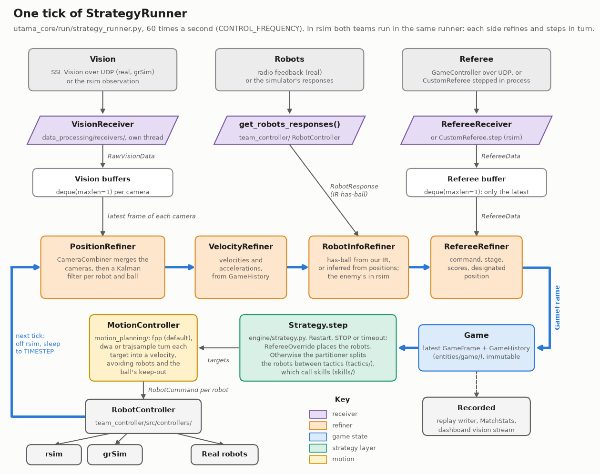
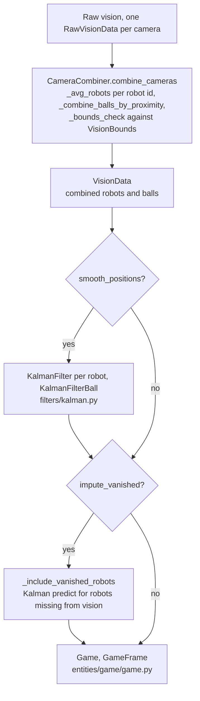

# Pipeline method

Drawn by `docs/img/pipeline/make_one_tick.py`; rerun it when a box's name changes. The same tick as a
Mermaid diagram with every module path: [architecture.md](architecture.md#one-tick).

How vision, robot and referee data become one `Game` state, and how one tick turns that
state into robot commands. Everything below runs inside `StrategyRunner`
(`utama_core/run/strategy_runner.py`).

## Data in

The referee is one of three sources (`run/referee_source.py`): none, the official
GameController over the network, or `CustomReferee`, which runs in the same process and is what
rsim matches and tournaments use (`docs/custom_referee.md`).

**Problem.** Combining new data with prior knowledge (e.g. a Kalman filter) kept bloating
`GameFrame` with new functions, and access to past and current state wasn't uniform.

**Solution.** `Game` holds our best estimate of the true current state and is updated by a
chain of **refiners**: each takes the current game frame and one kind of new data and returns
an updated frame. Later refiners see earlier updates: `RobotInfoRefiner` takes has-ball from our
robots' IR, or infers it from the refined positions for a robot whose IR isn't trusted, and
takes the enemy's from their responses when the sim provides them (both teams in rsim).
Friendly and enemy robots expose the same fields, estimated from different sources.

- **Multiple cameras** are combined inside `PositionRefiner`.
- **Falling behind:** receivers fill one-slot buffers (`deque(maxlen=1)`), and the main loop
  runs at a fixed rate and takes only the latest vision and referee data each tick.
- `GameFrame` is immutable; receivers (network) are separate from refiners, which makes
  testing easier.
- `GameHistory` (`utama_core/entities/game/game_history.py`) stores past frames.
- Before the first tick, `GameGater` waits until the frames hold the expected robots and ball.

The uniform `GameTimeline`/`Predictions` interface (pluggable per-property predictors) from
earlier drafts was never built; predictions are ad hoc per call site.

### Inside PositionRefiner

Camera combining and the Kalman filters (`data_processing/refiners/position.py`,
`data_processing/refiners/filters/kalman.py`). Smoothing and vanished-robot imputation are
separate switches; both run on the same per-robot filters.

## One tick

`CustomReferee` steps first (when in-process), then each side refines its frame, the replay
writer and `MatchStats` record it, and `AbstractStrategy.step` runs the strategy layer:
`Strategy.tick` (referee overrides, tactic slots), tactics, skills, then the `MotionController`
(fpp, dwa or trajsample) turns targets into one `RobotCommand` per robot for rsim, grSim or the
real robots.

In rsim both teams run in one `StrategyRunner`: each side has its own refiners, strategy and
motion controller and steps in turn, alternating which goes first. `MatchStats` and the replay
writer follow one side's frames. The dashboard's vision stream renders the same frames.
`docs/STRATEGY_DEVELOPMENT.md` covers the strategy layer; `docs/motion_planning_comparison.md`
the motion controllers.
