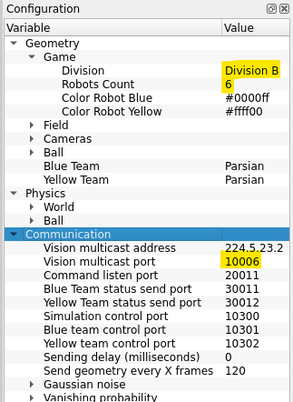

# Real robots

The reference for real-robot work: what we know about our robots, what a field log holds and the tools that read it, and the
external software (grSim, the official GameController, AutoReferee, ssl-vision). The procedure for a
test day is the tutorial [tutorials/field_day.md](../tutorials/field_day.md).

## Our robots

What we have measured on our two robots (radio 0 and radio 1), from field logs of 2026-10-27 to
10-29. Each robot's numbers live in `utama_core/config/robots/radio_<n>.json`, written by
`pixi run calibrate`; they apply on real robots only (the sim assumes league-level robots, see
"World / robot capability" in `AGENTS.md`).

- **The kicker has one power.** A full kick leaves at about 2.2 m/s on radio 0 (the sim kicks at
  about 5). Strength varies with charge and battery; don't chase it. No variable-power settings
  in sim or skills until the hardware has it.
- **Kicks bend with where the ball sits on the dribbler:** about 4 degrees per cm off centre on
  radio 0, 1 on radio 1, plus a small bias. Passes and shots correct for it (`kick_bend_deg_per_cm`,
  `kick_bias_deg`).
- **The dribbler is weak.** Robots lose the ball when they turn or move sideways or backwards with
  it, so `move()` caps carrying at 0.3 m/s and 0.6 rad/s on real robots. A first guess: tune it on
  the field (`pixi run calibrate` has a carry ladder).
- **Motion:** about 79 ms from command to motion; turns about 9% faster than commanded; sideways
  acceleration about 1.8 m/s^2 against about 5 forwards.
- **The lid is not the robot.** A robot is its radio (motors, kicker, dribbler); the patterned lid
  can be swapped. `pixi run find-robots` pairs them.
- **Vision over Wi-Fi is patchy.** Over a phone hotspot, packets arrived bunched and lost and the
  field check kept halting. When a run halts on vision gaps, check how the laptop gets vision before
  touching code.

## Field-day reference

The steps of a test day are the tutorial [field_day.md](../tutorials/field_day.md); this is what
lies behind them.

### Vision: ssl-vision or TagVision

Both send `SSL_WrapperPacket`s to 224.5.23.2:10006, so nothing in this repo changes with the
choice. TagVision (`First-Order-RoboCup-SSL/tagvision`) is ours: ring markers instead of colour
patterns, calibration from the taped field lines, phones as extra cameras; its `docs/setup-guide.md`
and `docs/compat.md` (what it sends, byte for byte) are the reference. A TagVision marker plays the
part of an ssl-vision lid: `find-robots` pairs radios with marker IDs the same way, and a robot
profile's tag offset is its marker's. As of 2026-11-13 no registered field session
(`tools/field/field_sessions.json`) used TagVision.

**ssl-vision cameras.**
- FLIR: install the **Spinnaker SDK** ("Spinnaker SDK, 64-bit" for your Ubuntu from
  [FLIR](https://www.flir.com/products/spinnaker-sdk)), its listed libraries, then
  `sudo sh install_spinnaker.sh`: yes to the udev entry (add your user to `flirimaging`) and to
  USB-FS 1000 MB. Exposure and gain are in its Spinnaker node and change live.
- USB webcam: cam idx is the `/dev/video` number of its image; the second node is metadata.
  Use **MJPEG** (the RER camera: uncompressed YUYV 5 fps at 1280x960, MJPEG 60-90 fps). Lock white
  balance after auto settles (`v4l2-ctl -d /dev/video0 --set-ctrl=white_balance_automatic=0` and
  `white_balance_temperature=<what it picked>`): drifting colours break the colour calibration.
  Exposure under about 10 ms (`exposure_time_absolute=100`) so the ball is not smeared.
- The **Lab Field** preset: 3 m x 2.25 m, goal 0.8 m, defense area 1 m x 0.5 m, two cameras. The
  Division B button sets the camera count to 1: don't use it with two cameras.
- `./bin/graphicalClient` on the vision laptop shows what ssl-vision sends, before any network.
- **Checking a calibration:** `tools/field/vision_check.py --guided ball`, then `--guided "blue 2"`
  (a robot facing +x), asks for the ball or robot on 9 points and prints each camera's error
  (`replays/field/*_vision_truth_*.json`). Errors growing to the edges: distortion or focal
  length; the same shift everywhere: the camera's position; more at one end: its tilt or height.
  Ball right but robot not: the robot height.

**Networks.** With two networks on the robot laptop (Wi-Fi for internet, Ethernet to the switch),
our receiver listens on the one Windows uses for internet: use one. If WSL USB support is
missing (`tee: .../usbfs_memory_mb: No such file`), it loads only once a device is attached;
`/etc/modprobe.d/usbfs.conf` with `options usbcore usbfs_memory_mb=1000` sets it then.

### The radio and which robot is which

One radio drives every robot of either colour, addressed by radio ID only, so radio IDs must
differ across all robots on it. The radio port is `PORT` in `utama_core/config/settings.py`
(`/dev/ttyACM0`). `debug-robots`: Shift is fast (0.5 m/s, else 0.1), C chips.

A robot is its radio: the board stays with its motors, kicker and dribbler, and its profile goes
by it. The lid (or TagVision marker) is a separate shell and can be swapped. `pixi run
find-robots` (radios 0-7; `--radios 0 1 4`) turns each answering radio about 70° and back, and
the pattern that turned with it is its lid. The pairing is saved per machine
(`replays/field/robots_found.json`). Examples pick robots by radio (`RADIO_0`, `RADIO_1` in
`tools/field/shooting_drill.py`); on start they watch vision for 0.5 s and use the saved lids, or
find the robots again (`find_robots.confirm`). Two robots in use that swapped lids with each other
can't be told apart: run `find-robots` after such a swap. `field-check` cannot see batteries:
the robots don't report them.

### Demos and the operator panel

`pixi run demos` starts the shooting drill behind one dashboard; the Live tab's Demo panel
switches demos (Halt, pick, Run: the demo closes with its log saved, the next starts and the page
reloads). A demo that fails to start shows why under the panel. Calibration and `planner_ab.py`
stay their own commands.
- **Settings** apply from the next Run: *first robot* (the attacker, shooter, robot A), *camera*
  (the part of the field in view, `CAMERA_HALF`) and *rules*, as editing the examples' config
  blocks would, for this process only.
- **Field check** runs `field-check` without leaving the page, then restarts the demo.
- **Teleop** (`examples/teleop.py`): pick the robot, tick "keys drive", Force Start; W/S A/D Q/E,
  Shift faster, B kicks, F the dribbler. A robot stops when its keys are let go, on Halt, and
  0.3 s after the page stops sending.
- The Robots panel shows each robot's share of commands answered over the last 2 s; under 80%
  (red) the link is poor, often a flat battery.
- The panel itself: [referee.md, "Operator panel"](referee.md#operator-panel).

Each run records `replays/field/<time>_<mode>_<name>.log` (every vision packet, the radio both
ways, the referee and which code ran) and, when it closes, a `.npz` replay of the world the
strategy saw. The runner adds a note whenever a robot's tactic or step changes.

### Calibrating a robot

`pixi run calibrate` (`tools/field/calibrate_robot.py`; `--radio N`, `--ball-only` for the ball
part again, `--check` to compare profiles, `--mode rsim --yes` to rehearse and write nothing).
Without `--robot colour:id` and `--radio` it finds the robot with `find-robots`. Once vision sees
the robot, put it near the middle facing +x, with 0.8 m clear ahead, 0.6 m to its left and a ball
at rest in view. It drives and turns for about 65 s, then the ball part
(`tools/field/ball_trials.py`), where the robot fetches the ball itself:

- **Carry ladder:** 0.5 m forward, backward, left, right and half a turn each way, at rising
  speeds (0.2-1 m/s, 0.5-4 rad/s), twice each (`--repeats`). A direction stops at the first speed
  that loses the ball (15 cm off the robot, or the ball sensor off for 0.3 s).
- **Kicks:** 10 (`--kicks`) along the field, each charged: a kick more than 30 s after the last
  one is preceded by an empty kick.

It asks only when the ball is out of view or within 25 cm of the edge. At the end it analyses the
log (loop delay, speed gain and acceleration per axis, vision noise at rest, kick speed; written
as `.calibration.json`) and writes `utama_core/config/robots/radio_<radio>.json`:

- `tag_forward_m`, `tag_left_m`: where the tag sits on the robot, from its turns on the spot.
- `kick_bend_deg_per_cm`, `kick_bias_deg`: how far kicks leave the heading per cm the ball sits
  off-centre, and with it centred. A tag stuck on turned shows in the bias.
- `kick_speed`, `kick_spread_deg`: those kicks' median speed and their scatter.
- `carry_speed`, `carry_turn`: the slowest direction's fastest speed that always kept the ball;
  `move()` holds this robot to them (`RobotParams.CARRY_*` otherwise).

What it could not measure stays as it was; broken hardware (`kicker`, `dribbler`, `ir`) is set
in the file by hand. Kick bend and bias apply on real robots only; rsim keeps its own kick.

**Is the new profile better?** `--check` alternates it with the committed one in 4 blocks
(`--blocks`), carrying at each profile's caps and kicking 5 times (`--kicks`) at the far end, and
prints how often each carry kept the ball and how far kicks missed (mean |miss| ± SE). Commit if
it is no worse; ten kicks a side only separate differences of a few degrees. Calibrate every robot
twice per session (early and late): their disagreement is how far to trust them. An older log:
`pixi run python tools/field/robot_calibration.py replays/field/<run>.log --tag yellow:0 0 -0.002`.

**Kicker charge in play.** On real robots a robot that hasn't kicked for 25 s fires an empty kick
when the ball is neither on it nor within 30 cm, never in a HALT (`kicker_charge.py`). 2026-10-28:
radio 0 kicked about 2.2 m/s 1 s or 30 s after its last kick; radio 1 recharges far slower (a
median 0.41 m/s within 15 s of its last kick, 1.29 after 15-30 s): for the electronics team.

## Field logs

Recorded on the physical pitch during real robot test days: vision frames, referee commands,
bidirectional radio packets, and session metadata.

---

### 1. File Location & Binary Format

- **Location**: `replays/field/<YYYYMMDD_HHMMSS>_real_<name>.log.gz`
- **Specification**: Follows the official RoboCup SSL Game Log format (`SSL_LOG_FILE`), stored compressed with standard `gzip`.
- **Streaming**: Python readers stream `.log.gz` directly without uncompressing:
  ```python
  from utama_core.replay.ssl_log import read_records

  for ts_ns, msg_type, payload in read_records("replays/field/<run>.log.gz"):
      ...
  ```

#### Record Types

| Type ID | Name | Contents |
|---|---|---|
| `4` | `VISION_2014` | Raw `SSL_WrapperPacket` from ssl-vision cameras (pixel positions, confidence, detection timestamps). |
| `3` | `REFEREE` | `Referee` state updates (commands, stage, score, team cards). |
| `100` | `RADIO_OUT` | 12-byte packed commands sent to robots over serial radio (forward, left, turn velocities, kick power, dribbler). |
| `101` | `RADIO_IN` | Feedback packets returned by robots (IR ball sensor trigger state). |
| `102` | `RUN_INFO` | Initial session metadata JSON: git commit SHA, dirty flag, vision-to-radio mapping, field bounds. |
| `103` | `NOTE` | Human operator notes entered from the dashboard during testing. |

---

### 2. Analysis & Calibration Tools

Every field log contains the ground-truth signals needed to evaluate robot hardware:

#### Robot Calibration (`tools/field/robot_calibration.py`)
Recovers physical dynamics and kicker geometry from a field test:
```bash
pixi run python tools/field/robot_calibration.py replays/field/<run>.log.gz
```
- **Loop Latency**: Sensing-to-action delay measured between commanded motion and camera-observed velocity (~61–62 ms).
- **Acceleration Limits**: Measured forward acceleration (~4.0–6.0 m/s²) vs. lateral acceleration (~2.7–3.6 m/s²).
- **Kick Characteristics**: Median ball launch velocity, directional offset bias (+2.7°), and bend caused by off-center dribbler contact (~4.2°/cm).
- **Dribbler Retention**: Sustained carry velocity and turn rate caps before the ball escapes (0.3 m/s, 0.6 rad/s).
- **Output**: Writes `<run>.calibration.json`.

#### Tag Alignment Calibration (`utama_core/analysis/tag_calibration.py`)
Measures optical tag placement relative to the chassis center:
```bash
pixi run python -m utama_core.analysis.tag_calibration replays/field/<run>.log.gz
```
- Fits circle trajectories during in-place spins to determine `(forward_m, left_m)` offsets.

#### Proximity & Close Calls (`utama_core/analysis/close_calls.py`)
Scans logs for incidents where robots came closer than 0.25 m:
```bash
pixi run python -m utama_core.analysis.close_calls replays/field/*real*.log.gz
```

#### Converting to Replay (`tools/realism/convert_ssl_log.py`)
Converts an SSL game log into our columnar `.npz` + `.pkl` replay format for replay visualization and scenario debugging:
```bash
pixi run python tools/realism/convert_ssl_log.py replays/field/<run>.log.gz --out replays/field/
```

---

### 3. Storage & Dataset Management

Raw field logs accumulate substantial disk space over a testing day. Three built-in tools manage log sizes:

#### 1. In-Place Compression
Raw `.log` files should be compressed to `.log.gz`:
```bash
pixi run package-field --compress-in-place
```
Reduces log sizes by **50%–60%** with zero data loss. All analysis tools support `.log.gz` out of the box.

#### 2. Trimming Idle Time Sectors (`tools/field/trim_idle_log.py`)
Field sessions frequently capture long periods of inactivity where the referee command is `HALT` or `STOP` (e.g. operators manually setting up the ball or discussing tests). Over **55% of field log duration is trailing dead time**:
```bash
# Preview reduction without modifying files
pixi run python tools/field/trim_idle_log.py replays/field/<run>.log.gz --dry-run

# Trim dead stretches and trailing halt in-place
pixi run python tools/field/trim_idle_log.py replays/field/<run>.log.gz --in-place
# Or batch trim all field logs:
pixi run trim-field
```
- Automatically removes idle pauses longer than 5 seconds while keeping 1.0 second safety padding around transitions.
- Fully strips trailing idle time recorded after drills end.
- Typically cuts file size by **65%–75%** while preserving every active drill frame.

#### 3. Packaging & Distributing (`tools/field/package_logs.py`)
Creates self-contained release archives of field logs and calibration results:
```bash
pixi run package-field
```
Bundles all `.log.gz` logs, `*.calibration.json`, and hardware profiles into `replays/field_logs_<timestamp>.tar.gz` for team sharing or dataset archival.

## External tools: grSim, GameController, AutoReferee, SSL Vision

None of this is needed for everyday work: rsim and the in-process
[`CustomReferee`](referee.md) run everything headless with no external process, and
behave the same across rsim, grSim and real mode. Set these up only to run against grSim, the
official competition software, or real robots.

### grSim

1. Go to the [grSim repo](https://github.com/RoboCup-SSL/grSim) and follow its
   [installation steps](https://github.com/RoboCup-SSL/grSim/blob/master/INSTALL.md).
2. Change the configuration to the values highlighted below:

   

3. To run it, execute `./bin/grSim` in the cloned repo.

### AutoReferee and the GameController

1. Make sure `grSim` is set up and can be called from a terminal.
2. `git clone` the [AutoReferee repo](https://github.com/TIGERs-Mannheim/AutoReferee) into a
   folder named `AutoReferee/` in the repository root.
3. Change `DIV_A` to `DIV_B` in `AutoReferee/config/moduli/moduli.xml`:

   ```xml
       <globalConfiguration>
           <environment>ROBOCUP</environment>
           <geometry>DIV_B</geometry>
       </globalConfiguration>
   ```

4. Get the latest [compiled game controller](https://github.com/RoboCup-SSL/ssl-game-controller/releases/),
   rename it to `ssl-game-controller`, and save it in a `ssl-game-controller/` directory in the
   repository root.

Both directories are gitignored.

#### Starting the external test environment

Only needed to test against the official referee software; the in-process `CustomReferee`
needs none of this. With grSim, the GameController and AutoReferee set up, start each in its
own terminal from the repository root:

```bash
grSim
cd ssl-game-controller && ./ssl-game-controller
cd AutoReferee && ./gradlew run
```

Then run your own strategy. The GameController's web UI is at http://localhost:8081/#/match
(this repo's dashboard is :8080).

### SSL Vision and the radio for real robots

The steps are the tutorial [field_day.md](../tutorials/field_day.md); the details are in
[Field-day reference](#field-day-reference) above.
