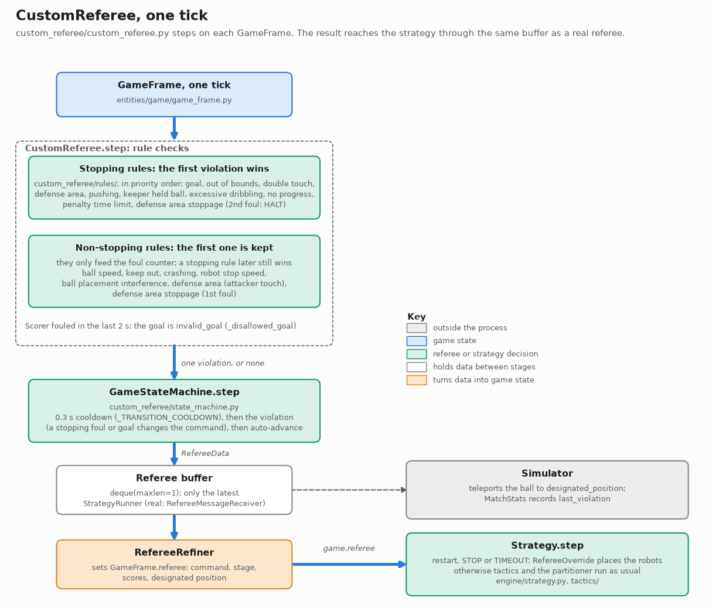
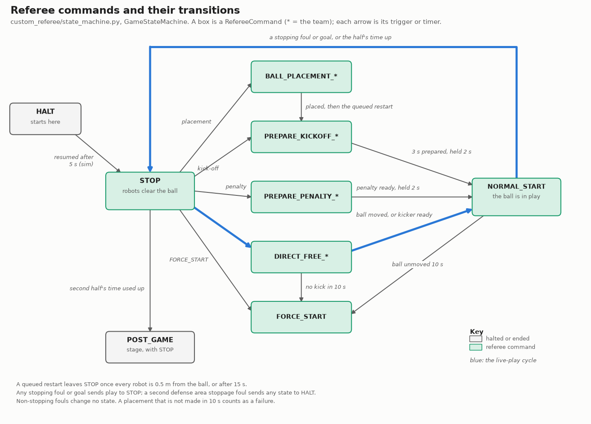
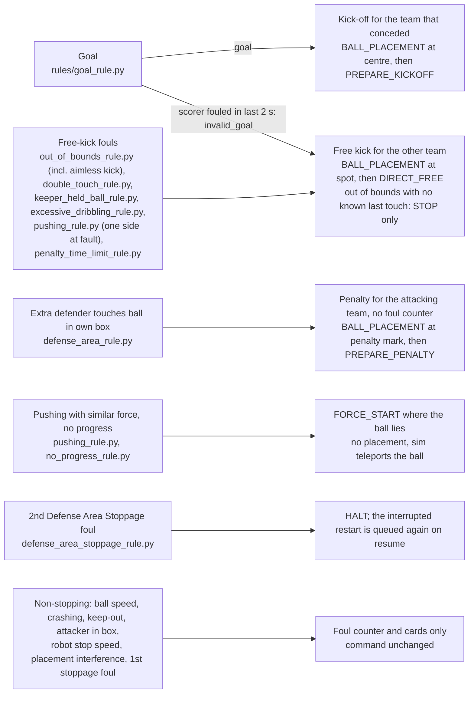

# Custom Referee

`CustomReferee` (`utama_core/referee/`) is an in-process referee: it steps
synchronously on `GameFrame`s and produces `RefereeData`, which `RefereeOverride`
(`engine/referee_override.py`) reads each tick via `game.referee`. No network, no AutoReferee
process, no simulator-specific code — identical in RSim, grSim and Real.

**Why not the TIGERs AutoReferee?** It is an asynchronous real-time Java/UDP process: unusable
in RSim and for faster-than-real-time RL, its thresholds are hardcoded (break on small test
fields), and strict rules ruin human-vs-robot exhibition play. Profiles solve the last two.

## Architecture

```
CustomReferee.step(game_frame, t)
  ├─ for rule in rules (priority order): rule.check(frame, geometry, command, placement_target)
  │     first *stopping* violation wins; a non-stopping foul (SSL §8.4.2) only feeds the
  │     foul counter and never suppresses a later stopping rule
  └─ GameStateMachine.step(t, violation)   # command, score, stage, next_command,
        → RefereeData(source_identifier="custom_referee")   designated_position
```

- 0.3s transition cooldown (`_TRANSITION_COOLDOWN`) stops one violation applying repeatedly.
- One-frame lag (the frame is from the previous step) — acceptable in every mode.
- `RefereeGeometry` is a frozen dataclass decoupled from `Field`; `StrategyRunner` overrides it
  from `full_field_dims` at startup (default `STANDARD_FIELD_DIMS`). YAML never sets geometry.
  In grSim/Real, `StrategyRunner` raises if the first vision geometry packet disagrees with
  `full_field_dims`.

Each tick, the rule checks decide which violation (if any) reaches the state machine, and the
state machine's output reaches the strategy through `RefereeRefiner` and `RefereeOverride`:



Drawn by `docs/img/custom_referee/make_architecture.py`; rerun it when a name in it changes.

## Rules

Built in `_build_active_rules` (`custom_referee.py`), in this priority order; defaults live in
`profiles/profile_loader.py`'s config dataclasses.

| Rule | Active during | Notes |
|---|---|---|
| `GoalRule` | live play | Scoring team from `my_team_is_right`/`my_team_is_yellow`; 1s cooldown; `designated_position=(0,0)`. `CustomReferee.step` turns it into a goal kick (`invalid_goal`) when the scorer committed a non-stopping foul in the previous 2 s (§7). |
| `OutOfBoundsRule` | live play | Free kick to the team that didn't touch last, placed 0.25m infield; over a goal line, a corner or goal kick in the corner, or, for a ball last touched in the kicker's own half that crossed the opponent's goal line untouched, a free kick from where it was touched (aimless kick, §6.2.3, Division B; `out_of_bounds.aimless_kick`, on in both profiles). Last touch: `rules/last_touch.py`'s colour-blind `infer_last_touch_team` (both teams' contact data; closest robot only when there is no prior attribution; unresolved rather than a default colour). |
| `BallSpeedRule` | live play | Ground speed > 6.5 m/s, edge-detected; same last-touch attribution. Non-stopping (§8.4.2). |
| `DoubleTouchRule` | `NORMAL_START` after a restart | Only the restart kicker (first toucher after arming) is barred; disarms when any other robot touches. Open-play release-and-reacquire dribbling is legal. Keeps `_prev_command` across `reset()` because `reset()` runs on the very transition it must observe. |
| `DefenseAreaRule` | live play | An extra defender (> `max_defenders`) touching the ball in its own area: penalty. An attacker touching the ball while at least partly in ours: non-stopping, 2 s re-raise (§8.4.2). With `defense_area.enabled: false` (`human`, and the real examples' profiles) our robots also stop keeping out of the boxes: `StrategyRunner` sets `Field.defense_area_rules` from it, for the planners, tactics and restart positioning; a ball resting in our own box stays the keeper's. |
| `KeepOutRule` | `DIRECT_FREE_*`, `PREPARE_KICKOFF_*` | Defending team within 0.5m for 30 consecutive frames: non-stopping, 2 s re-raise, restarts the free kick's 10 s clock (§8.4.3). Not during bare `STOP` or penalties, nor once a free kick is taken (stage 3 of the state machine: the ball moved 0.05m, so it is live). |
| `PenaltyTimeLimitRule` | `NORMAL_START`/`FORCE_START` after `PREPARE_PENALTY_*` | Penalty still in play 10 s after its normal start: goal kick for the defenders (§5.3.5). |
| `NoProgressRule` | live play | Ball hasn't moved 0.05 m in 10 s: `STOP` then `FORCE_START` where it lies, moved out of the opponent's defense area if it is inside it (`legal_restart_position`, §8.1). The clock waits for the ball to be in play (a `NORMAL_START` restart: 0.05 m of movement or the 10 s auto-in-play) and is held while the ball is inside either defense area. Last in the list, so a real foul on the same tick wins. |
| `PushingRule`, `KeeperHeldBallRule`, `ExcessiveDribblingRule`, `RobotStopSpeedRule`, `CrashingRule`, `DefenseAreaStoppageRule`, `BallPlacementInterferenceRule` | see each rule file | SSL §8.3/8.4 audit (`434ab29`). Rationale per rule: `referee.md ("Design decisions")`. |

## State machine and auto-advance

`GameStateMachine` starts in `HALT`. Violations move live play to `STOP` with a queued
`next_command`; then, when the profile's `auto_advance` flags allow (constants at the top of
`state_machine.py`):

| # | Transition | Trigger |
|---|---|---|
| 1 | `STOP` → queued restart | all robots ≥0.5m from ball (15s clear timeout) |
| 2 | `PREPARE_KICKOFF_*`/`PREPARE_PENALTY_*` → `NORMAL_START` | prepare timer + kicker in position (kick-off: and every robot in its own half, waited for at most 10 s past the prepare timer, `_KICKOFF_POSITIONING_CAP_S`), held 2s |
| 3 | `DIRECT_FREE_*` → `NORMAL_START` | the free kick is taken: the ball has moved ≥0.05m from where it was when the command began (at once). Not taken within 10 s: `FORCE_START` |
| 4 | `BALL_PLACEMENT_*` → next command | ball ≤0.15m from target, held 2s (10s placement timeout) |
| 5 | `NORMAL_START` → `FORCE_START` | `kickoff_timeout_seconds` elapsed and ball unmoved |
| 6 | end of a half → second half, then `POST_GAME` | the half's playing time (`half_duration_seconds`) used up |

The same transitions as a state diagram, with the command each one leaves and enters (team-specific
commands are shown as `*`; the restart team is the one named in the command):



Drawn by `docs/img/custom_referee/make_state_machine.py`; rerun it when a name in it changes.

Nothing leaves `HALT` on its own: a person or the game controller resumes it. In the sim,
`StrategyRunner` resumes after 5 s with `resume_from_halt`, which goes to `STOP` and keeps the
queued restart, so play continues into it (transition 1). A `HALT` that interrupts a restart in
progress (a kick-off being prepared, a ball being placed, a free kick) queues that restart again.
With nothing queued, the runner holds `STOP` for 4 s to clear robots, then `NORMAL_START`.

The match clock (`stage_time_left`) counts playing time only: it runs under `NORMAL_START`,
`FORCE_START` and free kicks and is paused in `STOP`, `HALT`, kick-off and penalty preparation and
ball placement, as the rulebook's Game Stages section says. When the first half's time is up
(transition 6), play stops, the stage becomes `NORMAL_SECOND_HALF_PRE` (half-time takes 0 s), the
ball goes to the centre and the team that didn't kick off the first half (`kickoff_team`) kicks
off the second, and the teams change ends.

**Ends.** The referee says which team defends the +x goal in `blue_team_on_positive_half`, the
game controller's field: taken from the side the teams start on, swapped at half-time.
`StrategyRunner` follows it every tick, from `CustomReferee` or the real game controller: when it
disagrees with the side a team plays on, both teams' frames, `Field`s and game history start
again on the other side (tactic memory is already cleared by the stoppage it happens in). In the
sim, every robot is also carried to the other end, turned half a turn about the centre spot, as
people do in the break: driving there crosses both defense areas. The
columnar replay stores the side on every tick (`side_is_right`; `ColumnarReplay.is_right_at`),
and replay analyses read it per frame (`frame.my_team_is_right`), never once per file.
`scenario_from_replay` turns a second-half frame half a turn, so a scenario is still played with
config_a defending the right goal. Replays written before this have one side throughout.

When the second half's time is up, the stage becomes `POST_GAME` with a plain
`STOP` (no `designated_position`, so the sim runner doesn't restart play), and violations are
ignored from then on. `evaluate.py` ends a match there.

`force_start_after_goal` is a legacy path (STOP → FORCE_START after `stop_duration_seconds`).
Scripts resume play with `referee.set_command(RefereeCommand.NORMAL_START, timestamp=...)`.

## Profiles

`CustomReferee.from_profile_name("simulation" | "human" | "/path/to.yaml", n_robots_yellow=,
n_robots_blue=)`.

- **`simulation`** — every rule on, all auto-advances on. Simulator, AI-vs-AI, RL.
- **`human`** — every rule off, auto-advances off; an operator issues every command. Real-field
  testing and human-vs-robot exhibition play.

Give every rule an explicit `enabled:` — an omitted rule block silently falls back to enabled
with sim defaults (`load_profile()` warns listing them; this once ran 9 strict rules in a
relaxed profile). Copy `simulation.yaml`/`human.yaml` to start a new profile.

## StrategyRunner integration

Pass `StrategyRunner(..., referee=CustomReferee(...))`. Then the UDP `RefereeMessageReceiver` is
not started; `referee.step()` runs each tick and feeds `ref_buffer`
(→ `RefereeRefiner` → `game.referee` → `RefereeOverride`); and when a `sim_controller` exists (skipped in
Real) the ball is teleported to the restart's `designated_position`: on entry to `BALL_PLACEMENT_*`
for a restart with a spot (fouls, goals, half time; the restart itself follows), or on the edge into
a `STOP` whose next command is `FORCE_START` (no progress), which then force-starts. `StrategyRunner` only checks `isinstance(referee, CustomReferee)`, so subclasses work
unchanged. `CustomReferee.reset()` restores score/stage/command/timers for a new RL episode
(`BaseRule.reset_for_new_episode()` also clears `GoalRule`'s cooldown); call `seed_clock()`
again afterwards.

## Known gaps

- **Last-touch attribution needs contact data for both teams.** Enemy `has_ball` is filled
  by `RobotInfoRefiner` from sim contact physics (`data_processing/refiners/robot_info.py`).

Resolved (kept here so nobody re-reports them): the old friendly-first, ≤0.15m proximity
last-touch heuristic and its yellow default (replaced by `infer_last_touch_team`), double touch,
ball speed, full-episode reset, teams changing ends at half-time,
`bt_nodes` → `debug_status` rename, auto-advance after goals/timeouts, keep-out during bare
`STOP`, blue-perspective goal tests, `StrategyRunner` integration tests
(`tests/run/test_referee_rsim.py`, `test_ball_placement_rsim.py`),
`force_start_after_goal`.

## Running

```bash
pixi run pytest utama_core/tests/referee/ --headless
pixi run python examples/demo_custom_referee.py     # pygame, 6 scripted rule scenes; SPACE pause, R restart, ←/→ skip
pixi run python examples/demo_referee_gui_rsim.py   # RSim + dashboard referee tab, see "Operator panel" below
```

## How commands reach robots

How referee commands reach robots, and what each command requires. The original py_trees
integration is gone (BT removed in `087ee4b`, `960662c`, `48affd6`); the current mechanism is
`RefereeOverride` (`utama_core/engine/referee_override.py`, design: §13 of
`tactic_model_design_decisions.md`) driving the `*Step` classes in
`utama_core/referee/actions.py`.

### Data path

```
AutoReferee UDP 224.5.23.1:10003 → RefereeMessageReceiver ─┐   (Real/grSim with the official GC)
CustomReferee.step() ──────────────────────────────────────┴→ ref_buffer (deque maxlen=1)
  → StrategyRunner._run_step → RefereeRefiner.refine(game_frame, referee_data)
  → game.referee → RefereeOverride (restart/stop commands) or the Strategy (live play)
```

In WSL, multicast UDP needs `networkingMode=mirrored` in `.wslconfig`.

`RefereeData` carries `referee_command`, `stage`, `stage_time_left`, `blue_team`/`yellow_team`
(`TeamInfo`: score, cards, goalkeeper id, fouls, `can_place_ball`), `designated_position`,
`blue_team_on_positive_half`, `next_command`, `current_action_time_remaining`,
`source_identifier`, plus `game_events`, `match_type`, `status_message` — the last three are
excluded from `__eq__` so they don't trigger spurious re-records in `RefereeRefiner`.

### Required behaviour per command ([SSL rulebook](https://robocup-ssl.github.io/ssl-rules/sslrules.html))

| Command | Our robots must |
|---|---|
| `HALT` | Zero velocity (2s braking grace). Highest priority. |
| `STOP` | ≤1.5 m/s, ≥0.5m from ball, ≥0.2m from opponent defense area, no ball contact. |
| `TIMEOUT_*` | Nothing forced; handled as `STOP`. |
| `PREPARE_KICKOFF` ours / theirs | All but the kicker in own half outside the 0.5m centre circle; kicker approaches, no touch. Theirs: everyone in own half outside the circle. |
| `PREPARE_PENALTY` ours / theirs | Kicker to the mark, no touch; others ≥0.4m behind the mark line. Theirs: keeper on own goal line, others ≥0.4m behind the mark. |
| `DIRECT_FREE` ours / theirs | Kicker approaches and may shoot after the ball moves ≥0.05m. Theirs: all ≥0.5m from ball, full speed allowed. |
| `BALL_PLACEMENT` ours / theirs | One robot places the ball at `designated_position` (±0.15m); others ≥0.5m. If `can_place_ball` is False, behave as `STOP`. Theirs: ≥0.5m from ball and target. |
| `NORMAL_START`, `FORCE_START` | Live play — no override; the Strategy runs. |

Yellow/blue variants are resolved to ours/theirs at tick time against
`game.my_team_is_yellow`, so nothing depends on team colour at construction time.

### Pre-rewrite baseline (BT priority tree)

Code comments cite this: the old tree put a referee `Selector` as the first child of every
strategy's root, one `Sequence` per command in priority order — `HALT`, `STOP`,
`TIMEOUT_YELLOW|BLUE` (dispatched to `StopStep`, same as `STOP`), ball placement, kickoff,
penalty, direct free — each `CheckRefereeCommand(...)` → `*Step`, falling through to the
strategy tree on `NORMAL_START`/`FORCE_START`. `RefereeOverride` keeps that command→Step
mapping as a plain class.

### Open

- **Ball placement before a free kick.** The rulebook sequence after ball-out is
  `STOP → BALL_PLACEMENT_* → DIRECT_FREE_* → NORMAL_START`; `OutOfBoundsRule` still queues
  `DIRECT_FREE_*` directly (in sim the ball is teleported instead). Depends on reliable
  `BallPlacementOursStep` carrying.
- **Placement carry mechanics.** Single-robot dribble tends to push rather than carry; options
  are a dedicated slow "get-behind-ball" approach or the two-robot technique most SSL teams use.
- **Pre-positioning from `next_command`** during `STOP` — an optimisation, not a compliance need.
- **Operator GUI "suggested next step"** based on the current command, so an operator decides
  only *when* to advance, not *what*.

## Operator panel

The browser operator panel for `CustomReferee` is the dashboard's referee tab
(`utama_core/dashboard/views/referee.py`). Attach it with:

```python
server = attach_dashboard()               # utama_core.dashboard
referee_view.attach(server, referee, profile)   # utama_core.dashboard.views.referee
```

`examples/demo_referee_gui_rsim.py` does this with RSim, the `human` profile and
`weaver` (constants `PROFILE`, `N_ROBOTS`, `MY_TEAM_IS_YELLOW`, `MY_TEAM_IS_RIGHT` at
the top of the file):

```bash
pixi run python examples/demo_referee_gui_rsim.py   # then open http://localhost:8080
```

The page shows the score, current/next command, stage and time left, `designated_position`, the
field, the active profile and an event log; a button issues each command.

### Field check (camera runs)

With vision from a camera (real robots or grSim) the Live tab also shows the field check
(`utama_core/run/field_check.py`), one row per question, red / amber / green:

| Row | Fails (red) when | Warns (amber) when |
|---|---|---|
| Camera | no vision packet for 0.5 s | |
| Field size | ssl-vision's geometry differs from `full_field_dims` | no geometry packet yet |
| `<colour> <id>` (each robot we drive) | never seen, lost by vision 0.5 s, or more than 0.3 m outside `field_bounds` | |
| `<colour> <id> radio` (real only) | it answered on the radio, then stopped | it has not answered yet (the firmware may send no feedback) |
| `<colour> <id>` (any other) | | seen inside `field_bounds` but not configured: our planners cannot see it, often a wrong ID |
| Ball | | not seen, or outside `field_bounds` |

Before it gets that far, the runner keeps our robots inside `field_bounds` on camera runs
(`utama_core/run/field_fence.py`): each robot's speed towards an edge is capped to what it can
stop from before the line, whatever tactic sent the command, so a robot chasing a ball out of the
camera's area stops at the line. The planners' walls at `field_bounds` are only obstacles to plan
around, and did not stop it (0.5–0.9 m out in grSim before the fence).

Only the red and amber rows are listed; the green ones fold into an "N ok" line that opens on
click. On real robots any red row forces `HALT`, whatever the command and whether or not the page is
open; the red banner says why. Pressing Force Start while a row is red halts again at once, so
the check is also the pre-start gate. The field is drawn as ssl-vision sees it (+x to the right),
with everything outside `field_bounds` dimmed, so a half-field test shows which half the runner
expects. Space halts; nothing on the keyboard starts the robots. The Kickoff and Free Kick
buttons are hidden when the profile has no rule that sets up a restart (goal detection only).

### Strategy panel

A script can let the page change what each side plays, or restart it, without restarting the
run (`utama_core/dashboard/views/strategy.py`):

```python
strategy_view.attach(server, runner,
    choices={"my": {"lead": make_lead, "press": make_press}},  # name -> builds a fresh AbstractStrategy
    running={"my": "lead"})
```

The Live tab then lists the choices per side with a Run button; Run on the one running restarts
it. `StrategyRunner.replace_strategy` takes the new strategy at the next tick and only while
halted, so the page refuses otherwise. `tools/field/shooting_drill.py` offers its attacker
and defender tactics this way.

### Commands and what robots do

| Button | Command | Use | Robots |
|---|---|---|---|
| Halt | `HALT` | Emergency / unsafe | Zero velocity |
| Stop | `STOP` | Between incidents, pre-match | ≤1.5 m/s, stay ≥0.5m from the ball |
| Normal Start | `NORMAL_START` | Restart formation is in position | Live play |
| Force Start | `FORCE_START` | Stalled play | Live play from the ball's current position (a tactic barrier reset, see `tactic_model_design_decisions.md` §4) |
| Kickoff Y/B | `PREPARE_KICKOFF_*` | Half start, after a goal | Kicker to centre, others to own half |
| Free Kick Y/B | `DIRECT_FREE_*` | Foul by the other team | Kicker to ball, opponents ≥0.5m |
| Penalty Y/B *(advanced)* | `PREPARE_PENALTY_*` | Manual override | Kicker at mark, others behind the line |
| Ball Placement Y/B *(advanced)* | `BALL_PLACEMENT_*` | Manual placement | One robot carries ball to `designated_position` |

Typical sequences: `Halt → Stop → Kickoff Yellow → Normal Start` to start a half;
`Stop → Free Kick → Normal Start` for a manual free kick. With `human`, nothing auto-advances —
after a goal the referee stays in `STOP` until the operator acts.

For a physical field, keep every `auto_advance` flag false so robots never start moving until
the operator presses a button. Profile keys, auto-advance triggers and making a custom profile:
above.

## Design decisions

Decisions from the audit of `CustomReferee` against the SSL rulebook. Numbers are stable.

### Resolved

1. **`human` profile keeps `STOP` after goals** (2026-03-31) — every auto-advance is off in
   `human`, so an operator advances each stoppage. `simulation` auto-progresses.
2. **`PrepareKickoffTheirsStep` enforces own half** (2026-03-13) — after radial clearance, each
   robot's x is clamped to our half.
3. **Unknown last touch no longer defaults to yellow** — `infer_last_touch_team`
   (`rules/last_touch.py`) attributes colour-blind, and `OutOfBoundsRule` leaves the restart
   unresolved rather than favouring a colour.
4. **`KeepOutRule`'s violation count doesn't carry over** — `CustomReferee.step()` calls
   `rule.reset()` on every command transition.
5. **`BallPlacementTheirsStep` actively clears** (2026-03-13) — robots within 0.55m of the ball
   are pushed radially outward, as in `DirectFreeTheirsStep`. Line-segment clearance (ball to
   target) is deferred.
6. **`GoalRule` only fires in live play** — no change needed: the ball isn't in play during a
   stoppage, so a goal then doesn't count.
7. **Penalty positioning, partial** (2026-03-13) — non-kickers go to the touch line
   (y = ±3.0m) behind the mark. Fully off-field placement is deferred until the simulator
   supports it. Penalties stay disabled in the built-in profiles.

### Foul to restart

Which violation gives which restart, and to whom, as the code does it (`_handle_goal` and
`_handle_foul` in `state_machine.py`). A stopping violation always goes through STOP first; when it
carries a spot, the team that gets the restart places the ball there before the restart.



### Rulebook audit (2026-09-28, Division B)

Checked against the [SSL rulebook](https://robocup-ssl.github.io/ssl-rules/sslrules.html).
"Sim" rows are deliberate deviations kept for the simulator; the reason is given.

| Rule | Rulebook | Ours before | Action |
|---|---|---|---|
| Defender Too Close To Ball (§8.4.3) | 0.5 m during an opponent kick-off or free kick; non-stopping; resets the kick timer; 2 s grace per team; no automatic sanction during STOP | Stopped play and re-awarded the restart, also during penalties | Fixed: non-stopping, 2 s re-raise, off during penalties. Only the first foul of a free kick resets its clock: our cards never remove a robot, so a defender parked inside 0.5 m held a free kick for the rest of a match |
| Keeper during a penalty (§5.3.5) | Keeper on the goal line; others 1 m behind the ball; a positioning breach is a human call (§8.3.4), not Defender Too Close | `KeepOutRule` checked every defender, keeper included | Fixed by the row above: `KeepOutRule` no longer runs during penalties, so the keeper question is moot. Our non-kickers now walk round the ball to stand 1 m behind it |
| Attacker Touched Ball In Opponent Defense Area (§8.4.2) | Touching the ball while partly or fully inside; non-stopping | Presence (centre inside) stopped play with a free kick | Fixed: needs a touch, counts partial overlap (`ROBOT_RADIUS`), non-stopping, 2 s re-raise |
| Ball Speed (§8.4.2) | Over 6.5 m/s in 3D; non-stopping | Stopped play, free kick to the other team | Fixed: non-stopping. Gap: still measured on ground (x, y) speed, not 3D |
| Goal validity (§7) | No goal if the scorer committed a non-stopping foul in the last 2 s, or the ball went above 0.15 m | Any ball in the goal scored | Fixed: foul in the last 2 s turns the goal into a goal kick. Gap: ball height is not checked |
| No Progress In Game (§8.1) | 10 s without progress while both teams may play: stop, then force start | Missing | Fixed: `NoProgressRule`; STOP now continues to a queued FORCE_START once robots clear. The clock starts once the ball is in play (after a kickoff/penalty `NORMAL_START` that means 0.05 m of movement or the 10 s auto-in-play; it was firing 10 s after an unmoved restart, 226 of 422 false alarms in real matches). Not counted while the ball is inside either defense area (0 of 506 real calls there) |
| Penalty kick (§5.3.5) | Still in play after 10 s: stopped, no goal, goal kick for the defenders | The normal start turned into open play | Fixed: `PenaltyTimeLimitRule`. Not implemented: the keeper's 90° deflection and ball-moving-backwards endings |
| Ball in play after a free kick (§5.4) | In play 10 s after the free kick command | `DIRECT_FREE_*` waited for the kicker forever | Fixed: `FORCE_START` after 10 s (clock restarted once, by the first Defender Too Close foul) |
| Ball in play after a kick-off (§5.4) | In play 10 s after the kick-off | `NORMAL_START` → `FORCE_START` after 10 s if the ball hasn't moved | Already correct |
| Free-kick position (§5.3.3) | ≥ 0.2 m from all lines and ≥ 1 m from either defense area, else the closest valid spot | 0.65 m from a defense area (planner margin) | Fixed: 1 m. Sim: the spot is pushed out along x only (a square corner), not to the Euclidean closest point, and lines aren't re-clamped for in-field positions |
| Throw-in, goal kick, corner kick (§6.1.1, §6.2.1–2) | Throw-in 0.2 m in from the touch line; goal kick 1 m / 0.2 m; corner kick 0.2 m / 0.2 m, in the corner | Ball placed where it crossed, 0.25 m infield, 0.5 m on both axes near a corner, then kept 1 m off the box | Fixed: over a goal line, a corner kick 0.5 m from both lines or a goal kick 1 m from the goal line, 0.5 m from the touch line, the same spot as every other goal kick (`RefereeGeometry.goal_kick_position`; a disallowed goal or a penalty out of time put it 0.2 m from the touch line) (placing it where it crossed made a free kick 2 m in front of goal: 521 kicks, 150 goals in one round-robin). Sim: 0.5 m, not 0.2 m, from the touch line, and a throw-in stays 0.25 m in; 0.2 m from two lines at once let a drifting ball go straight back out (the corner-loop fix in `OutOfBoundsRule`) |
| Aimless kick (§6.2.3, Div B) | A ball touched by a robot that then crosses the halfway line and the opponent's goal line outside the goal, touching no other robot: free kick for the opponent from where it was kicked | Not implemented: a goal kick in the opponent's corner, so a blind clearance cost nothing (28% of goal kicks led to one at the other end within seconds, tournament_20261005_170958) | Fixed: `OutOfBoundsRule` keeps where the ball was last touched in this spell of play (`last_touch.touching_team`), and restarts from there when the touch was on the far side of the halfway line, strictly (a kick-off from the line itself is not aimless); the spot is kept 0.25 m inside the lines and 1 m off the defense areas like any free kick. `out_of_bounds.aimless_kick`, on in both profiles: we play Division B |
| Free kick stages (§5.3.3) | One free-kick command; the kick puts the ball in play | One free-kick command; `DirectFreeOursStep` takes the kick and the ball moving 0.05 m from where it was when the command began makes it `NORMAL_START` (live play, and `KeepOutRule` stops). Fixed 2026-11-10: the referee also started play 2 s after the kicker came near, before any kick, and the tactics then stood over an unstruck ball. Before, the referee missed the kick and charged a defender the ball rolled onto with keep_out (`free_kick_robot_drives_in_at_start`). Auto-advance profiles only (`direct_free_to_normal`); a human-run referee issues `NORMAL_START` itself |
| Ball placement (§5.2) | The team places the ball | With a simulator controller, `StrategyRunner` teleports the ball to `designated_position` on entry to `BALL_PLACEMENT_*`, then the restart itself follows (only a `STOP` queued for `FORCE_START`, no progress, force-starts) | Sim: kept, so matches don't wait on physical placement. Real mode still places |
| Multiple Defenders (§8.4.1) | A non-keeper entirely inside its own area touching the ball: penalty | More than `max_defenders` (1) with centres inside, one touching | Fixed: the goalkeeper's own touch is exempt. The keeper id comes from the referee data on the frame (`GameFrame.referee`, the team info's `goalkeeper`); with no referee data attached every touch counts. The occupancy proxy (`max_defenders`) is kept |
| Double Touch (§8.2) | Kicker may not touch again before another robot; free kick from the ball position | Same | Already correct |
| Crashing | §8.4.2 | Any contact with closing speeds within 0.3 m/s of each other was a "both at fault" crash, including robots at rest against each other (6694 fouls in 231 matches; 30 of 97 goals then voided by the goal-validity rule) | Fixed: a crash needs > 1.5 m/s projected on the line between the robots; the 0.3 m/s band then compares the robots' own speeds, as TIGERs AutoReferee's `BotCollisionDetector` does. Its 0.1 s brake lookahead is modelled too (each robot's speed less 0.4 m/s, floored at 0, where TIGERs reverses it): without it a round-robin had 226 crashes to TIGERs' 8 over the same frames |
| Pushing, Keeper Held Ball, Excessive Dribbling, Robot Stop Speed, Too Close To Opponent Defense Area, Ball Placement Interference | §8.3–8.4 | Audited in `434ab29` | Already correct; not re-checked beyond thresholds (10 s, 1 m, 1.5 m/s, 0.2 m, 0.5 m, 2 s grace) |
| Match timing (Game Stages) | Two halves of 300 s of playing time with a 300 s half-time; the timer "is paused whenever no team is allowed to manipulate the ball" (stop, halt, kick-off and penalty preparation, ball placement); each half starts with a kick-off; the coin-toss winner chooses the goal it attacks in the first half | The clock was sim time since the stage began, running through every stoppage; nothing ended a half, so it stopped at 0 at 300 s of sim time and stayed there (score-aware strategies, via `is_late_in_half`, played their last-minute mode from 240 s on) | Fixed: the clock runs only under `NORMAL_START`, `FORCE_START` and free kicks; with `auto_advance.end_of_half` (on in `simulation`, off in `human`) the first half ends in a `STOP`, the ball goes to the centre and the team that didn't kick off the first half kicks off the second; the second half ends in `POST_GAME`, after which the referee ignores violations. At half-time the teams change ends (`blue_team_on_positive_half` swaps; `StrategyRunner` follows it). Sim: half-time takes 0 s |
| Boundary Crossing (§8.4.1) | Kicking the ball over the field boundary | Not implemented | Gap: rsim has no boundary wall to kick over |

### Open

8. **`TeamInfo` should be a frozen dataclass.** It is mutable, and `RefereeRefiner` stores
   `RefereeData` records that referenced the live objects, so a later `increment_score()`
   rewrote history and made `__eq__` drop new records. Workaround (2026-04-07):
   `GameStateMachine._generate_referee_data()` snapshots with `copy.copy`. Long-term: make it
   `@dataclass(frozen=True)` and replace mutations (`increment_score()`,
   `parse_referee_packet()`, ...) with `dataclasses.replace()`, including the network referee
   path. Deferred because it touches that path.
