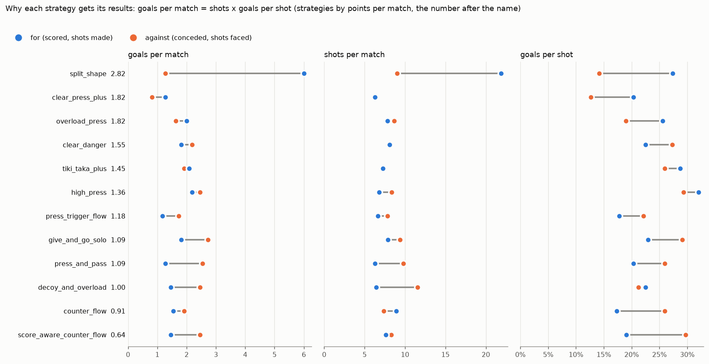
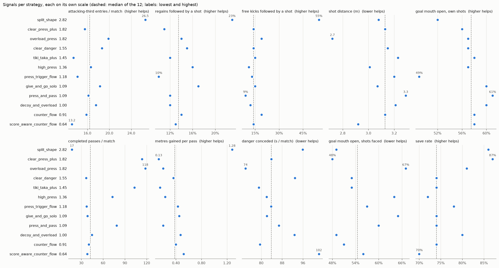
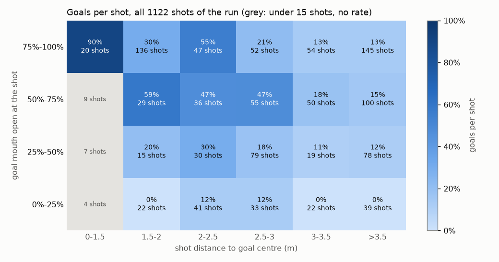
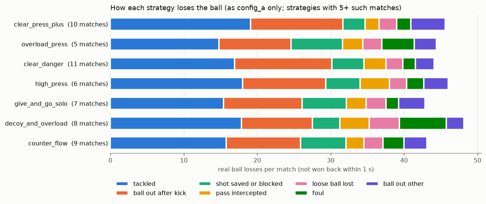
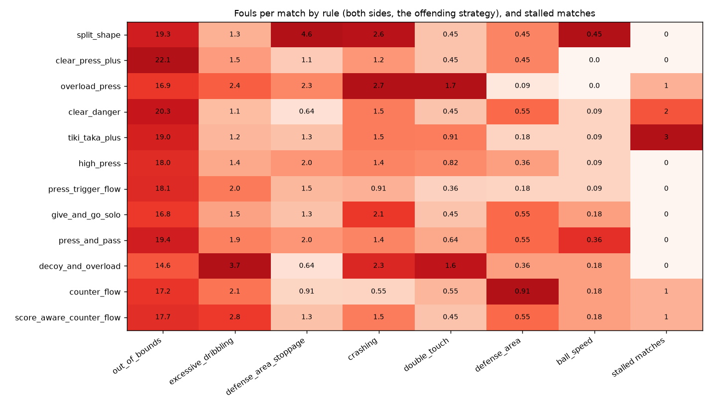
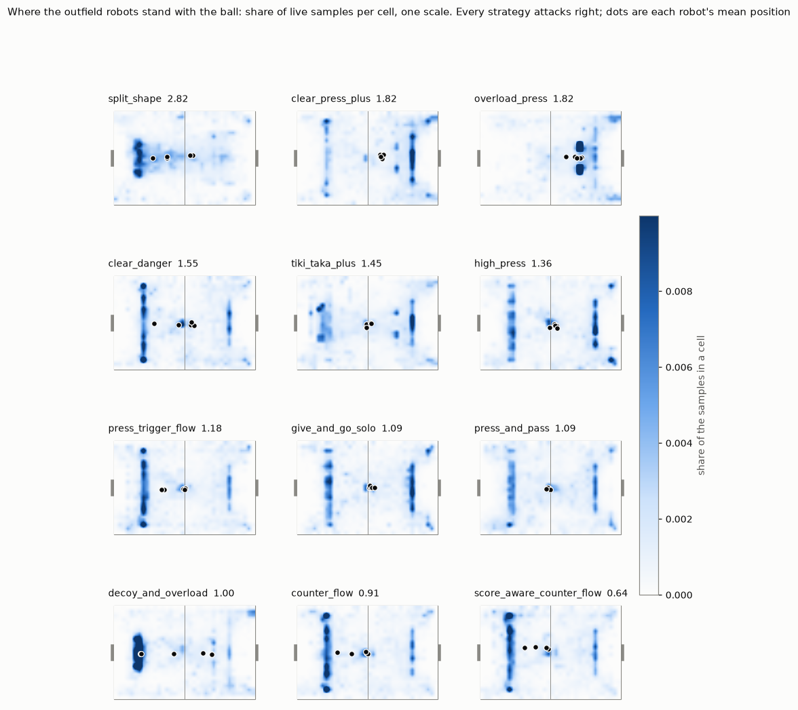
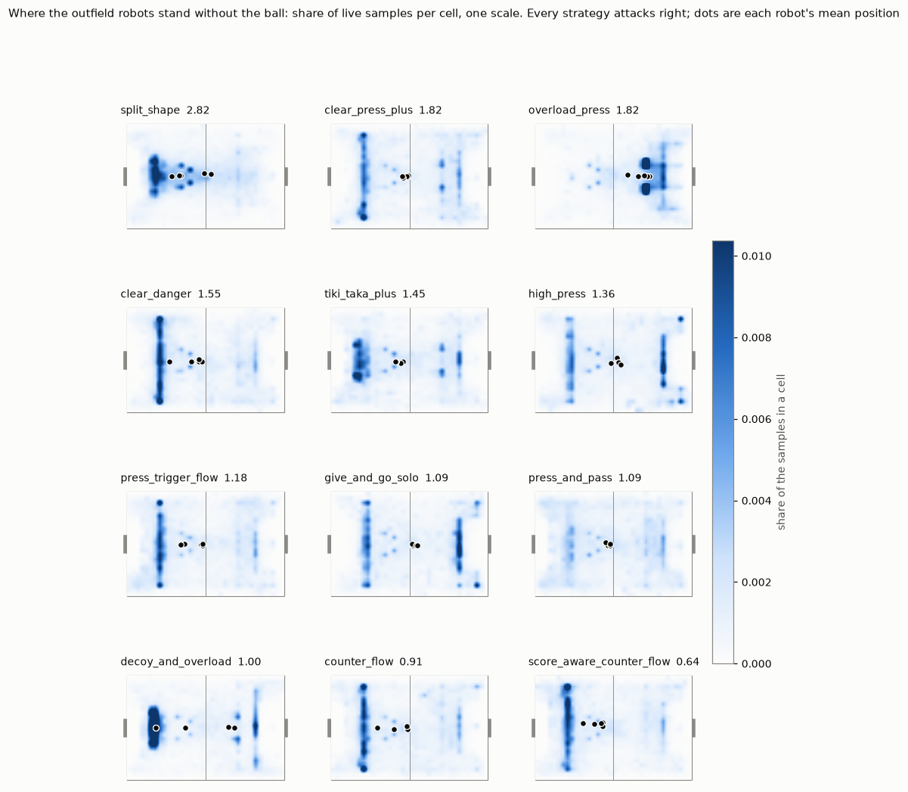
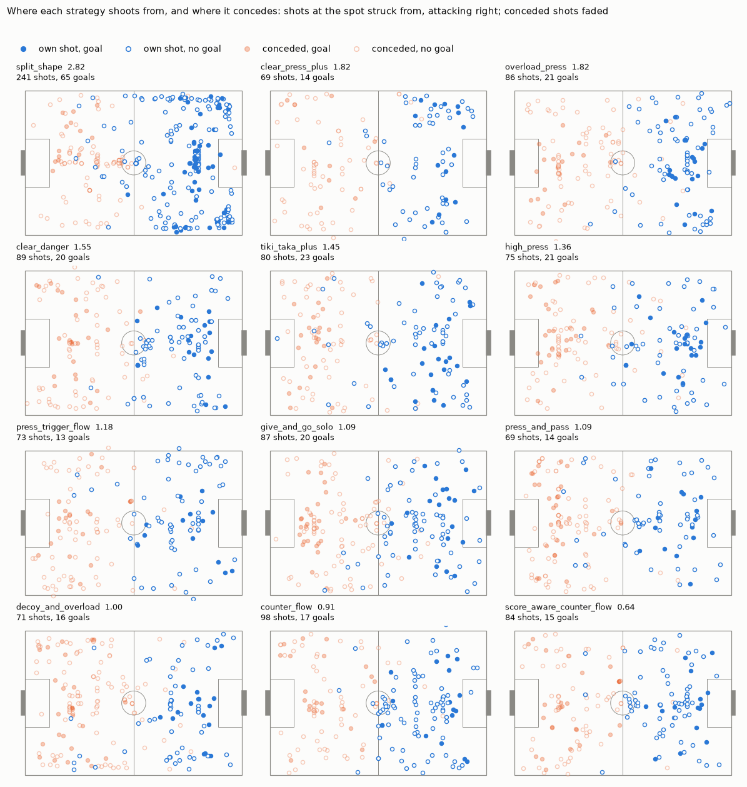
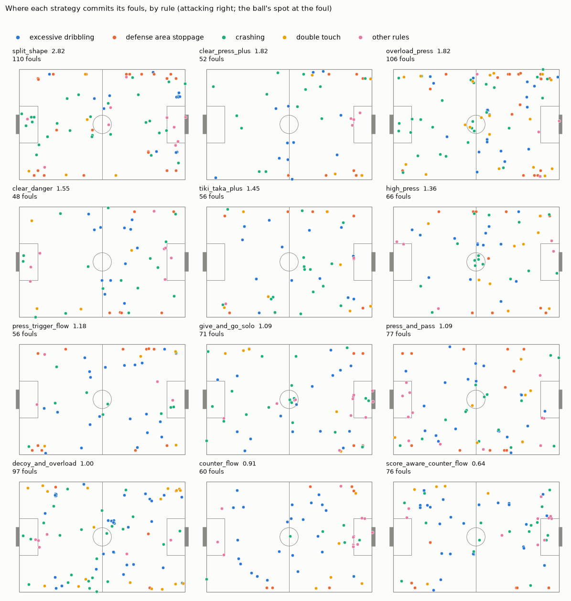

# Signal report

What each strategy does well and badly, from the signals in [`signals.md`](signals.md), drawn
from one round-robin. Standings are in [`strategies.md`](strategies.md); this shows why.

**Run:** `tournament_20261017_151052` (sim-realism-20261016 at `423f63a0`, the 12 non-retired
configs, 66 matches, sim noise `v3_seed2`). Regenerate the figures after a new full round-robin, then rewrite the notes:

    pixi run python tools/signal_report.py replays/tournament_<id>

Signals explain results; none is a target. A red cell is a place to look, not a thing to tune
away.

## Why each strategy gets its results

Goals per match are shots per match times goals per shot, so the three panels say whether a
strategy wins on how many shots it gets or on how good they are. Blue is the strategy's own,
orange the opponent's.

- **`split_shape` wins on both**: 21.9 shots to 9.0 faced, and 27% of its shots score against
  14% of the shots it faces.
- **`clear_press_plus` wins on quality alone**: as many shots as it faces (6.3 and 6.5), but
  only 13% of the shots against it score, the fewest of all.
- **`counter_flow` loses on quality**: it outshoots its opponents (8.9 to 7.4) but scores with
  17% of its shots, the worst, and concedes with 26%.
- **`decoy_and_overload` faces the most shots** (11.5 a match) and is outshot by 5.
- **`high_press` plays the most open games**: 32% of its shots score and 29% of those it faces.
- **`score_aware_counter_flow` is last on defense**: 30% of the shots it faces score.

## The signals behind it

Each panel is one signal on its own scale; every strategy is a dot, in the same order as above,
and the dashed line is the median. Only the lowest and highest values are printed: all of them
are in the table at the end.

- `split_shape` is far ahead in attack: 26.5 entries to the attacking third, a shot after 23% of
  its regains and 55% of its free kicks, 1.28 m gained per pass from the fewest passes (17).
- `clear_press_plus` and `split_shape` face the least open shots (48–49% of the goal mouth) and
  save 86–87%: the defense in front of the keeper blocks the lane. `overload_press` concedes
  the least danger (74 s) but faces the most open shots (67%).
- `clear_press_plus`, `overload_press` and `tiki_taka_plus` pass the most (100–118 a match)
  for the least ground (0.13–0.20 m a pass).

## What makes a shot score

All 1122 shots of the run; cells under 15 shots are grey, with no rate. With three quarters of
the goal open, 90% score inside 1.5 m and 13% past 3 m; with under a quarter open, at most 12%
do. So shot distance and open goal mouth measure chance quality, and a strategy's conversion
follows from where it shoots, not from luck. Every shot here is already on target
(`MatchStats`' detector), which is why the rates are high.

## How each strategy loses the ball

Real ball losses per match (not won back within 1 s). They are measured for config_a only, so
strategies with fewer than 5 matches as config_a are left out; in a round-robin config_a is the
earlier name, which leaves out `split_shape`, `tiki_taka_plus`, `press_and_pass`,
`press_trigger_flow` and `score_aware_counter_flow`.

- Being tackled (15–19 a match) and kicking the ball out (10–13) are the largest losses for
  everyone shown.
- `decoy_and_overload` loses the most to fouls (about 6 a match), the excessive dribbling and
  double touches below.

## Fouls and stalls

Fouls per match by the offending strategy, by rule; the ball going out of play is not a foul and
has its own panel. Each stall counts for both teams in the match.

- `split_shape` commits the most (about 10 a match), half of them stopping play in the defense
  area (4.6).
- `decoy_and_overload` dribbles too far most (3.7); it and `overload_press` run
  `DecoyOverloadTactic` and double-touch most (1.6 and 1.7): the lure lets the ball go and
  touches it again.
- The ball goes out 15–22 times a match for every strategy; most for `clear_press_plus` and
  `clear_danger`, the two with a clearance valve.

## On the pitch

Drawn by `tools/pitch_maps.py` from the same run (`pixi run python tools/pitch_maps.py replays/tournament_<id>`,
about 3 minutes). Every panel attacks to the right: the strategy's own goal is on the left, and a
team that attacks left is turned 180 degrees, so its left wing is the top of its panel too.
Live play only. "With the ball" means the team's nearest robot is within reach of the ball and the
ball is slow, the same radius `MatchStats` uses for possession.

Share of the live samples per cell, one scale for every panel; the five dots are each robot's mean
position (the goalkeeper is left out).

- `overload_press` is the most forward. 83% of its samples with the ball are in the attacking half,
  and only 17% of its samples without it are in its own half. Its robots stack about 2 m into the
  attacking half (the dark block in its panel).
- `split_shape` builds from deep: 37% of its samples with the ball are in the attacking half, yet
  72% of its shots are struck from the attacking third (below).

The same robots while the opponent has the ball.

- `split_shape` and `score_aware_counter_flow` sit deepest: 68% and 69% of their samples without the
  ball are in their own half, against 17% for `overload_press`.
- In most panels a vertical stripe stands about 2.7 m in front of the strategy's own goal, in both
  figures: robots that hold one line in their own half whether or not they have the ball.

Every shot at the spot it was struck from: filled if it scored, hollow if not. Conceded shots are at
the other end, faded. The counts are shots and goals per strategy over the run.

- `split_shape` takes the most shots (241, 22 a match, 65 goals). Its own shots are spread across the
  attacking half, and its conceded shots sit on the left.
- `decoy_and_overload` faces the most shots (127, 11.5 a match) and `clear_press_plus` the fewest (71,
  6.5 a match); the faded conceded shots of `decoy_and_overload` fill the left half of its panel.

Each foul at the ball's spot. The four most common rules in the run have their own colours and the
rest are "other rules"; ball out of play is not a foul.

- `score_aware_counter_flow` commits the largest share in its own defensive third (41% of its fouls),
  and `clear_press_plus` the smallest (12%); the script prints these shares.
- Excessive dribbling (blue) and crashing (green) are spread across the pitch in most panels.

## The numbers

Every value in the figures, one row per strategy, by points per match.

| strategy | points / match | GF | GA | shots | shots faced | goals / shot | conceded / shot faced | attacking-third entries / match | regains followed by a shot | free kicks followed by a shot | shot distance (m) | goal mouth open, own shots | completed passes / match | metres gained per pass | danger conceded (s / match) | goal mouth open, shots faced | save rate |
|---|---|---|---|---|---|---|---|---|---|---|---|---|---|---|---|---|---|
| `split_shape` | 2.82 | 6.0 | 1.3 | 21.9 | 9.0 | 27% | 14% | 26.5 | 23% | 55% | 3.1 | 52% | 17 | 1.28 | 96 | 49% | 86% |
| `clear_press_plus` | 1.82 | 1.3 | 0.8 | 6.3 | 6.5 | 20% | 13% | 15.5 | 11% | 14% | 3.1 | 56% | 114 | 0.13 | 84 | 48% | 87% |
| `overload_press` | 1.82 | 2.0 | 1.6 | 7.8 | 8.6 | 26% | 19% | 19.8 | 14% | 19% | 2.7 | 57% | 118 | 0.20 | 74 | 67% | 81% |
| `clear_danger` | 1.55 | 1.8 | 2.2 | 8.1 | 8.0 | 22% | 27% | 18.6 | 15% | 14% | 3.1 | 57% | 37 | 0.36 | 93 | 53% | 74% |
| `tiki_taka_plus` | 1.45 | 2.1 | 1.9 | 7.3 | 7.4 | 29% | 26% | 13.5 | 12% | 15% | 3.2 | 58% | 103 | 0.15 | 79 | 53% | 74% |
| `high_press` | 1.36 | 2.2 | 2.5 | 6.8 | 8.4 | 32% | 29% | 16.6 | 16% | 11% | 3.0 | 57% | 73 | 0.23 | 82 | 64% | 72% |
| `press_trigger_flow` | 1.18 | 1.2 | 1.7 | 6.6 | 7.8 | 18% | 22% | 14.2 | 10% | 13% | 3.2 | 49% | 37 | 0.43 | 84 | 57% | 78% |
| `give_and_go_solo` | 1.09 | 1.8 | 2.7 | 7.9 | 9.4 | 23% | 29% | 18.3 | 17% | 15% | 3.1 | 60% | 39 | 0.45 | 82 | 65% | 74% |
| `press_and_pass` | 1.09 | 1.3 | 2.5 | 6.3 | 9.8 | 20% | 26% | 16.2 | 12% | 9% | 3.3 | 61% | 79 | 0.20 | 87 | 60% | 74% |
| `decoy_and_overload` | 1.00 | 1.5 | 2.5 | 6.5 | 11.5 | 23% | 21% | 17.5 | 12% | 12% | 3.2 | 60% | 45 | 0.47 | 93 | 49% | 80% |
| `counter_flow` | 0.91 | 1.5 | 1.9 | 8.9 | 7.4 | 17% | 26% | 15.8 | 14% | 19% | 3.1 | 58% | 40 | 0.40 | 80 | 51% | 74% |
| `score_aware_counter_flow` | 0.64 | 1.5 | 2.5 | 7.6 | 8.3 | 19% | 30% | 13.2 | 13% | 14% | 2.9 | 58% | 38 | 0.52 | 102 | 56% | 70% |
