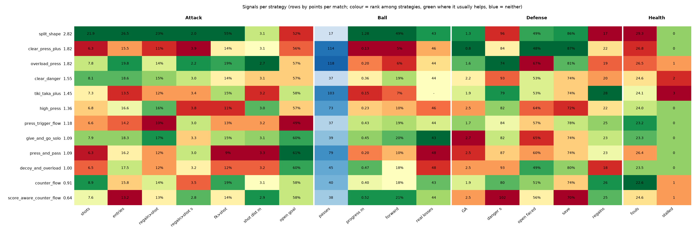
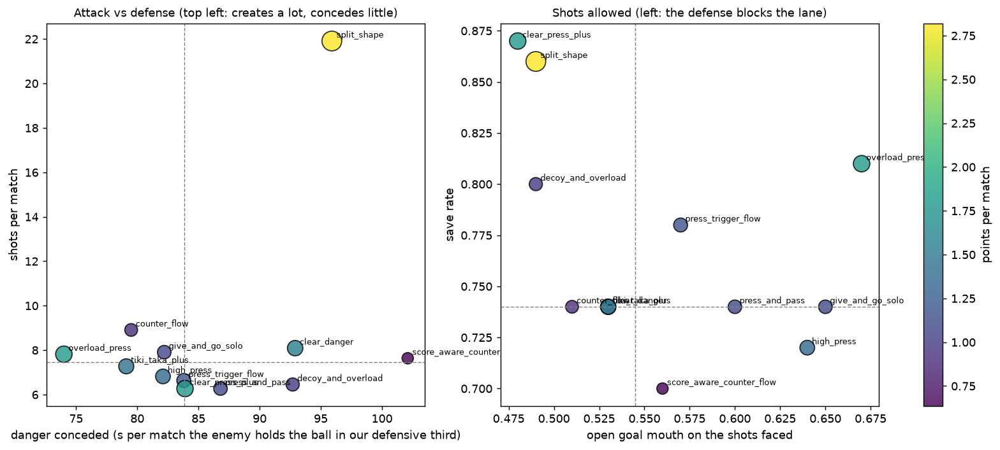

# Signal report

What each strategy does well and badly, from the signals in [`signals.md`](signals.md), drawn
from one round-robin. Standings are in [`strategies.md`](strategies.md); this shows why.

**Run:** `tournament_20261017_151052` (sim-realism-20261016 at `423f63a0`, the 12 non-retired
configs, 66 matches, sim noise `v3_seed2`). Regenerate the figures after a new full round-robin, then rewrite the notes:

    pixi run python tools/signal_report.py replays/tournament_<id>

Signals explain results; none is a target. A red cell is a place to look, not a thing to tune
away.

## Every strategy at a glance

Rows by points per match (the number after each name). Each column is coloured by rank among the
12 strategies, green where the value usually helps; passes are blue because more is neither
better nor worse. The printed number is the real value: per match, or a share.

- **`split_shape` is green across attack**: most shots (21.9) and entries (26.5), a shot after
  23% of its regains (2.0 s on average) and after 55% of its free kicks, 1.28 m gained per pass
  from the fewest passes (17), 49% forward. It also concedes least but one (1.3), saving 86% of
  the shots it faces; it commits the most fouls (29.3).
- **`clear_press_plus` is second by defending**: the fewest goals against (0.8), the shots it
  faces the least open (48%) and 87% saved. It barely moves the ball: 114 passes of 0.13 m, 5%
  forward, 6.3 shots.
- **`overload_press` concedes the least danger (74 s) but the most open shots (67%)**, and passes
  most (118) for 0.20 m each.
- **The pressers leave the lane open**: `high_press`, `give_and_go_solo` and `press_and_pass`
  face 60–65% open shots and save 72–74%; `give_and_go_solo` concedes the most (2.7).
- **`score_aware_counter_flow` is last on defense**: the most danger conceded (102 s) and the
  lowest save rate (70%).

## Attack against defense

Left: shots created against seconds the enemy holds the ball in the strategy's defensive third.
Only `split_shape` creates far more than the rest (22 a match; the others 6–9). `overload_press`
concedes the least danger, `score_aware_counter_flow` the most.

Right: how open the shots a strategy faces are, against its save rate. Every strategy fields the
same keeper, so this is the defense in front of it. `clear_press_plus` and `split_shape` are top
left: the lane is blocked (48–49%) and the keeper saves 86–87%. `high_press`, `give_and_go_solo`
and `press_and_pass` are bottom right. `overload_press` faces the most open shots (67%) yet saves
81%.

## What makes a shot score

All 1122 shots of the run. Inside 1.5 m with three quarters of the goal open, 90% score (20
shots); with under a quarter open, at most 25% do at any distance and none past 3 m; past 3 m,
even with the goal open, 13%. So shot distance and open goal mouth measure chance quality, and a
strategy's conversion follows from where it shoots, not from luck. Every shot here is already on
target (`MatchStats`' detector), which is why the rates are high.

## How each strategy loses the ball

Real ball losses per match (not won back within 1 s), measured as config_a only: `n` is how many
matches that is. In a round-robin config_a is the earlier name, so `split_shape` (1),
`score_aware_counter_flow` (2) and `press_trigger_flow` (3) rest on very little, and
`tiki_taka_plus` has none.

- **Being tackled and kicking the ball out are the largest losses**, about 15–20 and 10–13 a
  match: carrying into pressure, and passes and clearances that leave the pitch.
- `split_shape` (one match) loses the ball mostly to saved or blocked shots, a cost of shooting
  most.

## Fouls and stalls

Fouls per match by the offending strategy, colour scaled per column, and the stalled matches it
played in (each stall counts for both teams). 4 matches stalled: see [`strategies.md`](strategies.md).

- Out of bounds is the most common foul everywhere (14.6–22.1); `clear_press_plus` (22.1) and
  `clear_danger` (20.3), the two with a clearance valve, lead.
- `decoy_and_overload` (3.7) dribbles too far most; it and `overload_press` run
  `DecoyOverloadTactic`, and they also double-touch most (1.6 and 1.7): the lure lets the ball go
  and touches it again.
- `overload_press` (2.7) and `split_shape` (2.6) crash into robots most; `split_shape` also
  stops play in the defense area most (4.6), and `counter_flow` enters it most (0.91).
