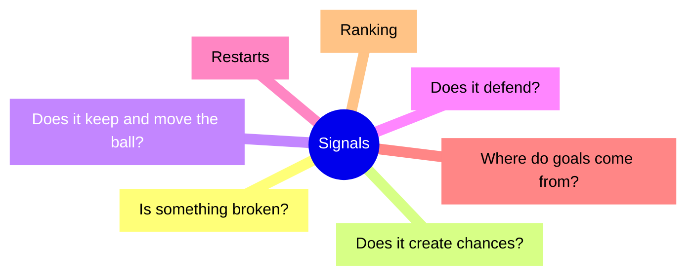
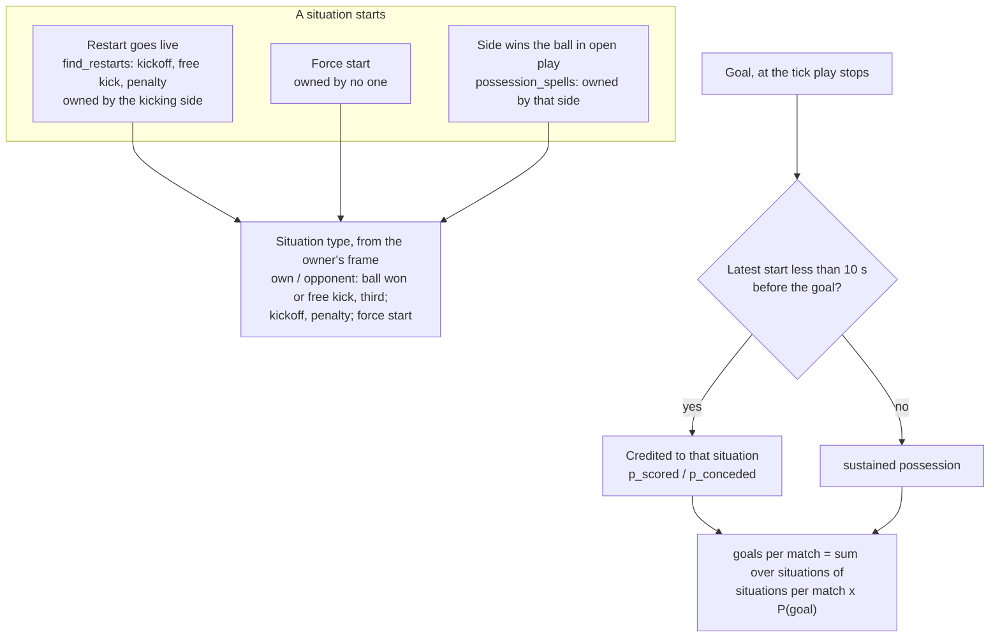
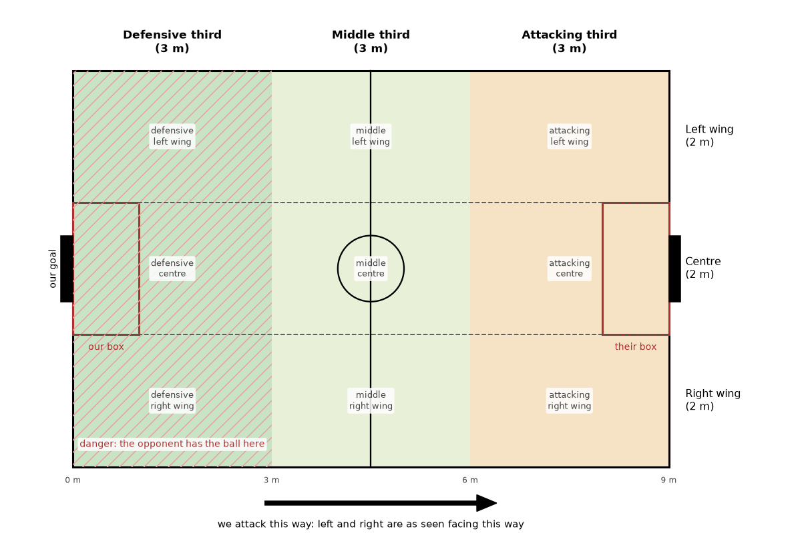

# Signals

Every signal we record about how a strategy plays, grouped by the question it answers. Use it
when designing or debugging a strategy: find the question, read the signal, compare with the
reference range, and follow "if it's off". Add a signal here when you add one anywhere else.

*Strategy names:* results here were recorded before the 2026-11-12 renames and use the old names
(`split_shape` is now `pendulum`, ...); the old name is under each strategy's name on the dashboard (`RENAMED` in `utama_core/strategy/catalog.py`).

Signals are diagnostics, not objectives: use them to explain a result, to find what a strategy
does badly, and to notice a shared primitive (reception, carrying, the planner, the referee)
failing every strategy at once. A strategy that never passes or shoots loses the ball least, so
no signal is "better" on its own. Ranking uses goals alone: see [Ranking](#ranking).

The sections below group the signals by the question each one answers; this map shows the groups.

## Ranking

Strategies are ranked by goals only, through ratings fitted on match margins
(`tools/evaluation/evaluate.py`; `docs/strategy.md`, "Evaluating a strategy").
Signals explain a result; none of them ranks or is a search objective.

Tested and rejected as rankers (2026-10-17, two noisy round-robins of the same 12 strategies with
different seeds, `tournament_20261016_201213` and `tournament_20261017_002337`; scripts in
`~/dev/ssl/eval-infra/` and `~/dev/ssl/xg-analysis/metrics_quick/`). Those scripts were one-off
analysis scripts kept outside the repo; the data they used are the two round-robins above and the
match results store (`replays/match_results/`).

- **Shots on target.** Within one run, strengths from shots predicted held-out matches about as
  well as goals; across runs, goal strengths from run 1 predicted run 2's goal strengths better
  (rank correlation 0.57) than shot strengths did (0.37), leaving out pendulum, whose margin
  swung from +1.5 to +4.9 between seeds and dominates any correlation that includes it.
- **xG** (real-data model, `analysis/realism/xg.py`): sim keepers save twice as often as real
  ones, so it misjudges sim strategies by how they shoot.
- **Possession, completed passes, possession under pressure**: consistent between runs but
  predict *losing* in this pool. Territory and attacking-third entries predict nothing.
- **Weighted combinations** of match stats: the weights depend on the strategy pool they are
  fitted on, so a new strategy's score would depend on unrelated strategies.
- **A value model** of the game state (in git history: `docs/sim_realism.md`): no more reliable than goals.

## Where they come from

Every `tools/evaluation/evaluate.py` run prints round 1's sections and writes each round's data to
`replays/eval_<id>/round_<k>/summary.json` (round 1's also in `report.json`; older round-robins:
`replays/tournament_<id>/summary.json`, which also had `standings` and `ratings`; evaluate.py has neither):

| Printed section | `summary.json` key | Computed by |
|---|---|---|
| STRATEGIES | `strategies[*]` | `MatchStats` (live, every match) |
| LOSS KINDS, BALL LOSSES, `passes:` line | `strategies[*].real_loss_kinds_as_a`, `ball_losses` (tables in `ball_losses.md`) | `analysis/turnover_breakdown.py` |
| CHANCES | `strategies[*].chances`, `pass_progress_m`, `forward_pass_share` | `analysis/chances.py` |
| FOULS | `fouls` | `MatchStats` |
| STALLS | `stall_incidents`, `stalls_checked` (matches each strategy was checked in, as config_a), per-match `stats.stall_events` | `MatchStats` stall watchdog |
| RESTARTS | `restarts` | `analysis/restart_outcomes.py` |
| — | `results[*].stats` | per-match `MatchStats`, everything above per match |
| — | `run` | git commit, dirty flag, argv: compare runs only at clean commits |

**Offline only** (not in `evaluate.py`'s output): `python -m utama_core.analysis.goal_sources <run_dir>`
writes the goal sources
([Where do goals come from?](#where-do-goals-come-from)).

**Sides.** Per-match stats are config_a's view ("friendly"); a strategy's row reads its own
side of every match. Signals marked *config_a* need the intentions log, which only config_a
writes, so they cover the matches a strategy played as config_a (`matches_as_a`).

**Reference ranges** are per match over the 22 strategies of `tournament_20261005_170958`
(600 s matches, strategy-guard at `b26f5b37`): min · median · max, with who holds the extremes.
They show what normal looks like now; they move as strategies and shared code change.

## Is something broken?

Check these first: a broken strategy's other signals mean nothing.

| Signal | Where | Meaning | Reference | If it's off |
|---|---|---|---|---|
| Stalls | STALLS; `stats.stall_events` | `RESTART_STALL`: a restart held > 15 s, with a one-line diagnosis. `COMMITTED_FROZEN`: ball moved < 5 cm for > 10 s in live play while a slot was committed, with who holds the ball | 10 of 231 matches | A bug to fix before anything else. Restart it from its replay with `tools/debug/repro_from_replay.py`, look with `tools/debug/replay_trace.py` and `render_window()` |
| Possession backstop | `results[*].possession_backstop` | possession pinned 100/0 with the ball barely moving: a freeze the watchdog missed | 0 | Same as a stall |
| Restarts not taken | RESTARTS; `restarts.by_kind[*].outcomes` | a kickoff, free kick or penalty `voided`, `timeout`, `stopped_before_kick` instead of `taken` | free kicks: 3414 taken of 3467 | The taker can't reach or kick the ball: restart positioning, a planner clamp, a keep-out circle |
| Fouls by rule | FOULS; `fouls` | every foul by rule, then strategy/tactic of the offending robot | per strategy 6.3 (`chameleon`) · 7.9 · 23.3 (`three_slot`); run: out_of_bounds 2938, excessive_dribbling 448, defense_area 310, crashing 307 | One tactic dominating a rule is its bug: dribbling too far, entering the box, driving into robots |
| `no_progress` restarts | `results[*].stats.rule_event_counts` | the referee stopped play: nobody moved the ball for 10 s | 296 in the run | Two robots wedged on the ball, or a carrier holding without a pass |

## Does it create chances?

| Signal | Where | Meaning | Reference | If it's off |
|---|---|---|---|---|
| Shots | STRATEGIES `shots`; `chances.shots` | hard balls from the attacking third heading into the goal mouth (on target by construction) | 1.4 (`three_slot`) · 6.1 · 11.2 (`pendulum`) | Few shots with many entries: attacks stall in the final third |
| Attacking-third entries | STRATEGIES `entries` | times the ball crossed into the attacking third | 6.6 (`shadow_switch`) · 11.9 · 17.2 (`pendulum`) | Few: the build-up never reaches the final third |
| Regain to shot | CHANCES `regain>shot`, `secs`; `chances.regain_to_shot`, `regain_to_shot_s` | share of open-play regains (kept ≥ 1 s, not just after a restart) followed by a shot within 10 s, and how fast | 1% (`shadow_switch`) · 9% · 28% (`pendulum`); 2.0 s · 4.4 · 9.3 | Low: winning the ball leads nowhere. Slow: too many passes before the shot |
| Free kick to shot | CHANCES `fk>shot`; `chances.free_kick_to_shot`, `attacking_free_kick_to_shot` | share of the side's free kicks (corner and goal kicks included) followed by a shot within 10 s | 0% (`three_slot`) · 12% · 38% (`pendulum`) | Low in the attacking third: set pieces are wasted |
| Shot distance | CHANCES `dist`; `chances.shot_distance_m` | metres from the goal centre where the shooting side last held the ball | 2.2 · 2.5 · 3.0 m | Far: shooting because nothing better was found |
| Open goal mouth | CHANCES `open`; `chances.shot_open_goal` | share of the goal mouth no opponent blocked at the shot. Tops out near 75%, the keeper always covers some | 43% · 50% · 68% | Low: shooting into bodies; the attack never opens a lane |
| Conversion | CHANCES `conv`; `chances.conversion` | goals per shot. High for everyone, since a shot is already on target | 21% · 35% · 60% | Read with distance and open goal, not alone |
| Goals without a shot | `chances.unshot_goals` | goals no detected shot preceded: deflections, slow rolls, scrambles | 73 of 1068 goals | Many: goals by accident, not by design |

## Does it keep and move the ball?

| Signal | Where | Meaning | Reference | If it's off |
|---|---|---|---|---|
| Completed passes | STRATEGIES `passes` | passes from one teammate's control to another's | 15 (`pendulum`) · 38 · 61 (`avalanche`) | Many passes with few shots: circulation without progress |
| Pass progress | CHANCES `progress`, `fwd`; `pass_progress_m`, `forward_pass_share` | mean metres gained toward goal per completed pass, and the share gaining ≥ 1 m | 0.3 (`avalanche`) · 0.65 · 1.7 m (`pendulum`); 10% · 23% · 56% | Near 0: sideways passing. Fine if the strategy wins by regaining instead |
| Pass outcomes, catch rate *(config_a)* | `passes:` line; `ball_losses.receptions` | every pass followed to `received` / `missed_reception` (reached a teammate, no contact) / `intercepted` / `off_target`; catch rate of reachable passes, by receiver facing and by tactic | run: 79% caught; 96% when the receiver faces the ball within 10° | Low catch rate: reception or passing into a turned receiver. ±4–8 points between runs is noise |
| Real ball losses *(config_a)* | LOSS KINDS; `real_losses_as_a`, `real_loss_kinds_as_a` | losses not won back within 1 s, by kind: `tackled`, `ball_out_after_kick`, `shot_saved_or_blocked`, `pass_intercepted`, `loose_ball_lost`, `foul`, `ball_out_other` | total 25 (`weaver`) · 34.5 · 42.7 (`three_slot`); tackled 2 · 12.3 · 23.8 | The dominant kind names the fix: tackled (carrying into pressure), kicked out (aim), intercepted (pass choice) |
| Losses by tactic *(config_a)* | BALL LOSSES; `ball_losses.by_tactic`, `ball_losses.md` | which tactic held the ball when it was lost | — | One tactic with most losses is where to look |
| Possession under pressure | `results[*].stats.possession_under_pressure_s` | seconds the side's ball holder had an opponent within 0.5 m | — | High: carrying into opponents |

## Does it defend?

| Signal | Where | Meaning | Reference | If it's off |
|---|---|---|---|---|
| Goals against | STRATEGIES `GA` | | 23 (`pendulum`) · 40 · 122 (`shadow_switch`) per 21 matches | |
| Danger conceded | CHANCES `danger`; `chances.danger_s_per_match`, `danger_spells_per_match` | seconds the enemy had possession (its passes and shots in flight included) with the ball in the side's defensive third in live play, and how many separate spells | 50 (`avalanche`) · 78 · 167 s (`high_line_zone`) | High: the defense doesn't win the ball back near its goal or lets the enemy settle there. One stalled match can add hundreds of seconds |
| Shots faced, open goal faced | `chances.shots_faced`, `faced_open_goal` | the enemy's shots and how open they were | open 37% · 49% · 66% (`ricochet`) | Open shots faced: nobody blocks the lane; usually everyone is upfield |
| Save rate | CHANCES `save`; `chances.save_rate` | 1 - goals from shots / shots faced. Every strategy fields the same keeper, so this measures the shots the defense allows | 49% (`wolfpack`) · 64% · 74% (`pendulum`) | Low: see open goal faced |
| Regains | `chances.regains` | open-play regains kept ≥ 1 s | 16 (`shadow_switch`) · 25 · 29 (`wolfpack`) | Few: the press or the marking doesn't win the ball |

## Restarts

| Signal | Where | Meaning | Reference | If it's off |
|---|---|---|---|---|
| Free kick to shot | see "Does it create chances?" | | | |
| Restart to first entry | `results[*].stats.restart_to_first_entry_s`, `n_restarts`, `n_restarts_with_entry` | seconds from a restart until the possessing side's ball reaches its attacking third; restarts with no entry are counted, not averaged | — | Slow or rarely entering: restarts are played backward or lost |
| Restart outcomes | RESTARTS | see "Is something broken?" | | |

## Where do goals come from?

The goal sources (`analysis/goal_sources.py`, *offline*) gives every goal to the situation that
started the play it ended, if that was less than 10 s before: a restart going live (kickoff,
free kick, penalty, force start) or a side winning the ball in open play, each named from the
strategy's side ("own" / "opponent") with the third in the owner's attack frame. Goals with no
start that recent are "sustained possession". A strategy's goals per match is then exactly the
sum over situations of situations per match × P(goal), for goals scored and conceded alike: a
result splits into which situations a strategy creates or allows, and how well it converts or
defends them. It reads only the replay and its referee file, so it runs on converted official
logs too. The rules are in the module's docstring. `--rates PATH` writes how often each
situation happens per team per live minute, whoever owns it (the scenario bench, retired
2026-10-17, used these as its weights).

How a goal is credited (`analysis/goal_sources.py`; `WINDOW_S` = 10 s):

Reference: `split_shape` in `tournament_20261011_230119` (17 matches; 6.76 scored, 4.41
conceded per match).

| Signal | Where | Meaning | Reference | If it's off |
|---|---|---|---|---|
| Situations per match | `goal_sources.json` `strategies[*].types[*].situations_per_match` | how often each situation happens in a strategy's matches | own free kicks in the attacking third 6.7, the opponent's 6.2; balls won in the attacking third: own 3.4, opponent's 3.6; in the defensive third ~19 each | Many "opponent ball won, attacking third": losing the ball near our own goal (build-up). Many opponent free kicks in the attacking third: fouls and clearances out near our goal |
| P(goal) per situation | `p_scored`, `p_conceded` | share of a situation's occurrences followed by a goal before the next situation starts, within 10 s | scored: own penalty 88%, own ball won in the attacking third 47%, own free kick in the attacking third 28%; conceded: opponent penalty 100%, opponent free kick in the attacking third 20%, opponent ball won in the attacking third 20% | High P(conceded) from opponent free kicks: set-piece defence (wall, marking). High from balls the opponent wins high: nobody covers behind the press |
| Goals per match by situation | `scored_per_match`, `conceded_per_match` | situations per match × P(goal); the column sums to goals per match | conceded 4.41 = opponent balls won 1.41 + free kicks 1.35 + penalties 0.76 + sustained possession 0.71 + kickoffs 0.18 | The largest row is where a fix pays most |

## Adding a signal

Check this page first: it probably exists. A new signal should be interpretable on its own,
in game terms, and say what to do when it's off; correlation with results is not required.
Put it where it's cheapest:

- a count the match can keep as it plays: `MatchStats` (`engine/match_stats.py`). Changing it
  changes every match's fingerprint, so the next evaluation plays everything again;
- anything else derived from replays, both sides: `ChanceTracker` (`analysis/chances.py`), fed
  from the replay pass the ball-loss breakdown already makes. Cached records keep the analysis
  they were stored with: delete the store to refresh them (`utama_core/replay/match_results.py`);
- needing the intentions log (which tactic, which robot's role): `analysis/turnover_breakdown.py`,
  config_a only.

Then add its row here with a reference range from a full round robin (`evaluate.py --all`).

## Pitch zones

Names for the parts of the pitch, so that people, agents, docs and code mean the same place.
Every zone is defined from one team's point of view: "defensive" is near that team's own goal,
"left" is on its left as it faces the goal it attacks. Measurements are for the standard 9 × 6 m
field (`STANDARD_FIELD_DIMS`).

(Drawn by `docs/img/pitch_zones/make_pitch_zones.py`.)

### Along the pitch: thirds

| Name | Where | In code |
|---|---|---|
| **Defensive third** | the 3 m nearest our own goal line | `ball_zone()` returns `"own"`; `MatchStats` robot zone time `"defensive"` |
| **Middle third** | 3 to 6 m from our goal line, either side of halfway | `"mid"` in both |
| **Attacking third** | the 3 m nearest the goal we attack | `ball_zone()` returns `"final"`; `MatchStats` `"attacking"`, `attacking_third_entries` |

Each third is a third of the pitch length, measured from our own goal line toward the goal we
attack. On the standard field the boundaries are at |x| = 1.5 m. Say "defensive" and
"attacking" rather than "own" and "final"; the code's `own`/`final` are older spellings of the
same thirds.

**Our half / their half**: either side of the halfway line.

### Across the pitch: wings and centre

| Name | Where |
|---|---|
| **Left wing** | the 2 m strip along the touch line on our left as we attack |
| **Centre** | the 2 m strip down the middle, as wide as the box, so it runs straight at both goals |
| **Right wing** | the 2 m strip along the touch line on our right |

The centre is |y| ≤ 1 m (the box's half width). Left and right turn with the team: for a team
attacking toward +x, its left wing is y > 1 m; for a team attacking toward −x (`my_team_is_right`),
its left wing is y < −1 m. So the two teams' left wings are on opposite touch lines.

No tactic uses the lanes yet; one that needs them should use these boundaries.

**Ball side / far side**: the wing the ball is on, and the wing opposite it. When the ball is in
the centre, neither applies. **Weak side** is not the same thing: in `SwitchOfPlayTactic`
(`_weak_side`) it is the half of the pitch, split at y = 0, with fewer opponents in it, wherever
the ball is.

### Cells

A third and a strip together name one of nine cells: "attacking left wing", "defensive centre".

### Areas the rules define

- **The box**: the defense area, 1 m deep and 2 m wide in front of each goal. At most one
  defender (the goalkeeper) may be inside its own box, and attackers may not enter the
  opponent's (`referee/rules/defense_area_rule.py`). "Our box" and "their box" are from
  the team's point of view. Code calls it the defense area (`FieldDimensions.right_defense_area`).
- **The goal**: 1 m wide.
- **The centre circle**: 0.5 m radius; it matters at kickoffs.

### Words with a fixed meaning

- **Danger**: the opponent has possession with the ball in our defensive third in live play.
  Possession is the team's: a pass between two opponents, or their shot, stays theirs until we
  touch the ball. The signal
  `danger_s` counts the seconds of it (`analysis/chances.py`; see [signals.md](signals.md)).
  Don't use "danger" for anything else.
- **Clearance condition**: when `ClearBallTactic` clears (`clear_ball.in_danger`): the ball within
  2.6 m of our goal line and an opponent within 1.2 m of it. It is narrower than danger; the function's
  name predates this doc.
- **Entry**: the ball crossing into a team's attacking third, whoever touched it last
  (`attacking_third_entries`). Once in, it has to come back 0.3 m behind the line before it can
  count again.
