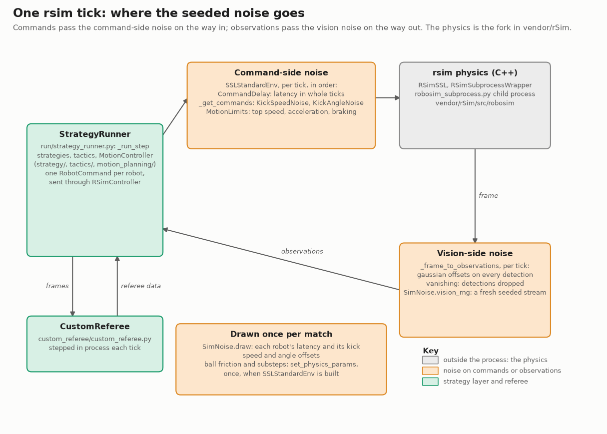

# Sim realism: closing the gap between rsim and real matches

Status: plan, 2026-10-14 (priorities added 2026-10-16; Phases 0-2 are built, 2026-10-16/17).
Nothing below is built yet unless it says so.

## Where this leads

The end goal is **search over the structured strategy space**: tactics, their parameters, and
the scheduler (partitioner) that combines them. Candidates are scored with a **dense value
signal** instead of goals alone. Three pieces, in priority order:

| Priority | Work | Why this order |
|---|---|---|
| P0 | Sim realism, Phases 0–3 below: scorecard, league ranges, seeded per-match physics draws, calibration | Search finds whatever wins in the sim. If the sim rewards an unrealistic detail (a perfect keeper, kicks that never miss), stronger search exploits it harder. The seeded draws are also the controlled-noise framework every later evaluation uses |
| P1 | [Value model fitted on real logs](#p1-value-model-on-real-data) | A model trained on sim outcomes learns the sim's errors. Fitted on real matches, it values situations the way real matches do. Safe to apply to sim strategies only once the sim varies over realistic ranges |
| P2 | [Structured search](#p2-structured-strategy-search) scored by the value model in the randomized sim | Needs both of the above |

A "novel" winner from search looks exactly like a sim exploit until checked. Every one gets
the per-strategy scorecard: an edge from parts the sim gets right (positioning, chance
creation) is kept; an edge from parts it gets wrong is suspect.

## Why

Strategies are developed and ranked in rsim. A ranking is only useful if a strategy that wins
in the sim would also win on a real field. That needs two things:

- **Sim physics in the right range.** The sim must not reward behaviour that only works
  because of an unrealistic detail, such as a perfect keeper or a perfectly accurate kick.
- **Robustness.** Real parameters drift (floor friction, kick speed as the capacitor drains,
  dribbler wear, one robot slower than another). A strategy must win across that drift, not
  at one tuned value.

The goal is therefore not a perfect replica of one real robot. It is a sim whose behaviour
matches real matches on the measures that decide goals, and that varies its physics over the
ranges real robots vary over.

We assume no measurements of our own robots for the next month. Ranges come from the official
match logs of other teams (see [Official logs](#what-the-official-logs-can-and-cannot-give)),
and are replaced by our own measurements once hardware tests are possible.

## What we found (2026-10-14)

Real: 54 official Division B matches from 2025–2026 (`tools/convert_ssl_log.py`). Sim: the
baseline round-robin `tournament_20261014_144456` (66 matches). An expected-goals (xG) model
was fitted on real shots. On held-out matches it ranks shots with AUC 0.82 and its predicted
rates agree with observed ones.

Goal attempts per live minute, their real xG and finishing (goals ÷ xG) each sit inside the
real 95% interval (pooled sim ÷ real: ×1.09, ×1.12, ×1.11). That agreement hides two
differences that cancel:

| Shots of equal quality (xG band) | Real | Sim |
|---|---|---|
| Saved by the keeper, all shots | 17% | 39% |
| Saved by the keeper, xG > 0.35 | 20% | 52% |
| Wide or off the post | 22% | 6% |
| Goal rate, xG < 0.05 | 2% | 14% |
| Goal rate, xG > 0.35 | 53% | 35% |

Sim keepers save far more good chances; sim shooters almost never miss.

Other differences:

- **Ball slow-down:** the sim ball keeps 57% of its speed by 1 m from goal; real balls keep 67%.
- **Kick speed:** every sim kick is 4.75 m/s; real kicks range from 3.9 to 5.5 m/s (interquartile).
- **Keeper position:** the sim keeper always stands on the goal line, 0.09 m deep; real keepers stand about 0.2 m out.
- **Shot count:** with passes and clearances counted, sim teams make 1.8× more goalward kicks than real teams.
- **Live time:** real matches have about 7.4 live minutes; the sim has about 9.1. Together with the slightly higher per-minute rates above, this is why sim matches have more goals per match.

Lesson: **never judge realism by goal totals.** They can match for the wrong reasons.
Compare the components, as in the [scorecard](#the-realism-scorecard).

## How one rsim tick is built

Where the sim noise is applied in one tick: commands go down through the seeded command-side
noise, and the observations come back through the seeded vision noise. The C++ physics is the
fork in `vendor/rSim` ([FORK_NOTES.md](../vendor/rSim/FORK_NOTES.md) covers the build).

Drawn by `docs/img/sim_realism/make_rsim_tick.py`; rerun it when a name in it changes.

## Parameters

Ordered by how much each one is likely to change match outcomes.

**Between** means the value differs per robot or per match (one robot's top speed, a field's
friction). **Within** means kick-to-kick noise for the same robot.

| Parameter | Why it matters | From official logs? | rsim today |
|---|---|---|---|
| Sensing-to-action latency (vision, decision, radio, motor response) | Likeliest cause of the keeper gap | Only as other teams' total reaction time: from a kick to their keeper accelerating; for our robots, `tools/robot_calibration.py` on a recorded field test (command sent to motion seen) | None: commands act on the next tick |
| Ball rolling deceleration (and the switch from sliding to rolling) | Pass and shot timing; keeper reaction time | Yes: fit free-rolling segments, per match (venue carpet) | Fixed in the C++ physics (`vendor/rSim`) |
| Kick speed: between and within | How much time the keeper has; pass weight | Yes: peak ball speed after each kick, per team | Fixed |
| Kick direction error | Wide rate (6% vs 22%) | Partly: shot miss distance, pass error relative to the receiver | None: exact |
| Robot top speed, acceleration, braking, turn rate | Who reaches the ball first | Yes: from the tracker, per robot | One limit for all robots (2 m/s for evaluation) |
| Vision noise and dropped frames (ball especially, also when blocked) | Every decision; keeper tracking | Yes from raw vision packets in the logs; the converter currently reads the filtered tracker | Yes: `SimNoise` (`--sim-noise`, the pool's `sim_noise`) in `run_match`, the round-robin and `evaluate.py`; `rsim_noise` and `rsim_vanishing` in `StrategyRunner` are its older form |
| Dribbler: hold strength, ball loss when turning or touched, release speed | Possession, passing | Weak: only possession-loss rates as a proxy | Fixed, with the fork's dribbler fixes (`vendor/rSim/FORK_NOTES.md`) |
| Ball bounce off robots and walls | Rebounds, deflections | Partly: speed before and after contact | Fixed |
| Robots fielded per team | Defenders in the way of each shot (real 4.5 on average, sim always 6) | Yes: robots on the field in live play, per match | Always 6 |
| Robot breakdowns and lost commands | Gaps in defence and support | Partly: robots that stop mid-play. Lost radio commands only from our hardware | None |
| Stoppages: how often, and how long (ball placement, human-confirmed goals) | Game flow: set pieces vs continuous pressing | Yes: restarts and dead time per match (real 41.6 restarts, sim 25.4) | Our referee's rules and timings |

### What the official logs can and cannot give

- **They describe the league, not our robots.** That's still the right range for opponents, and
  a reasonable starting range for our own robots until we measure them. A strategy robust
  across the league's range is unlikely to break on ours.
- **Robots and ball come from an autoref's tracker**, which filters positions. Peaks
  (kick speed, acceleration) are smoothed, so tracker-based estimates are lower bounds. Raw
  camera detections are also in the logs, for vision noise.
- **Latency cannot be separated from decision time** for other teams. We get their total
  reaction time, which is what matters for keeper saves anyway.
- **Kick direction error needs an intended target**, which the logs don't record. Proxies are a
  shot's miss distance, and a pass's distance from the nearest teammate when it arrives.

## How varying parameters are handled in strategy development

**Domain randomization:** each parameter gets a range, and the sim draws from it.

1. **Between-values are drawn per match and per robot; within-noise per kick.** For example:
   - friction once per match;
   - a top speed and kick-speed mean per robot;
   - kick speed and direction noise on every kick.
2. **Draws come from the match seed.** They join the seeded vision noise already planned for
   the round-robin. When strategy A and strategy B each play the baseline,
   they see the same draws, so the comparison is paired and the extra randomness costs few
   extra matches.
3. **Ranges are measured, not guessed.** Use the spread of team-level medians for between-
   values, and each team's own spread for within-noise. Too narrow overfits to the sim; too wide
   rewards overcautious play.
4. **Randomize only what changes standings.** A sensitivity sweep decides which parameters
   are randomized; the rest stay fixed at the league median.
5. **Edge cases are a separate diagnostic, not part of the ranking.** Run candidates at the
   edges (slow robot, weak kick, worn dribbler) and report how far they fall.
6. **Prefer strategies that measure parameters over ones that assume them.** For example, a
   pass speed chosen from the kick speeds actually observed. The sim then checks that the code
   copes with the whole range.

## The realism scorecard

One report that compares sim with real on the components that decide goals. Each row is a
real value with a 95% interval, the sim value, and a pass mark (sim inside the real
interval):

- shots per team per live minute (passes and kicks from beyond 6 m excluded);
- real xG per shot;
- finishing (goals ÷ real xG), overall and in each xG band;
- shot outcome shares: keeper, defender, wide or post, goal;
- ball speed kept to 1 m from the goal;
- kick speed: median and spread;
- keeper depth and keeper reaction time;
- live minutes per match and restarts per match (referee-driven, so they are checked but not targeted).

Real values are recomputed when new logs are converted. The sim side reruns on any
round-robin.

## Plan

Each phase ends with a checkpoint: results reported, decision taken, then the next phase
starts. Evaluation changes and strategy changes go in separate commits.

### Phase 0: Bring the analysis into the repo (2–3 days) — done 2026-10-16

`pixi run python tools/realism_scorecard.py` (see `docs/tools.md`); package
`utama_core/analysis/realism/`, real reference `real_2025_2026.json`. On the baseline it
reproduces the outcome numbers above. Rows failing on the baseline: goal rate in every xG
band, keeper and defender share, wide or post, ball speed kept, kick speed spread, keeper
depth. Keeper reaction time is not a row yet (Phase 1).

The xG and shot-outcome analysis currently lives outside the repo (`~/dev/ssl/xg-analysis/`).

- Move it into `utama_core/analysis/`:
  - `shots.py`: the kick-based shot detector. Real goals are linked through the game
    controller's GOAL events, because real goals are confirmed by a human operator seconds to
    minutes late.
  - `xg.py`: the model fit and the decomposition.
  - `shot_outcomes.py`: what happened to each shot.
- Add a `tools/realism_scorecard.py` entry point, and unit tests on the shot detector and goal
  linking using small synthetic frames.
- Commit the fitted real xG coefficients as data, so the sim side doesn't need the real logs.
- Done when: the scorecard reproduces the numbers above for the baseline.

### Phase 1: League ranges from the official logs (1 week, analysis only)

One script per parameter, each giving a between-range and a within-spread with intervals:

1. **Ball deceleration:** free-rolling segments (no robot within 0.3 m, speed below the
   sliding threshold), fitted per match.
2. **Kick speed:** peak speed after each detected kick. Spread across teams, and within each team.
3. **Robot motion:** per robot, the 95th-percentile speed and acceleration, and braking.
4. **Reaction time:** from a shot's kick to the keeper's acceleration onset, and to its first
   movement toward the shot line. The same for the nearest defender.
5. **Kick direction error, by proxy:** miss distance of shots, and pass arrival error relative
   to the nearest teammate.
6. **Vision noise and dropped frames:** from raw camera detections of a ball at rest, and the
   share of frames missing each object. This needs the converter to keep raw detections (a
   small converter option).

Done when: a table with each range and its caveats has been added to this doc.

#### Results so far (2026-10-16, `python -m utama_core.analysis.physics_ranges`)

54 real 2025–2026 Division B matches against the 66-match sim baseline. Deceleration in m/s²,
speed in m/s, turn rate in rad/s; brackets are 95% bootstrap intervals over matches.

| Measure | Real | Sim |
|---|---|---|
| Ball rolling deceleration (1 s or more after a kick) | 0.29 [0.28, 0.30]; per-match IQR 0.29–0.33; within-match IQR 0.09 | 0.65 at every speed, no spread |
| Ball sliding deceleration, 0.1–0.2 / 0.2–0.3 / 0.3–0.5 s after a kick | 3.7 / 2.7 / 1.9 | 0.9 / 0.65 / 0.65 |
| Robot speed, 95th percentile (team medians) | 1.37 (0.65–2.04) | 1.66 (1.32–1.92) |
| Acceleration, 95th percentile (team medians) | 2.56 (1.54–3.49) | 2.85 (2.80–2.89) |
| Braking, 95th percentile (team medians) | 4.09 (1.77–5.79) | 2.96 (2.92–3.07) |
| Turn rate, 95th percentile (team medians) | 3.02 (1.01–6.43) | 2.56 (2.32–2.78) |
| Ball unseen in live play (tracker output) | 1% per match; 4.9 gaps per live minute, median 0.05 s, p90 0.2 s | none |

- **The sim ball has the wrong shape, not just the wrong level.** A real ball slides for about
  0.5 s after a kick, losing 2–4 m/s², then rolls at about 0.3. The rsim ball loses a constant
  0.65. It keeps too much speed early and loses twice too much while rolling. Phase 2 needs
  two-phase ball friction in the C++ fork, not one damping value.
- **Robot motion measures driving, not just hardware.** The baseline ran the FPP planner on
  both sides with a 4 m/s² configured acceleration limit, so the sim's 2.85 / 2.96 m/s² are how
  FPP drives. Real values mix each team's planner (often bang-bang or trajectory sampling) with
  its hardware. Per-robot sim limits are hardware caps applied below any planner; take their
  range from real peaks (a lower bound, because of tracker smoothing), not typical driving.
- **Sim teams are near-identical:** acceleration 2.80–2.89 across teams against 1.5–3.5 real;
  real top speeds differ about 3× between teams. Per-team and per-robot draws are justified.
- Caveats: the tracker smooths peaks (robot values and sliding deceleration are lower bounds;
  the first 0.1 s after a kick is unusable). Tracker dropouts understate vision dropouts,
  because the tracker bridges short occlusions. Exclude 2026-07-02 TurtleRabbit vs NAMeC
  (broken tracker: ball unseen 57%). Robots moving with a 95th-percentile speed under
  0.5 m/s are dropped, which also drops keepers.
- Next data: the converter discards raw camera detections and the tracker's `KickedBall`
  message (kick time, kicker, velocity) and per-object `visibility`. Keeping them gives
  vision noise and a direct kick-speed source.

#### More measurements (2026-10-16, from the raw-vision and kick sidecars)

| Measure | Real | Source |
|---|---|---|
| Raw robot position noise per detection | 0.4–1.0 mm | 2022 `.vision.zip`, 2nd difference / √6, 4 matches, one camera each |
| Raw robot heading noise | 0.2–0.3° | same |
| A robot missing for one camera frame | 0.1–0.9% | same |
| Kick speed spread at full power, within one team | IQR 0.7–1.1 m/s, SD about 0.45 | 2022 `.kicks.json`: kicks at or above 0.8 × the team's 90th percentile |
| Full-power kick speed, between teams | 4.1–6.3 m/s (team medians) | same |

- **Kick speed spread across all kicks (IQR 1.66) is mostly teams choosing a speed**, not
  kicker noise. Our kicker is fixed power, so the within-team full-power spread is the range to
  draw from; the scorecard's all-kicks IQR row should not be expected to match.
- **Vision noise is small and must be set from the measurement.** A provisional 5 mm / 1° made
  the recorded sim positions jitter 7 mm frame to frame (real tracker output: 0.6–0.8 mm), and
  that jitter read as robots reacting: keeper "velocity change within 0.4 s" went from 68% to
  98%. Our replay records the positions after our own Kalman filter, as the strategy sees them;
  real logs are another team's tracker output. Rows built on velocities are only comparable when
  the sim's vision noise is realistic.

#### First calibration samples (2026-10-16)

Six matches each (split_shape, tiki_taka_plus, press_trigger_flow, score_aware_counter_flow,
full length, `--sim-noise ~/dev/ssl/xg-analysis/calib/v{1,2}.json`), against the 53-match real
reference. Common to both: latency 0.05–0.10 s, kick speed SD 0.45 (per robot 0.2), kick
direction SD 3° (per robot 1.5°), ball slide 2.5–4.0 then roll 0.27–0.33 m/s², acceleration cap
1.5–3.5 m/s². v1 vision noise 5 mm / 1° / 2% dropped (provisional); v2 0.7 mm / 0.3° / 0.5%
(measured). Six matches give wide intervals: read directions, not passes.

| Row | Real | Baseline (knobs off) | v1 | v2 |
|---|---|---|---|---|
| Goals per match | about 3 | 6.2 | 3.7 | 5.2 |
| Finishing (goals / xG) | 1.00 | 1.10 | 0.89 | 1.01 |
| Keeper saves | 0.17 | 0.39 | 0.35 | 0.38 |
| Keeper velocity change, median (s) | 0.18 | 0.12 | 0.12 | 0.19 |
| Keeper moves toward the line, median (s) | 0.22 | 0.12 | 0.18 | 0.20 |
| Wide | 0.11 | 0.05 | 0.13 | 0.10 |
| Aim outside the posts | 0.20 | 0.11 | 0.21 | 0.20 |
| Ball speed kept 1 m from goal | 0.67 | 0.57 | 0.66 | 0.65 |
| Pass line offset, median (m) | 0.26 | 0.09 | 0.19 | 0.10 |
| Pass completion | 0.50 | 0.70 | 0.52 | 0.63 |
| Live minutes per match | 7.1 | 9.1 | 7.2 | 7.4 |
| Restarts per match | 42 | 25 | 44 | 48 |

- With measured vision noise, **keeper reaction times match real** (0.19 s vs 0.18) with
  latency 0.05–0.10 s, and so does the nearest defender's. The latency range is consistent with
  real reactions, though it is still a stand-in for our own hardware's (Phase 5).
- **Keepers still save about twice as often as real ones**, at every xG band, with reaction
  times now matching. Not explained yet. Candidates: our keeper's positioning (0.09 m off the
  line vs 0.21 real), contact physics (a real ball off a keeper deflects unpredictably; rsim's
  bounces cleanly), and real shots the scorecard counts as on target that real keepers cannot
  reach. Look before adding a knob.
- **v1's better passing rows came from vision noise, not kick noise.** With realistic vision,
  pass offset falls back to 0.10 m against 0.26 real. Real pass error includes other teams'
  decisions and receivers moving, so it is not purely kick error; do not raise kick direction
  noise to close it without a hardware measurement of our kicker.
- **Real "crossed, no goal" was mostly the ball bouncing inside the goal after a goal**, before a
  human confirmed it (hand check: 10 of 12 cases, 8 followed by the score rising). Those kicks
  no longer count as shots; the reference dropped from 1,055 to 959 attempts and real crossed-
  no-goal from 7.7% to 2.8%. Against the rebuilt reference v2 reads: attempts per team per live
  minute 1.85 vs 1.27 real, finishing 0.87 vs 1.00, keeper saves 0.38 vs 0.18, wide 0.10 vs
  0.10. The table above uses the old reference.
- **Keeper gap, first look** (`~/dev/ssl/xg-analysis/keeper/`): keeper depth, distance to the
  shot line and the speed needed to reach it have the same distributions real and sim, and at
  matched values the sim keeper still saves about twice as often (shot line within 0.1 m of the
  keeper: real 0.29, sim 0.56). Lead to check when the 2025–26 kick sidecars exist: about 10% of
  real kicks leave the ground (tracker `KickedBall` vertical speed, 2022–24), and a chip beats a
  keeper standing on the line; our strategies rarely chip.
  **Checked 2026-10-16, ruled out:** joined to the 2025–26 tracker kicks, only 21 of 1,180 real
  shots (1.8%) leave the ground (vertical speed > 0.5 m/s; 2% of all 2025–26 kicks, against
  ~10% in 2022–24). Flat shots alone are saved 0.17 of the time, the same as all shots, so the
  sim's 0.38 is not about chips. Next suspects: what happens when the ball reaches the keeper
  (contact and rebound, sim keeper body), and shot speed at the keeper.
- **First sensitivity sweep** (v2 with one change each, 6 matches per run, same 4 strategies;
  `~/dev/ssl/xg-analysis/sens/summary_all.json`). Changing only the seed moves goals per match by
  0.5 and pass completion by 0.06, and reshuffles every place below the top: split_shape
  wins every run, the other three swap places by chance alone. Latency 0–0.05 / 0.10–0.15 s:
  goals per match 4.0 / 3.8 against 5.2, finishing 0.80 / 0.73. Kick direction 1° / 6°: goals
  per match 6.0 / 3.5, pass completion 0.80 / 0.39 (real 0.50), keeper saves 0.34 / 0.27.
  Kick direction moves the most and needs measuring on our kicker (Phase 5). No knob closes
  the keeper gap without overshooting another row (at 6°, saves 0.27 but completion 0.39).
- **v3, 28 matches** (v2 with latency widened to 0.03–0.15 s, 8 strategies, 3 workers;
  `replays/tournament_20261016_185615`, `~/dev/ssl/xg-analysis/calib/v3_compare.json`):
  3.2 goals per match (real ~3). Matching real: attempts per team per live minute 1.23 vs 1.27,
  open-play and set-piece attempts, attempt distance, xG per attempt, aim outside the posts, kick
  speed median, keeper reaction times. Still off: keeper saves 0.33 vs 0.18, so finishing 0.75
  vs 1.00; defender blocks 0.22 vs 0.35; wide 0.17 vs 0.10; pass completion 0.66 vs 0.50 and
  pass line offset 0.11 vs 0.26 m; keeper depth 0.09 vs 0.21 m (strategy). With 8 strategies
  instead of 4, attempt volume matches; the 4-strategy samples' excess was those strategies.
  The knobs cost about 1% of match time (120 s match: 28.0 s off, 28.3 s on).
- **New baseline, 2026-10-16** (`replays/tournament_20261016_201213`, all 12 strategies, 66
  matches, v3 noise, 8 workers, ~70 min): 3.6 goals per match (old deterministic baseline
  `tournament_20261014_144456`: 6.7). split_shape still first (26 points, GD +18; was +58).
  Below it the order barely survives: rank correlation with the old baseline 0.17
  (clear_danger 10th → 2nd, decoy_and_overload 12th → 4th, press_and_pass 2nd → 10th). With
  one match per pairing and per-match GD SD ≈ 3, those middle places are not resolved either
  way; separating them needs repeated seeds.
- No stalls in either sample; a dribbled ball stays at the kicker with two-phase friction
  (`test_dribble_with_friction.py`).

**Checkpoint:** review which ranges are trustworthy.

### Phase 2: Knobs in the sim (1–2 weeks)

All of these are built (2026-10-17): `SimNoise` draws each knob per match from its range, seeded
and recorded in the replay, and reaches `run_match`, the round-robin option, `evaluate.py` and
`pool_v1` (the v3 ranges, played as `v3_seed2` in the 2026-10-17 round-robin). A knob at zero
reproduces the old behaviour, so results played without `--sim-noise` are unchanged.

Each knob is off by default, so current results are unchanged, and each comes with a test that
pins its effect:

- **Latency:** a delay buffer between the strategy's command and rsim (Python). This is the cheapest and probably biggest.
- **Vision noise and dropped frames:** done. `SimNoise` (`--sim-noise`, the pool's `sim_noise`) goes through `run_match`, the round-robin and `evaluate.py`.
- **Kick speed noise:** perturb the commanded kick speed (Python).
- **Kick direction noise:** perturb the direction inside the C++ kicker (fork change, recorded in `FORK_NOTES.md`).
- **Ball deceleration:** expose the ball's damping or friction in the C++ fork.
- **Per-robot motion limits:** speed and acceleration caps per robot in the sim controller.
- **One seeded draw** per match, and per robot, from the ranges, recorded in the replay so any match can be reproduced.

Done when: a match reproduces exactly from its seed, and every knob at zero reproduces today's results.

**Physics substeps (gated, not assumed).** rsim runs 5 substeps per tick, hardcoded in
`vendor/rSim/src/robosim/sslworld.cpp` (`SSLWorld::step`); making it a parameter is a fork change. Fewer would be
faster, but substep error is systematic (every kick, contact and dribble wrong the same way),
so it does not average out like vision noise. A fast ball at 6.5 m/s moves about 22 mm per
substep at 5 and 36 mm at 3, against a 43 mm ball, and the fork's kicker and dribbler fixes
were tuned at 5. Physics was 46% of match time (2026-10-10), so 3 substeps saves at most about
15–20% of a round-robin. Steps:

1. Measure match time at 3, 4 and 5 substeps.
2. Measure kick speed and direction, ball slow-down, dribbler hold and release, and collisions
   at 3, 4, 5 and a 10-substep reference.
3. Adopt fewer substeps only if the error against the reference sits well inside the Phase 1
   real ranges, and the scorecard and standings don't move beyond match noise. Adoption
   reruns every cached match, so it goes in with the Phase 4 baseline.

### Phase 3: Calibrate and find what matters (1 week)

- **Sensitivity sweep:** for each knob, rerun a small fixed set of matches at the low, median
  and high end of its range. Measure the change in the scorecard and in standings between a few
  strategy pairs.
- **Calibrate:** set each kept knob to its league range and check the scorecard moves into the
  real intervals, keeper saves and the wide rate above all. Where a knob at the league range
  overshoots or does nothing, record it. That usually means a modelling gap, not a tuning problem.
- **Held-out check:** calibrate on 2025–2026, then check the scorecard on 2022–2024 (rules
  changed in 2022, so compare per year). A sim that passes only on the years it was calibrated on
  has fitted the scorecard, not reality.
- Done when: the scorecard passes on its main rows, or the remaining gaps are named with a cause.

**Checkpoint:** decide which knobs become the evaluation default.

### Phase 4: Adopt in evaluation (3–5 days)

- The round-robin uses randomized physics by default, with several seeds per pairing (number
  set by the per-match noise: goal difference varies by about 3 goals per match) and paired seeds for A/B comparisons.
- Run a new baseline round-robin. Every cached match reruns: a cache invalidation, so batch it
  with any pending renames.
- Update `docs/STRATEGY_DEVELOPMENT.md` (evaluation), `docs/signals.md` (scorecard rows that
  become signals) and `docs/strategies.md` (new results).
- Done when: the strategy catalog has been re-ranked under the new evaluation, and the
  changes in ranking are explained.

### Phase 5: Our own robots (when hardware tests are possible)

Replace league ranges with measurements of our robots. Tests, each short and repeatable:

| Test | Measures |
|---|---|
| Step command, timed from the vision log | End-to-end latency |
| Repeated kicks at a target, at several charge levels | Kick speed mean and spread, direction error, drop with charge |
| Rolling and kicked balls on the competition carpet (and our lab floor) | Deceleration, sliding-to-rolling switch |
| Speed and acceleration ramps, per robot | Motion limits, spread across robots |
| Dribble while turning or being touched; release | Hold strength, loss rate, release speed |
| Ball at rest under the cameras | Vision noise and dropped frames for our setup |
| A long run with radio logging, through a full battery | Lost commands, robot dropouts, speed and kick drop as the battery drains |

Ranges for our robots then replace the league ranges for our side only. Opponents keep the
league ranges.

#### First measurements of our robot (field test 2026-10-22)

From the logs in `replays/field/20261022_*_real_*.log`, one robot (blue 2, firmware 0), mostly
`score_goal` runs. Of 33 recorded minutes, the robot moved for under 3, dribbled for 3.5
and kicked 9 times, so these are small samples. The radio log (`RADIO_OUT`) says when the
dribbler and kicker were commanded. Kicks and ball slow-down come from one camera's raw ball
detections, because the two cameras disagreed by several cm. Vision noise comes from
`tools/robot_calibration.py`.

| Measure | Ours | League / sim |
|---|---|---|
| Full kick, launch speed | 1.95–2.37 m/s (3 kicks on one camera; a 4th, from the fused ball, about 2.5); one weak kick at 1.07 | league full power 4.1–6.3; sim 5 (`KICK_SPD`) |
| Kick misfire: the ball moved under 15 cm | 4 of 9, the IR sensor seeing the ball every time | sim never |
| Kick direction, against the robot's heading | +2.6° to +4.9°: a steady offset, about 1° of spread | sim 0 |
| Kick command to the ball moving (camera seen) | 63–89 ms | sim: next tick |
| Ball slide, first 0.4 s after a kick | 1.0–3.5 m/s² | league 2–4; sim 0.65 |
| Ball rolling, after 0.5 s | 0.22–0.37 m/s² | league 0.29; sim 0.65 |
| Robot position noise at rest | 0.2–0.6 mm (2–8 mm in 4 logs where the robot rocked or the cameras traded off) | league 0.4–1.0 |
| Robot heading noise at rest | 0.3–0.5° | league 0.2–0.3 |
| Robot missing from a camera frame | 3–9% | league 0.1–0.9% |
| Ball at rest, position noise | 0.2–0.5 mm | |
| Ball lost while dribbling | 12 losses, nearly all with ≥ 0.85 m/s or ≥ 2.5 rad/s commanded in the 0.7 s before; slow, straight dribbles held 10–15 s | |
| Loop delay (command to motion seen) | 80 ms, from 3 noisy steps in one log | sim 0.05–0.10 when on |

- **Our kicker is less than half as fast as the league's and the sim's.** The electronics team
  says the capacitor's charge, and so the kick strength, depends on how long it has been
  charging, and they can't control it. So the sim should treat every kick as a full kick, at
  about 2.1 m/s for our robots, with the league range kept for opponents.
- **Misfires aren't explained by the ball's place in the mouth.** On the misfires, vision put the
  ball within 22 mm of where it sits when IR sees it, and within 8 mm sideways; full kicks sat
  just as far off. Vision in those logs is only good to about ±2 cm, so a ball a centimetre
  short of the kicker can't be ruled out. Off-centre balls didn't explain direction either: the
  offset was +3° to +5° whatever the ball's sideways place. It is likely the robot's heading as
  vision reads it, or the kicker's mounting.
- **The ball on this floor slows like the league's carpet:** it slides, then rolls at about
  0.3 m/s². This is the two-phase friction found in Phase 1, which rsim's single 0.65 doesn't
  reproduce.
- **The IR ball sensor never fired with the ball more than 25 cm away.** Where vision puts the
  ball while IR fires shows vision's own error at the dribbler. It was steady (95–99 mm from
  the robot's centre) after the cameras were retuned, but spread over 66–104 mm earlier.
- **Still unmeasured:** loop delay and acceleration limits (they need a `--calibrate` run, not
  strategy runs), spread across robots (one robot), and kick strength against charging time.

#### Our robots' kicks in rsim rehearsals (2026-10-29)

A robot's calibrated profile now drives its kick in rsim when a run gives the profile (the
examples do): ball speed `kick_speed` (yellow 0 2.19 m/s, blue 0 1.31, the medians of
2026-10-28's kicks), direction bias + bend × ball offset + normal scatter of `kick_spread_deg`
(`utama_core/rsoccer_simulator/src/Utils/real_kick.py`). rsim's ball leaves 0.26 m/s slower than
the kick speed commanded, at 1 to 5 m/s, so the command adds that back. The strategy evaluation
passes no profiles, so its matches are unchanged: whether evaluation should use our kick is the
Phase 4 / roadmap 2a decision, not this one. Latency is left out: real robots predict their
79 ms delay, and rsim would need both to stay faithful.

## P1: Value model on real data

The xG model is already a small value model fitted on reality, for shots only. The extension
values every situation: V = P(we score within 10 s) − P(they score within 10 s), from a dozen
interpretable features (ball position and zone, who has the ball, defenders goal-side,
attackers ahead of the ball, keeper position, the restart it came from). Football analytics
calls these expected threat and VAEP.

- **Fit and check** on real logs, held out by match, like the xG model: calibration and AUC.
- **Score sim strategies** by crediting each action (pass, dribble, interception, shot) with
  the change in V it caused. Reported next to standings in the round-robin summary.
- **Validate** that ranking by it agrees with match results once the sim is randomized.
- **Limits:**
  - 54 real matches (118 with 2022–2024) give about 1,300 shots and 5 live hours: enough for
    a compact model, not for a learned world model or policy.
  - Where sim strategies reach situations the real data rarely contains, the model is
    guessing. Measure the overlap, and fall back to match results there.
  - V assumes league-average play from each situation on, so it cannot credit a tactic whose
    payoff comes after the situation it scores.
- The 2026-10-12 sim-trained value model failed as a cheaper outcome partly because it was
  trained on sim outcomes; this one is not.

**First results, 2026-10-16** (`~/dev/ssl/xg-analysis/value/`, report2.md and
estimators/report.md). Fitted on the 118 real matches only (486 goals): two boosted-tree
classifiers, "we score next within H s" and "they do", V their difference. On held-out years at
H = 10 s, AUC 0.82 and R² 0.23 (0.17 without the last second before goals), against 0.73 / 0.08
for ball position alone. V rises toward the opponent goal and orders our ball > loose > theirs.
On the 66-match v3 baseline, as a way to rank strategies with fewer matches: mean V (k = 0)
fails again (split-half 0.05 against 0.27 for goal difference). Real goals for k s and then V
improves with k, but the best (k = 20 s, split-half 0.41) is only a little better than
discounted goals with no V at all (0.39), and both are inside each other's noise.
Most of the gain over goal difference needs no model: goal difference per live minute is
already 0.30. So V does not yet save matches; it is for explaining results and for scoring
paired starts cut off at T s (the scenario bench, retired 2026-10-17). 12.7% of sim states have some feature outside the real
1st–99th percentile range (mostly ball speed toward goal).

Pass 3 (2026-10-17, `report3.md`): converted real logs hold an unseen ball at its last
position with zero velocity and do not keep the seen flag (`ssl_log.py` `finish()`), so a hidden
ball reads as a stopped one. Dropping balls held over 0.5 s, frames with no robots of a team and
the last 80 live s, and weighting matches equally, changes little: H = 10 s AUC 0.805 (pass 2
0.821, on a different set of states); in the ranking test the best V estimator rises to
split-half 0.42 (discounted goals alone 0.39, goal difference per live minute 0.30).
Writing `ball_seen` into converted logs would let a later pass tell hidden from stopped.

## Evaluation infrastructure (2026-10-17)

Built instead of a cheaper outcome (V, shots, xG, stat combinations: all rejected, see
`docs/signals.md`, "Ranking"): `tools/evaluation/evaluate.py` judges a candidate against the
champion of a fixed, versioned pool (`tools/evaluation/pools/pool_v1.json`) in rounds of seeded
noisy matches, with ratings from goal margins (`analysis/ratings.py`) and a ledger of every
match (`replays/eval/ledger.jsonl`); see `docs/STRATEGY_DEVELOPMENT.md`, "Evaluating a strategy".
This covers Phase 4's "several seeds per pairing, paired seeds for A/B".

Measured on a second noisy round-robin (`tournament_20261017_002337`, seed 2, same 12
strategies and code as `tournament_20261016_201213`, seed 1):
- Per-match goal-difference SD 1.85 (seed 1) and 2.83 (seed 2); residual SD after strengths 1.9,
  close to normal tails. "~3 goals" above was the old sim.
- The noise is drawn per colour and robot, and config_a is always yellow: seed 1 gave yellow
  +0.26 ± 0.23 goals per match, seed 2 gave blue +0.64 ± 0.35. split_shape went from +1.5 to
  +4.9 between seeds. evaluate.py plays the candidate and the champion in the same colour for
  each seed.
- Same-seed matches against a common opponent correlate slightly between *different*
  strategies (residual correlation +0.03 against -0.11 across seeds), but fully for identical
  code: a match is a pure function of (both strategies' code, seed, colours). A byte copy of
  split_shape (6 rounds, 2026-10-17) reproduced every one of the champion's 24 results against
  the opponents, while the old decision rule (from the ratings fit, which treats every match
  as independent) put P(copy better) at 0.93 after four lucky head-to-heads. The decision now
  uses the paired differences, with their spread estimated from the data
  (`ratings.paired_difference`): the copy stays at P 0.55-0.68, undecided. Small edits of a
  strategy, the common case, sit between the two and gain the most.
- Mirror matches of one strategy (yellow minus blue over seeds 1-6: +1, -4, +1, 0, -2, -9) show
  how much a colour's robot draws can matter in one match. Giving both teams the same draws
  narrowed it (+2, 0, -1, -5, +1, 0) but not to zero, the rest being the match's own chaos; not
  adopted, since it would replay the whole ledger and the paired decision already cancels the
  draws (candidate and champion get identical ones against each opponent).

## P2: Structured strategy search

Search over what the repo already composes:
- which tactics fill each slot;
- tactic parameters;
- the partitioner that splits robots between slots (for example `split_shape`'s
  possession split).

Candidates are scored by `evaluate.py` (match results in the randomized sim, paired seeds; the
value signal was dropped as a scorer). The 2026-10-11 search (PR #142) is the manual version of this loop: candidates
written by hand, screened by round-robin, held out on a ladder (retired 2026-10-17, replaced by `evaluate.py`). Its lesson carries over: a lead
from one match per pairing is not evidence.

## Risks and rules

- **Don't tune the sim toward goal totals.** Only components, with a named physical cause each.
- **League ranges are a prior.** Don't treat the league median as our robot.
- **More randomness means more matches** for the same confidence. Paired seeds and sequential
  stopping keep that affordable. Measure the cost in Phase 3 before adopting.
- **Real logs are other teams under real referees.** Live time and restarts differ for
  referee reasons, not physics. Compare per live minute.

## Related

- [`signals.md`](signals.md): how strategies are measured.
- [`roadmap.md`](roadmap.md): the workstream entry.
- `tools/convert_ssl_log.py`: official logs as replays.
- `vendor/rSim/FORK_NOTES.md`: physics fork changes.
