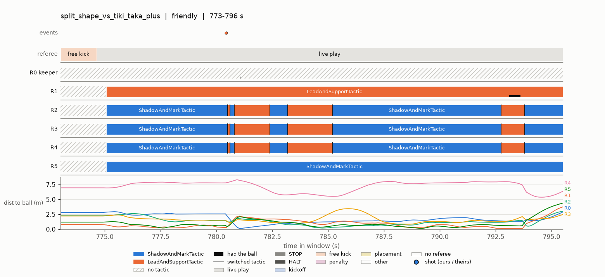

# Seeing the game

What our robots actually do, drawn on the pitch from real replays: how each strategy plays, one match
over time, a restart, and the motion planner, from fixed scenarios down to a single tick. Each section
gives the picture, how to read it, what it has shown us so far, and the command that draws it.

A picture explains a result; it never makes one. Strategies are judged on goals
([STRATEGY_DEVELOPMENT.md](STRATEGY_DEVELOPMENT.md), "Evaluating a strategy"), and every claim a
picture suggests is confirmed with numbers before it is acted on. Each picture tool can also write the
problems it flags as JSON (`--findings`, format in [tools.md](tools.md)), for filtering without
opening images. An agent misread a planner trace once in this repo: the numbers caught it.

Conventions in every pitch picture: blue is the side being studied, orange the other team (faded when it
is context), the pitch is in metres with the centre at (0, 0), and the strategy maps turn every match
so the studied strategy attacks right. Zone names (defensive third, the box, ...) are the ones in
[pitch_zones.md](pitch_zones.md).

## Start here: triage

`pixi run python tools/triage.py RUN_DIR --strategy NAME` picks the strategy's worst matches (by goal
difference, among those it played as config_a), collects every problem the tools flag (tactic flip-backs,
stalls, and with `--restarts` illegal restart targets), and draws the worst few with the picture for that
kind. Read its `index.md` first: each problem's numbers, then the picture path. About 20 s a match
(a minute with `--restarts`); `evaluate.py --explain` runs it on the candidate's two worst matches.

A stall it found in `split_shape` against `tiki_taka_plus`: from 783 to 786 s, four of our robots
oscillate with the ball frozen. The picture is the match timeline around it, recorded data only:

Robots 2-4 switch between `ShadowAndMarkTactic` and `LeadAndSupportTactic` together, three times within
half a second at 780.5 s and again at 782.4, 783.2 and 785.2 s, while robots 0, 1, 2 and 5 stay within
about 2 m of the ball and robot 4 stays 5-8 m away.

## 1. How a strategy plays

### Where its robots stand

One panel per strategy from the latest round-robin, in order of points per match (the number after the
name). Darker cells hold more of the outfield robots' samples while the strategy has the ball; black dots
are each robot's mean position. The same picture without the ball:

What it shows:

- Most strategies stand on **vertical lines**: robots spread across the pitch at one depth, one line
  just outside our box (x ≈ −2.7 m) and one just outside theirs (x ≈ +2.8 m): robots holding spots
  rather than following the ball, and the lines barely change between possession and not.
- `split_shape`, the top scorer, keeps most of its outfield robots in **its own defensive third even
  with the ball**, and attacks with one or two. `overload_press` is the opposite: a block just past
  halfway, in and out of possession.
- `decoy_and_overload` sits deep in a cluster in front of its own box.

### Where it shoots from, and concedes

Blue are the strategy's own shots at the spot they were struck from (filled: a goal), faded orange the
shots it conceded. `split_shape` takes 241 shots in its 11 matches, from all over the attacking half,
two and a half times the next strategy; the others take 69-98.

### Where it fouls

Each foul at the ball's spot, coloured by rule (one fixed colour per rule, the same in every panel):
which rules a strategy breaks, and where on the pitch.

Draw: `pixi run python tools/pitch_maps.py replays/tournament_<id>` (a full round-robin, about 3 min).
The rest of the strategy report, as numbers: [signal_report.md](signal_report.md).

## 2. A candidate against the champion

The same maps for just two strategies, a candidate and the champion, side by side on one colour scale;
`evaluate.py --explain` draws them (with shots, fouls and a `summary.json`) before an evaluation removes
its replays. This example is drawn from the round-robin: `split_shape` holds 37% of its possession in the
attacking half against `clear_press_plus`'s 65%, yet takes 21.9 shots a match against 6.3, and commits
twice the fouls (10.0 against 4.7 a match, mostly ball held in the defense area and crashing).

Draw: `tools/evaluation/evaluate.py CANDIDATE --explain`, or `tools/evaluation/explain.py RUN_DIR
CANDIDATE CHAMPION --out DIR` on any run dir.

## 3. One match over time

Sixty seconds of `split_shape` against `tiki_taka_plus`. From the top: events (fouls, shots), the
referee command, one lane per robot coloured by the tactic it was in (a tick at each switch, a black strip
while it had the ball), and each robot's distance to the ball. Hatched lanes are stoppages, where the
referee override moves robots instead of their tactics.

What it shows: robots 2-4 switch between `ShadowAndMarkTactic` and `LeadAndSupportTactic` together,
several times within a few seconds (112-117 s, 139-146 s), while robots 1 and 5 hold one tactic. Over a
whole round-robin, a tactic held under 1 s and then reverted (a flip-back) happens about 5 times a
minute in most strategies that split attack and defence on possession, 13 in `press_and_pass`, and
almost never in `give_and_go_solo`, `high_press` or `decoy_and_overload`. Not fixed yet.

Draw: `pixi run python tools/match_timeline.py REPLAY.npz T0 T1`.

## 4. A restart

Where the referee override sends each of our robots at one restart: a free kick against us, ball at the
cross, the 0.8 m keep-out circle dashed. Each robot moves toward its commanded target (grey cross; red
when a target breaks a rule) or holds; the table lists each target and its distance from the ball.
Robot 3 starts inside the circle and is sent to exactly 0.80 m.

Across more replays this picture found a real defect: the step that clears robots out of the circle
stops 1 cm short and leaves them at 0.79 m (`keep_out_short` in the findings). Not fixed yet.

Draw: `pixi run python tools/restart_picture.py REPLAY.npz --t S`, or `--all-restarts` for one panel per
restart command in the match.

## 5. The motion planner on fixed scenarios

The benchmark runs the three planners (`fpp`, the fast path planner we use, `dwa` and `trajsample`) on
fixed scenarios in headless rsim, with no strategy involved.

One robot crosses a staggered line of three parked opponents. `fpp` and `trajsample` drive almost
straight through (the gaps are wide enough) at 2 m/s, 12 cm from the nearest robot at worst;
`trajsample` brakes briefly at each obstacle. `dwa` slows down from 1.3 s, weaves, stalls beside the
middle obstacle at x = 0 and touches it.

Two of our robots, both driven by the planner under test, cross at right angles (dashed is the
second robot). With `fpp` one robot holds its line and the other swerves round it: closest pass 0.18 m,
both arrive. With `dwa` they converge and collide, and neither arrives. `trajsample` gives a wide berth
(0.9 m) but detours 55% further and takes 5.1 s instead of 3.3.

Every metric per planner and scenario, each on its own scale; hollow dots are failed runs.

Draw: `pixi run python tools/motion_planning_benchmark.py --figures DIR`. How to read the full
benchmark: [motion_planning_comparison.md](motion_planning_comparison.md).

## 6. The motion planner in a real match

### One tick

The planner's decision for one robot on one recorded tick: every robot with its clearance ring, the
ball's keep-out circle (dashed), the robot's target and the carrot (the point the planner steers to this
tick). Here `tiki_taka_plus`'s robot 4 (the replay's enemy side) sits on the keep-out circle at a kickoff, 0.799 m from the ball; its target
(−1.0, −0.3) is across the circle. The planner's answer is a carrot 5 cm away: push the robot out to
0.85 m first.

Draw: `pixi run python tools/plan_snapshot.py REPLAY.npz --t S --robot ID [--side enemy] [--target X Y]`.

### A window

The same robot over 12 s: its path coloured by time, the carrot at each sample (green dots, joined to
where the robot was), then distance to the ball, distance to the carrot, speed and the referee command.
The robot runs in, reaches the circle at about 255.5 s (dipping to 0.76 m), then holds 0.80 m from the ball for the rest of the
prepare-kickoff, 1.76 m short of its target. That was the planner before the push-out fix: it
parked robots on the circle.

The trace replays recorded positions and runs today's planner on them; it does not re-simulate. So the
robot's path is the old behaviour, and the carrot line (0.05 m, at 0.85 m from the ball) is what today's
planner would do from there: push out first. The annotation names it "pushed out of the keep-out"; a
short carrot with nothing to push out of is labelled "parked".

Draw: `pixi run python tools/plan_trace.py REPLAY.npz --t0 S --t1 S --robot ID [--side enemy]
[--target X Y]`.

## Which picture for which question

| Question | Picture |
|---|---|
| How does this strategy play, overall? | pitch maps (1) |
| Why did the candidate win or lose against the champion? | `--explain` (2) |
| What were the robots doing in this stretch of a match? Thrashing, everyone chasing the ball? | match timeline (3) |
| Where did the referee override put us at this restart, and was it legal? | restart picture (4) |
| Is the planner itself good at driving, with no strategy involved? | benchmark (5) |
| Why did this robot stop, detour or go the wrong way? | plan snapshot, then plan trace (6) |
