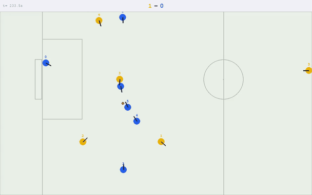

# Debug a moment

A robot did something wrong in a match. This page takes one real case from "that looks wrong"
to the line of code that causes it and a test that proves it. The bug is still open, so the
last step, fixing it, can be your first pull request. Allow about 45 minutes.

You need the replays from [Your first strategy](first_strategy.md), step 2.

## 1. See it

Run `pixi run dashboard`, open the match `pendulum_vs_wolfpack` and go to **3:54**.



Wolfpack (blue) defends the left goal. The ball rolls slowly through blue's box (the rectangle in
front of the goal), passes its keeper, robot 0, and goes out. Only the keeper may touch the ball
in its own box, so nobody else can save it. Yellow gets a free kick.

## 2. Say exactly what is wrong

"The keeper is bad" can't be checked. Say what happened and what should have:

> The ball rolled through our box, slowly, wide of the goal. The keeper stayed about 0.4 m from
> it and let it go out. It should have gone and fetched it.

## 3. Get the numbers

A picture can fool you. Print the moment as text, every half second:

```
pixi run python tools/debug/replay_trace.py replays/eval_20261112_225153/round_1/pendulum_vs_wolfpack.npz 234 237.5 --every 30
```

```
 234.00 NORMAL_START  ball (-2.85,-0.33) 0.96m/s held=- near F 3@0.57   E 5@0.17
 234.50 NORMAL_START  ball (-3.21,-0.06) 0.87m/s held=- near F 1@1.23   E 5@0.26
 235.00 NORMAL_START  ball (-3.53,+0.17) 0.75m/s held=- near F 1@1.01   E 5@0.27
 235.50 NORMAL_START  ball (-3.82,+0.38) 0.62m/s held=- near F 1@1.00   E 5@0.54
 236.00 NORMAL_START  ball (-4.06,+0.56) 0.53m/s held=- near F 1@1.15   E 0@0.39
 236.50 NORMAL_START  ball (-4.26,+0.70) 0.46m/s held=- near F 1@1.35   E 0@0.33
 237.00 NORMAL_START  ball (-4.42,+0.82) 0.36m/s held=- near F 1@1.51   E 0@0.41
 237.37 STOP          ball (-4.51,+0.89) 0.32m/s held=- near F 1@1.61   E 0@0.49   | Ball out of bounds
```

Each line: the time, the referee's command, where the ball is and how fast it moves, and the
nearest robot of each side (`F` is pendulum, `E` is wolfpack) with its distance to the ball.
Blue's box runs from x = -4.5 to -3.5. So the ball is in the box from 235.0 s, moving at
0.75 m/s and slowing down, and goes out at 0.32 m/s. Keeper `E 0` is 0.33 to 0.49 m away
the whole time.

`--events` prints only kicks, touches, referee changes and fouls: a quick way to find a moment.

## 4. Find the code

The keeper is controlled by `GoalkeeperTactic` (`utama_core/tactics/goalkeeper.py`), which calls
the skill `goalkeep` (`utama_core/skills/goalkeep.py`). Search that file for where the keeper
decides to fetch the ball:

```
grep -n "def _ball_needs_retrieval" -A20 utama_core/skills/goalkeep.py
```

The last lines:

```python
    ball_speed = (game.ball.v.x**2 + game.ball.v.y**2) ** 0.5
    return ball_speed < _RETRIEVE_BALL_SPEED
```

and at the top of the file, `_RETRIEVE_BALL_SPEED = 0.3`. The keeper fetches a ball in its box
only when the ball moves slower than 0.3 m/s; anything faster counts as a shot, to block from
the goal line. Our ball was in the box at 0.75 to 0.32 m/s: never slow enough. That is the cause.

## 5. Write the test that fails

Before changing anything, write a test that shows the bug. It must fail now and pass once the
bug is fixed. Build the moment at 236 s by hand: no simulator needed. Create
`utama_core/tests/skills/test_goalkeep_retrieval.py`:

```python
# utama_core/tests/skills/test_goalkeep_retrieval.py
"""The keeper fetches a ball rolling slowly through its box (pendulum_vs_wolfpack, 3:54)."""

from utama_core.skills.goalkeep import _ball_needs_retrieval
from utama_core.tests.fixtures.game_builder import build_game, make_ball, make_robot


def test_the_keeper_fetches_a_ball_rolling_slowly_through_its_box():
    # Our goal is on the left (x = -4.5). As at 236 s: the ball rolls at 0.5 m/s
    # through our box, heading wide of the goal; the keeper is 0.4 m from it.
    keeper = make_robot(0, is_friendly=True, x=-4.3, y=0.25)
    ball = make_ball(-4.06, 0.56, vx=-0.4, vy=0.3)
    game = build_game({0: keeper}, {}, ball, my_team_is_right=False)
    assert _ball_needs_retrieval(game, 0)


def test_a_still_ball_in_the_box_is_fetched_already():
    keeper = make_robot(0, is_friendly=True, x=-4.3, y=0.25)
    game = build_game({0: keeper}, {}, make_ball(-4.06, 0.56), my_team_is_right=False)
    assert _ball_needs_retrieval(game, 0)
```

```
pixi run pytest utama_core/tests/skills/test_goalkeep_retrieval.py
```

The first test fails (`assert False`): that is the bug, caught. The second passes: it guards what
already works, so a fix can't break it.

## 6. Fix it: your turn

Change `_ball_needs_retrieval` so both tests pass. Think about what must **not** change: a real
shot, heading into the goal, should still be blocked from the line, not chased. So "slow" is the
wrong question. A better one: is the ball heading into the goal mouth? Add a test for that case
too (a ball rolling straight at the goal, which the keeper must not chase).

Then:

```
pixi run test
pixi run lint
```

The keeper is shared: every strategy uses it, so this fix changes every match. Say so in your
pull request; the team runs one evaluation over a batch of shared fixes, rather than one per fix.
When the fix lands, update this page: `utama_core/tests/strategy/test_tutorial_code.py` fails
until you do, on purpose.

## Where to go next

- [strategy.md](../docs/strategy.md), "Debugging a foul or failure": every debugging tool, and
  the bugs found so far.
- `pixi run python tools/debug/find_bugs.py replays/eval_20261112_225153/round_1 --strategy pendulum`
  finds moments like this one in a whole round: stalls, fouls, robots that thrash.
