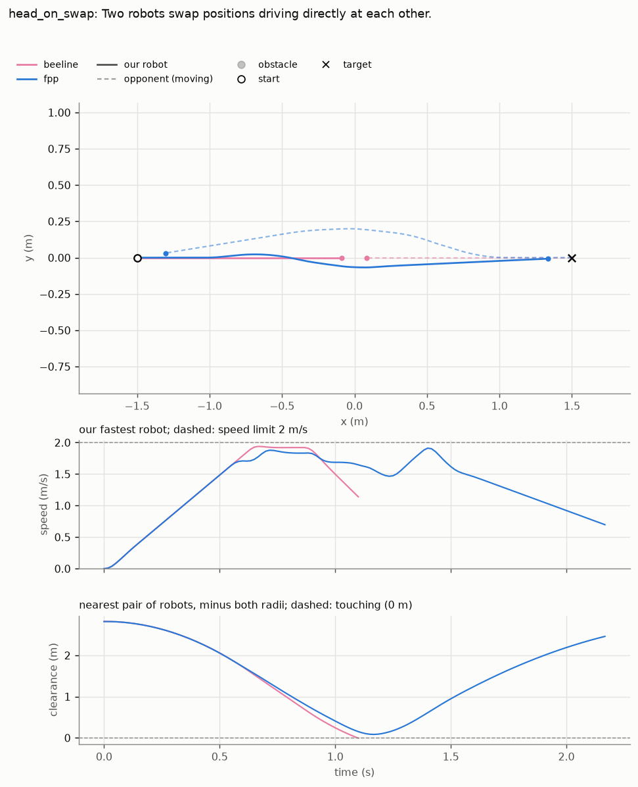
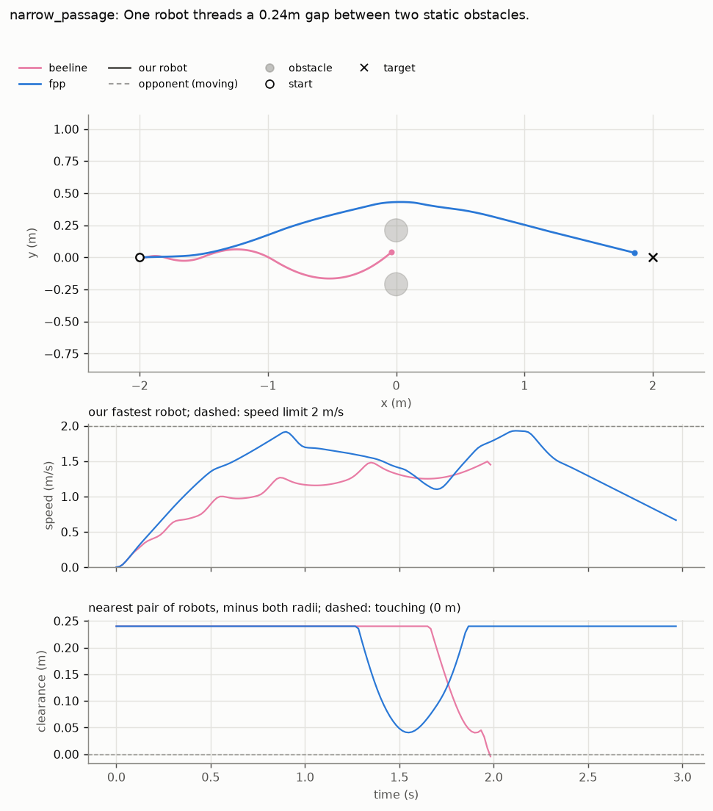

# Your first motion planner

A strategy decides *where* each robot should go; the motion planner decides *how* it gets there:
which way to drive this tick, how fast, and round which robots. Here you write a small planner,
`beeline`, score it on the benchmark against our planner (`fpp`), find where it crashes, and
improve it. No football needed. Allow about an hour.

## 1. What a planner does

Every tick, a skill asks for a robot to go somewhere: `move(...)` with a target position and
heading. `move()` hands that to the planner's `calculate`:

```
calculate(game, robot_id, target_pos, target_oren)  ->  (velocity, turn)
```

`velocity` is the robot's velocity across the field (m/s, field axes), `turn` its turning speed
(rad/s). That is the whole job, 60 times a second for every robot.

Planners live in `utama_core/motion_planning/controllers/` and are listed by name in
`CONTROL_SCHEME_MAP` (`utama_core/motion_planning/common/control_schemes.py`). Matches use `fpp`;
`dwa` and `trajsample` are older ones kept for comparison.

## 2. The benchmark

`tools/motion_planning_benchmark.py` drives robots through 29 fixed situations ("scenarios"):
a straight run, two robots meeting head on, a gap between two robots, a crowd round the ball, and
more. A run **passes** if every robot reaches its target in time and no two robots ever touch.
Try it on `fpp`:

```
pixi run python tools/motion_planning_benchmark.py --schemes fpp --scenarios direct head_on_swap
```

Each run prints one line:

```
PASS (completed), sim=4.17s, path=0.98x (+0.00m), controller=0.14ms
```

`sim` is how long the robot took (simulated seconds), `path` how long its path was compared with
a straight line, `controller` how long one `calculate` took. A table of all this, and more, is in
`benchmark_results/`. `--list-scenarios` lists them all.

## 3. A first planner

`beeline` drives straight at the target. Three ideas, each a few lines:

- **Brake in time.** A robot that can slow down at `a` m/s² needs `v² / 2a` metres to stop from
  `v` m/s. So never go faster than `√(2·a·distance)`; with a little margin (`BRAKE_SHARE`).
- **Change speed gently.** A motor can't jump from 0 to 2 m/s. Each tick the velocity may change by
  at most one tick of acceleration (`max_acceleration · DT`).
- **Turn towards the target heading**, faster the further off it is (`TURN_GAIN`).

Create `utama_core/motion_planning/controllers/beeline.py`:

```python
# utama_core/motion_planning/controllers/beeline.py
"""`beeline`: drive straight at the target, braking in time. It avoids nothing (yet)."""

import math

from utama_core.geometry.math_utils import normalise_heading
from utama_core.motion_planning.common.motion_controller import MotionController

DT = 1 / 60  # seconds per tick
BRAKE_SHARE = 0.8  # plan to brake at this share of the robot's acceleration, to leave a margin
TURN_GAIN = 4.0  # rad/s of turn per rad of heading error
MAX_TURN = 4.0  # rad/s


class BeelineController(MotionController):
    def __init__(self, mode, rsim_env=None):
        super().__init__(mode, rsim_env)
        self.last = {}  # robot id -> the velocity we commanded last tick

    def calculate(self, game, robot_id, target_pos, target_oren):
        robot = game.friendly_robots[robot_id]
        to_target = target_pos - robot.p
        distance = to_target.mag()

        # As fast as we may, but slow enough to stop at the target: v^2 = 2 a d.
        speed = min(self.max_speed, math.sqrt(2 * BRAKE_SHARE * self.max_acceleration * distance))
        wanted = to_target.norm() * speed

        # Change velocity by at most one tick of acceleration.
        last = self.last.get(robot_id, robot.v)
        change = wanted - last
        step = self.max_acceleration * DT
        if change.mag() > step:
            change = change.norm() * step
        velocity = last + change
        self.last[robot_id] = velocity

        turn = TURN_GAIN * normalise_heading(target_oren - robot.orientation)
        return velocity, max(-MAX_TURN, min(MAX_TURN, turn))

    def sent(self, robot_id, velocity, angular_vel):
        self.last[robot_id] = velocity

    def reset(self, robot_id):
        self.last.pop(robot_id, None)
```

`self.max_speed` and `self.max_acceleration` come from `MotionController`, the base every planner
shares: 2 m/s and 4 m/s² in the simulator. `sent` and `reset` keep `self.last` honest when
`move()` slows a robot down (with the ball) or a robot restarts.

Now give it a name. In `utama_core/motion_planning/common/control_schemes.py`, import it and add a
line to the map:

```
from utama_core.motion_planning.controllers.beeline import BeelineController
...
    "trajsample": TrajectorySamplingController,
    "beeline": BeelineController,
```

## 4. Score it

```
pixi run python tools/motion_planning_benchmark.py --schemes beeline fpp --scenarios direct head_on_swap --allow-failures --figures benchmark_results/beeline
```

On our laptop (yours may differ a little):

| Scenario | beeline | fpp |
|---|---|---|
| `direct` (a straight 6 m run) | pass, 3.45 s | pass, 4.17 s |
| `head_on_swap` (two robots drive at each other) | **collision** at 1.1 s | pass, 2.17 s |

On the open road `beeline` is faster than `fpp`. Then it drives straight into the other robot,
which also runs `beeline` (in the benchmark, moving opponents use the planner under test). The
figure, `benchmark_results/beeline/trajectories_head_on_swap.png`, shows it: the pitch with each
planner's path, then speed, then the gap between the nearest two robots over time.



Now every scenario (about 40 s):

```
pixi run python tools/motion_planning_benchmark.py --schemes beeline fpp --allow-failures
```

`beeline` collides in 9 of the 29; `fpp` in 1 (`kickoff_reset`, ten robots in a scramble). This
is why the benchmark checks for passing before anything else: going fast is easy when you avoid
nothing.

## 5. Steer round robots in the way

For every other robot, ask: if we both keep our velocities, when are we nearest it (`t`), and how
far apart are we then (`miss`)? If that happens within the next second and `miss` is under
`CLEARANCE`, it is in the way. Take the first such robot and turn away from where we would pass
it. If it is dead ahead, turn right: the other robot, running the same code, turns its own right,
so they pass.

Replace everything in `beeline.py` with:

```python
# utama_core/motion_planning/controllers/beeline.py (step 5: with steering)
"""`beeline`: drive straight at the target, braking in time, and steer round a robot in the way."""

import math

from utama_core.entities.data.vector import Vector2D
from utama_core.geometry.math_utils import normalise_heading
from utama_core.motion_planning.common.motion_controller import MotionController

DT = 1 / 60  # seconds per tick
BRAKE_SHARE = 0.8  # plan to brake at this share of the robot's acceleration, to leave a margin
TURN_GAIN = 4.0  # rad/s of turn per rad of heading error
MAX_TURN = 4.0  # rad/s
LOOKAHEAD = 1.0  # seconds: how far ahead we look for a robot in the way
CLEARANCE = 0.30  # metres between centres we want when passing (two robots touch at 0.18)
STEER = 1.0  # how hard to steer away: 1 turns the heading up to 45 degrees


class BeelineController(MotionController):
    def __init__(self, mode, rsim_env=None):
        super().__init__(mode, rsim_env)
        self.last = {}  # robot id -> the velocity we commanded last tick

    def calculate(self, game, robot_id, target_pos, target_oren):
        robot = game.friendly_robots[robot_id]
        to_target = target_pos - robot.p
        distance = to_target.mag()

        # As fast as we may, but slow enough to stop at the target: v^2 = 2 a d.
        speed = min(self.max_speed, math.sqrt(2 * BRAKE_SHARE * self.max_acceleration * distance))
        wanted = to_target.norm() * speed
        wanted = self.steer_round(game, robot_id, robot, wanted)

        # Change velocity by at most one tick of acceleration.
        last = self.last.get(robot_id, robot.v)
        change = wanted - last
        step = self.max_acceleration * DT
        if change.mag() > step:
            change = change.norm() * step
        velocity = last + change
        self.last[robot_id] = velocity

        turn = TURN_GAIN * normalise_heading(target_oren - robot.orientation)
        return velocity, max(-MAX_TURN, min(MAX_TURN, turn))

    def steer_round(self, game, robot_id, robot, wanted):
        """Turn `wanted` away from the first robot we would pass closer than CLEARANCE."""
        first = None
        others = [r for i, r in game.friendly_robots.items() if i != robot_id]
        for other in others + list(game.enemy_robots.values()):
            gap = other.p - robot.p  # where it is, from us
            closing = wanted - other.v  # our velocity relative to it
            if closing.mag() < 1e-6:
                continue
            t = gap.dot(closing) / closing.dot(closing)  # when we pass nearest to it
            if not 0 < t < LOOKAHEAD:
                continue
            miss = closing * t - gap  # where we would be then, from it
            if miss.mag() < CLEARANCE and (first is None or t < first[0]):
                first = (t, miss)
        if first is None:
            return wanted
        away = first[1].norm()
        if away.mag() == 0:  # dead ahead: pass on our right, like the other robot will
            away = Vector2D(wanted.y, -wanted.x).norm()
        return (wanted.norm() + away * STEER).norm() * wanted.mag()

    def sent(self, robot_id, velocity, angular_vel):
        self.last[robot_id] = velocity

    def reset(self, robot_id):
        self.last.pop(robot_id, None)
```

Run every scenario again. On our laptop `beeline` now passes 25 of 29, and `head_on_swap` in
2.08 s, a little faster than `fpp`. Four still collide: `mirror_swap`, `ball_scrum`,
`kickoff_reset` and `narrow_passage`.

Look at `narrow_passage`: **it passed before**. The robot must go through a 0.24 m gap between two
robots. With steering it swerves away from one of them, into the other:



A change that fixes one case often breaks another. That is why you run every scenario each time,
not only the one you are fixing.

## 6. Your turn

Make `narrow_passage` pass without losing the others. Shrinking `CLEARANCE` to 0.22 is not enough:
`narrow_passage` still collides, and `recovery_run` starts to. Some ideas to try, one at a time:

- Steer away from *every* robot in the way, weighted by how soon you reach it, not only the first.
- When robots are in the way on both sides, aim for the middle of the gap, or go round both, as
  `fpp` does.
- Slow down, as well as turn, when something is close.

Add `--repeats 3` before you believe a change: a planner that passes once and fails the next time
is not fixed.

## 7. Test the steering

The benchmark shows whole runs; a unit test pins one decision, here `steer_round`, on a game built
by hand. Create `utama_core/tests/motion_planning/test_beeline.py`:

```python
# utama_core/tests/motion_planning/test_beeline.py
"""`beeline`'s steering, on game states built by hand (no simulator)."""

from utama_core.config.enums import Mode
from utama_core.entities.data.vector import Vector2D
from utama_core.motion_planning.controllers.beeline import BeelineController
from utama_core.tests.fixtures.game_builder import build_game, make_robot

STRAIGHT = Vector2D(2.0, 0.0)  # full speed along x


def steer_with_opponent_at(x, y):
    """Our robot 0 at the centre wants STRAIGHT; one opponent stands still at (x, y)."""
    game = build_game(
        {0: make_robot(0, is_friendly=True)},
        {1: make_robot(1, is_friendly=False, x=x, y=y)},
    )
    planner = BeelineController(Mode.RSIM)
    return planner.steer_round(game, 0, game.friendly_robots[0], STRAIGHT)


def test_a_robot_dead_ahead_is_passed_on_our_right_at_the_same_speed():
    velocity = steer_with_opponent_at(1.0, 0.0)
    assert velocity.y < 0
    assert abs(velocity.mag() - 2.0) < 1e-9


def test_a_robot_just_inside_the_clearance_is_steered_away_from():
    # We would pass 0.25 m from it, less than CLEARANCE (0.30): steer away, to negative y.
    assert steer_with_opponent_at(1.0, 0.25).y < 0


def test_a_robot_we_would_pass_with_room_to_spare_is_ignored():
    # We would pass 0.35 m from it, more than CLEARANCE.
    assert steer_with_opponent_at(1.0, 0.35) == STRAIGHT


def test_a_robot_behind_us_or_more_than_a_second_away_is_ignored():
    assert steer_with_opponent_at(-1.0, 0.0) == STRAIGHT
    # 2.5 m ahead at 2 m/s is 1.25 s away, past LOOKAHEAD (1 s).
    assert steer_with_opponent_at(2.5, 0.0) == STRAIGHT
```

```
pixi run pytest utama_core/tests/motion_planning/test_beeline.py
```

Two tests sit either side of `CLEARANCE`: 0.25 m steers, 0.35 m doesn't. If you change how
`steer_round` decides, these tell you what you changed.

## 8. From the benchmark to matches

Matches, and every evaluation, play `fpp` for both teams (`tools/evaluation/match.py`). A new
planner changes how every robot moves, in every strategy, so it doesn't reach matches by itself:

1. It should pass at least the scenarios `fpp` passes, with `--repeats 3`, and not be much slower
   per tick (`controller` ms: at 60 ticks a second, six robots must fit in a few ms).
2. Then switching the team to it is a team decision, in a PR.

To improve `fpp` itself instead, read [motion_planning.md](../docs/motion_planning.md) ("FastPathPlanner
decisions per tick") and check every change on the benchmark, as here.

## Where to go next

- [motion_planning.md](../docs/motion_planning.md): every scenario, every number in the table, and
  "Reading it", how to compare two planners.
- `utama_core/tests/motion_planning/`: the planner tests, from small cases to `fpp`'s.
