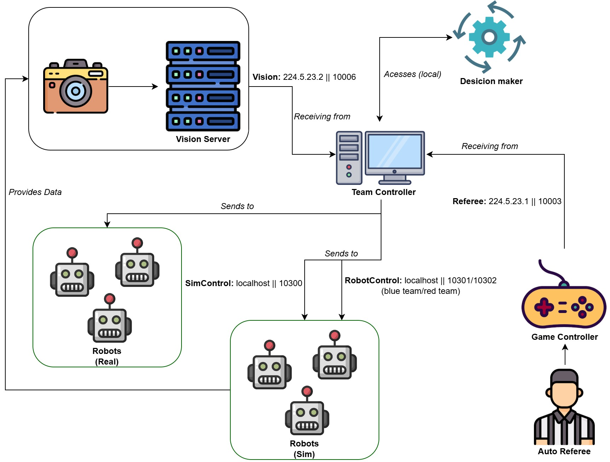
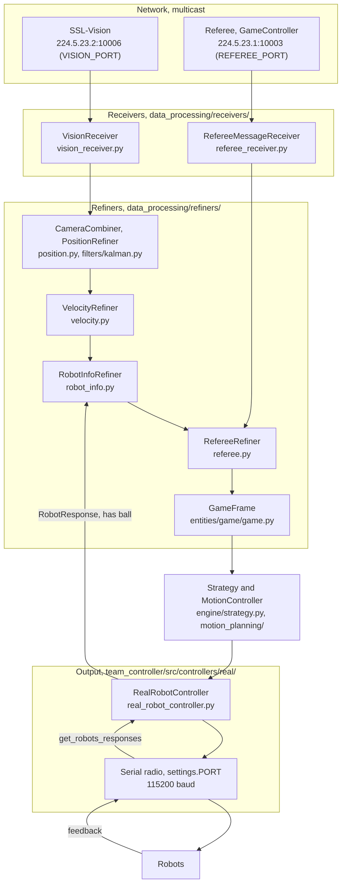

# Data flow

This is the data flow diagram of what will be received and sent by the Team Controller:

From the image above, the Vision and Referee use UDP multicast addresses. More information is available on the [SSL RoboCup official page](https://ssl.robocup.org/league-software/#:~:text=Simulation%20Protocol.-,Standard%20Network%20Parameters,-Protocol)

## Real robot path

The path of one real-match tick, as `StrategyRunner` wires it: the receivers fill one-slot buffers,
the refiners build the `GameFrame`, and the real controller sends the commands over the serial radio.
The robots' feedback comes back the same way and reaches `RobotInfoRefiner`.

## Controllers

This folder contains controller classes for communication with both simulated and real components, including:

- Simulation Control
- Robot Control

## Data

This folder contains all the files which perform the initial processing of data being received, this includes:

- **Referee Data**
  - Receives and processes referee messages containing game state information.
  - Updates internal data structures with the latest referee commands, stage, team information, and designated ball placement positions.
  - Provides methods to retrieve the latest referee data, command, stage, and other relevant information.
- **Vision Data**
  - The `VisionDataReceiver` class is responsible for receiving and managing vision data for robots and the ball in a multi-robot game environment. It interfaces with a network manager to receive packets containing positional data for the ball and robots on both teams. The class updates internal data structures accordingly. Here is an [example usage](../tests/receivers/vision_receiver_unit_test.py) (and an [integration test](../tests/receivers/vision_receiver_integration_test.py)).
  - **Data Types**:
    - `Ball`: A named tuple representing the ball's position with fields `x`, `y`, and `z`.
    - `Robot`: A named tuple representing a robot's position with fields `x`, `y`, and `orientation`.

## Utils

This file contains files which manage network communication via a UDP socket for sending and receiving data:

- Network Manager
- Network Utils

